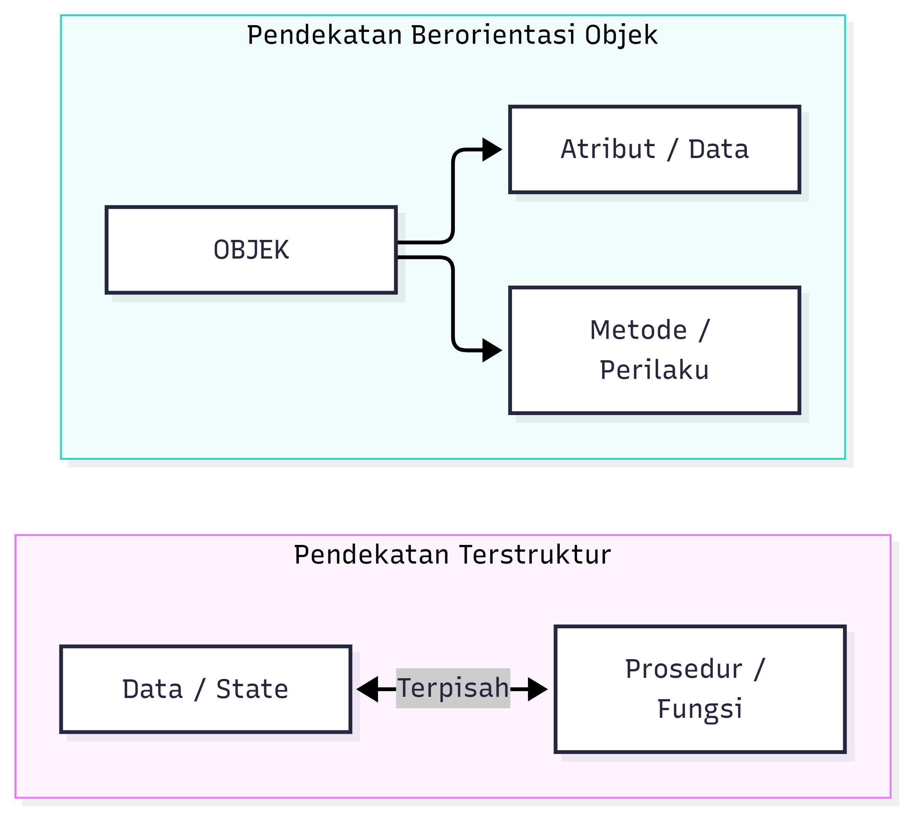
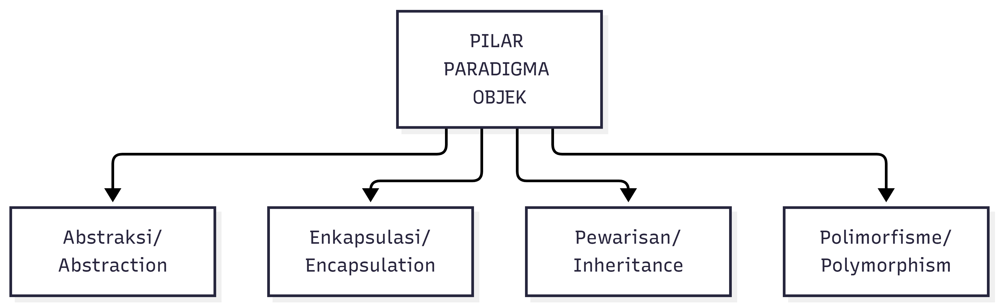
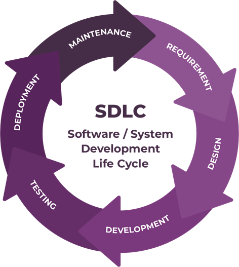
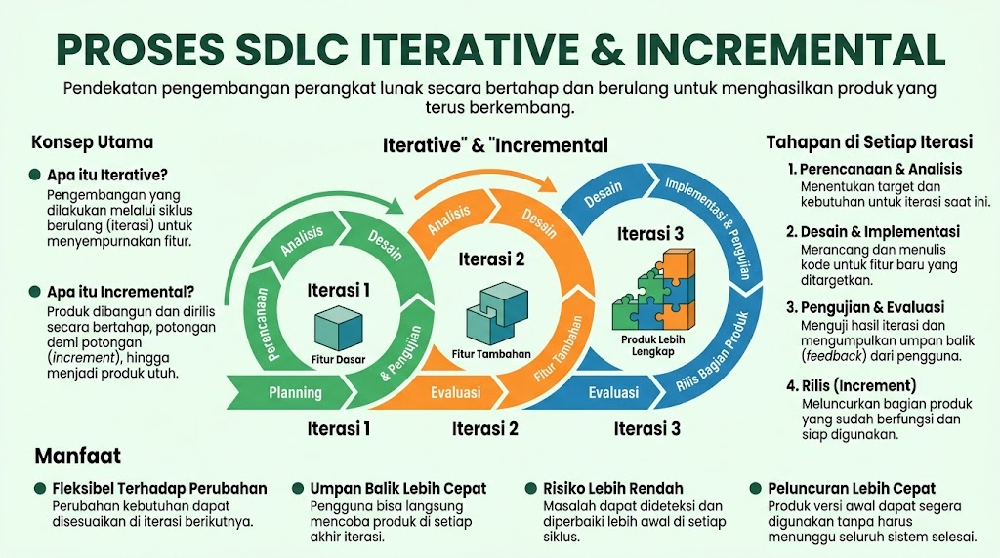
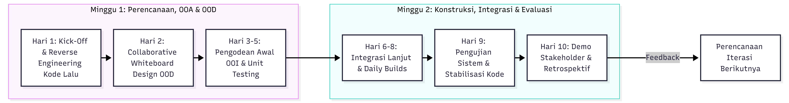
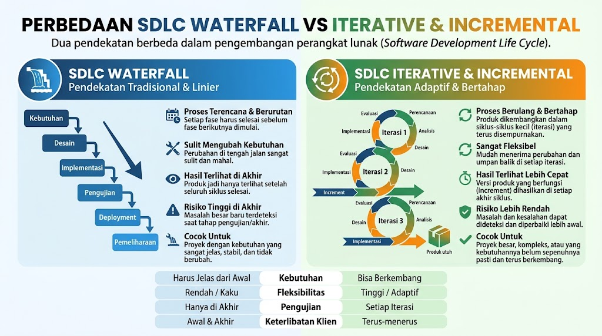

# Pengantar Object-Oriented Analysis and Design (OOAD)

## 1. Pengantar Paradigma Objek (_Object-Oriented Paradigm_)

> 👨‍🏫 Mata kuliah Object Oriented Programming (OOP) biasanya menjadi prasyarat untuk Anda mengambil mata kuliah OOAD. Dalam OOP biasanya Anda akan berkenalan dengan *object-oriented paradigm*, dan mengimplementasikannya secara praktis dalam program. Dalam OOAD, kita menerapkan paradigma ini pada *scope* yang lebih luas, yaitu ada desain sistemnya itu sendiri.

### 1.1 Latar Belakang & Evolusi Paradigma

Pengembangan perangkat lunak pada era awal (1960-1970-an) didominasi oleh **pendekatan terstruktur/prosedural**. Krisis perangkat lunak (_software crisis_) yang diidentifikasi pada _NATO Software Engineering Conference_ (1968) mengungkapkan bahwa peningkatan kompleksitas sistem enterprise menyebabkan metode terstruktur mulai kewalahan.

Pendekatan terstruktur memisahkan secara tegas antara **data (state)** dan **proses/fungsi (behavior)**:

- **Data** dimodelkan secara statis melalui _Entity-Relationship Diagram_ (ERD).
- **Proses** dimodelkan secara dinamis melalui _Data Flow Diagram_ (DFD) atau diagram alur prosedural.

Pemisahan ini menimbulkan **kerapuhan struktural** (_structural fragility_). Ketika skema data mendasar berubah, perubahan tersebut akan merambat (_cascading modifications_) dan merusak rutinitas prosedural di seluruh aplikasi.

**Paradigma Berorientasi Objek** hadir untuk menyatukan kembali data (_attributes_) dan fungsi (_methods/operations_) ke dalam satu kesatuan independen yang dinamakan **Objek**. Objek merefleksikan entitas dunia nyata, sehingga menjembatani celah konseptual antara domain masalah (_problem domain_) dan domain solusi perangkat lunak (_solution domain_).

---

### 1.2 Konsep Dasar Objek dan Kelas

1. **Objek (**_Object_**)**: Entitas individual yang memiliki **identitas (**_identity_**)**, **keadaan (**_state_**)**, dan **perilaku (**_behavior_**)**:
    - **State**: Nilai-nilai dari atribut yang dimiliki objek pada waktu tertentu. Dalam OOP, _state_ identik dengan _property/attribute_
    - **Behavior**: Himpunan operasi/metode yang dapat dilakukan oleh objek sebagai respons terhadap pesan (_message_) yang diterima. Dalam OOP, _behavior_ identik dengan _method_
    - **Identity**: Karakteristik unik yang membedakan satu objek dari objek lainnya meskipun memiliki nilai atribut yang sama.
2. **Kelas (**_Class_**)**: Cetak biru (_blueprint_) atau templat abstrak yang mendefinisikan atribut dan metode yang akan dimiliki oleh semua objek instansinya.

---

### 1.3 Pilar-Pilar Utama Paradigma Objek

Ketika membicarakan paradigma *object-oriented*, maka ada 4 prinsip/pilar penting yang perlu dipahami:

#### A. Abstraksi (_Abstraction_)

Abstraksi adalah proses menyembunyikan detail implementasi yang kompleks dan hanya menampilkan karakteristik esensial dari suatu entitas sesuai dengan sudut pandang pengguna (_observer_). Abstraksi mengurangi beban kognitif pengembang saat berinteraksi dengan sistem yang rumit.

#### B. Enkapsulasi (_Encapsulation_) & Information Hiding

Enkapsulasi membungkus data (_attributes_) dan metode yang mengoperasikan data tersebut ke dalam satu unit objek, serta membatasi akses langsung dari luar.

- Melalui mekanisme _information hiding_, struktur internal objek terisolasi di balik antarmuka publik (_public interface_).
- Pengubah akses (_access modifiers_) umum seperti `private`, `protected`, dan `public` digunakan untuk menjaga integritas data dari perubahan tak disengaja.

#### C. Pewarisan (_Inheritance_)

Pewarisan memungkinkan suatu kelas turunan (_subclass/specialization_) mewarisi atribut dan metode dari kelas induk (_superclass/generalization_).

- Memfasilitasi **reusabilitas kode** (_code reuse_) dan membentuk struktur hirarki "IS-A".
- Subclass dapat menambahkan atribut/metode baru atau melakukan penimpaan (_overriding_) terhadap perilaku kelas induk.

#### D. Polimorfisme (_Polymorphism_)

Polimorfisme (berasal dari bahasa Yunani: "banyak bentuk") adalah kemampuan suatu pesan/operasi yang sama untuk menghasilkan respons atau perilaku yang berbeda tergantung pada objek yang mengeksekusinya.

- **Dynamic Binding / Late Binding**: Penentuan metode spesifik yang dipanggil dilakukan saat _runtime_ berdasarkan tipe objek sebenarnya.
- Mendorong prinsip fleksibilitas seperti _Open-Closed Principle_ (OCP).

---

## 2. SDLC Tradisional vs. Object-Oriented Analysis and Design (OOAD)

### 2.1 SDLC Tradisional (_Waterfall Model_)

Siklus Hidup Pengembangan Perangkat Lunak tradisional umumnya diasosiasikan dengan model sekuensial linier (_Waterfall_).

Karakteristik & Masalah Utama SDLC Tradisional:

1. **Pendekatan Sekuensial Kaku**: Setiap fase harus diselesaikan dan didokumentasikan secara penuh sebelum fase berikutnya dimulai.
2. **Asumsi Syarat Beku (_Frozen Requirements_)**: Mengasumsikan kebutuhan pengguna dapat didefinisikan secara lengkap di awal proyek. Dalam kenyataan industri, kebutuhan selalu berubah.
3. **Pengujian Terlambat (_Late Testing_)**: Integrasi dan pengujian sistem baru dilakukan di akhir siklus pengembangan. Kerusakan atau kesalahan desain yang ditemukan pada fase ini berbiaya sangat mahal untuk diperbaiki.
4. **Resiko** **Big Design Up Front** **(BDUF)**: Upaya membuat desain menyeluruh di awal tanpa pengujian hipotesis secara cepat melalui prototipe terintegrasi.
---

## 3. Pengembagan dengan pendekatan Iteratif dan Inkremental

Pendekatan **Iteratif dan Inkremental (**Iterative and Incremental Development)** merupakan jantung dari metodologi rekayasa perangkat lunak modern dan menjadi landasan utama eksekusi _Object-Oriented Analysis and Design_ (OOAD).

Pendekatan ini dikembangkan untuk mengatasi keterbatasan SDLC linier tradisional (seperti _Waterfall_) yang sering mengalami kegagalan akibat asumsi kebutuhan beku (_frozen requirements_) dan penundaan pengujian hingga akhir proyek.

### 3.1. Definisi Konseptual: Iteratif vs. Inkremental

1. **Inkremental (**_Incremental_**)**: Berfokus pada **penambahan fungsionalitas secara bertahap (_piece by piece_)**. Perangkat lunak dipecah menjadi beberapa rilis bagian (_subsets/increments_), di mana setiap rilis menambahkan fitur atau modul baru ke dalam sistem yang sudah berjalan.
2. **Iteratif (_Iterative_)**: Berfokus pada **penyempurnaan dan revisi berulang (_refinement_)**. Setiap bagian perangkat lunak melewati siklus analisis, desain, pengodean, dan pengujian berulang kali. Tujuannya adalah memperbaiki desain, meningkatkan performa, dan menyesuaikan kebutuhan berdasarkan umpan balik riil (_feedback_).

Dalam praktiknya, **inkremental menambahkan fungsionalitas baru**, sedangkan **iteratif meningkatkan kualitas dan ketepatan desain** dari inkremen tersebut.

---

### 3.2. Prinsip & Karakteristik Utama

Metodologi Iteratif dan Inkremental berlandaskan pada beberapa prinsip operasional penting:

#### A. Alokasi Waktu Terbatas (_Timeboxing_)

Pengembangan diorganisasikan ke dalam mini-proyek berdurasi tetap yang pendek, biasanya berlangsung antara **2 hingga 6 minggu** (umumnya 4 minggu). Jika suatu fitur tidak selesai dalam tenggat waktu _timebox_, fitur tersebut direschedul dalam iterasi berikutnya, bukan memperpanjang durasi iterasi.

#### B. Penggerak Berbasis Risiko (_Risk-Driven Development_)

Berbeda dengan _Waterfall_ yang menunda pekerjaan berisiko tinggi (seperti integrasi dan pengujian beban) ke fase akhir, pendekatan iteratif memprioritaskan persyaratan dan komponen arsitektural yang **paling berisiko (_high risk_)** dan **bernilai bisnis tinggi (_high value_)** pada iterasi-iterasi awal.

#### C. Hasil Akhir Berupa _Executable Code_

Hasil dari setiap akhir iterasi bukan sekadar dokumen atau prototipe, melainkan bagian dari kode produksi (_production-grade subset_) yang terintegrasi, teruji, dan dapat dieksekusi.

#### D. Pengujian dan Integrasi Berkelanjutan (_Continuous Testing_)

Verifikasi kualitas dilakukan sejak hari pertama. Setiap iterasi mencakup aktivitas unit testing, integrasi, dan pengujian penerimaan pengguna (_acceptance testing_).

---

### 3.3. Penerapan dalam Kerangka Kerja Unified Process (UP / RUP)

Metodologi Iteratif dan Inkremental paling populer diimplementasikan dalam **Unified Process (UP)** atau **Rational Unified Process (RUP)** yang dirancang oleh _The Three Amigos_ (Grady Booch, James Rumbaugh, Ivar Jacobson).

UP membagi siklus hidup proyek menjadi **Empat Fase Utama**:

1. **Inception (Inisiasi)**: Menentukan visi proyek, studi kelayakan bisnis, batas cakupan, dan _use case_ utama (_core use cases_).
2. **Elaboration (Elaborasi)**: Mematangkan persyaratan, memitigasi risiko terbesar, dan membangun fondasi arsitektur perangkat lunak yang teruji (_executable architecture baseline_).
3. **Construction (Konstruksi)**: Mengimplementasikan sisa fitur yang berisiko lebih rendah secara inkremental hingga sistem lengkap.
4. **Transition (Transisi)**: Melakukan pengujian beta, perbaikan bug akhir, pengerahan (_deployment_), serta pelatihan pengguna.

#### 3.4. Anatomi Satu Iterasi

Setiap iterasi tunggal dapat dipandang sebagai sebuah **"proyek mini"** (_mini-waterfall_) yang menjalankan seluruh disiplin rekayasa perangkat lunak secara paralel dan proporsional, contoh sebagai berikut:

---

### 3.5. Perbandingan: Waterfall vs. Iteratif & Inkremental

| Kriteria / Dimensi             | SDLC Tradisional (Waterfall)                                    | Iteratif & Inkremental (OOAD / UP)                                       |
| ------------------------------ | --------------------------------------------------------------- | ------------------------------------------------------------------------ |
| **Pola Manajemen Risiko**      | Risiko ditumpuk hingga fase pengujian akhir (_high late risk_). | Risiko diidentifikasi dan dikurangi sejak iterasi awal.                  |
| **Umpan Balik Pengguna**       | Baru didapat setelah seluruh proyek selesai diskenariokan.      | Diperoleh secara kontinu pada setiap akhir iterasi.                      |
| **Respon Terhadap Perubahan**  | Kaku; perubahan kebutuhan dianggap kegagalan analisis.          | Adaptif; mengandalkan evaluasi ulang per-iterasi (_adaptive lifecycle_). |
| **Hasil Rilis _Deliverable_)** | _Big Bang_; rilis tunggal di akhir proyek.                      | _Continuous Releases_; Rilis bertahap dari subset fitur yang berfungsi.  |
| **Integrasi Kode**             | Dilakukan sekali secara masif di akhir (_painful integration_). | Integrasi dilakukan terus-menerus (_continuous integration_).            |

---

## 4. Studi Kasus: pengembangan Aplikasi E-Commerce "TokoCepat"

Dalam skenario pengembangan **Aplikasi E-Commerce "TokoCepat"**, pendekatan Iterative & Incremental memungkinkan tim pengembang untuk merilis fungsionalitas inti ke pasar dengan cepat, lalu terus menambahkan fitur dan melakukan penyempurnaan berdasarkan umpan balik pengguna di setiap siklusnya.

Berikut adalah rincian tahapan per iterasi:

### Iterasi 1: Membangun Produk Minimum yang Layak (MVP)

Tujuan pada iterasi pertama adalah menghasilkan _increment_ (potongan perangkat lunak) berupa fitur dasar agar pengguna bisa mulai berbelanja.

- **Perencanaan & Analisis:** Tim menentukan bahwa fitur absolut yang dibutuhkan adalah registrasi pengguna, katalog produk dasar, keranjang belanja, dan _checkout_ menggunakan metode transfer bank manual.
- **Desain:** Membuat rancangan antarmuka (UI) sederhana dan skema database dasar untuk tabel _User_, _Product_, dan _Order_.
- **Implementasi:** Programmer menulis kode (misalnya menggunakan arsitektur MVC pada Spring Boot atau Laravel) untuk mewujudkan fitur-fitur dasar tersebut.
- **Pengujian:** Melakukan _unit testing_ dan pengujian fungsional untuk memastikan pengguna benar-benar bisa mendaftar dan membuat pesanan.
- **Rilis (Increment 1):** Aplikasi versi 1.0 diluncurkan ke sekelompok pengguna awal (beta tester).
- **Evaluasi (Feedback):** Pengguna berhasil berbelanja, tetapi mereka mengeluh kesulitan mencari produk spesifik dan merasa transfer bank manual terlalu merepotkan.

### Iterasi 2: Penambahan Fitur Pencarian dan Otomatisasi Pembayaran

Berdasarkan evaluasi Iterasi 1, tim merencanakan perbaikan (iteratif) dan penambahan fitur baru (inkremental).

- **Perencanaan & Analisis:** Menetapkan target fitur baru berupa Kolom Pencarian (Search & Filter) dan integrasi _Payment Gateway_ (seperti e-Wallet atau _Virtual Account_).
- **Desain:** Memperbarui UI untuk meletakkan _search bar_ di halaman utama dan merancang alur API untuk _Payment Gateway_.
- **Implementasi:** Tim _backend_ mengintegrasikan API pihak ketiga, sementara tim _frontend_ membangun komponen filter produk. Tim juga memperbaiki beberapa _bug_ kecil dari Iterasi 1.
- **Pengujian:** Menguji fitur pembayaran secara menyeluruh (sandbox) dan memastikan fitur keranjang belanja dari Iterasi 1 tidak rusak (_regression testing_).
- **Rilis (Increment 2):** Aplikasi versi 2.0 diluncurkan. Kini aplikasi lebih fungsional.
- **Evaluasi (Feedback):** Transaksi meningkat pesat karena pembayaran lebih mudah. Pengguna kini meminta fitur untuk melacak status pengiriman dan memberikan ulasan pada barang yang sudah dibeli.

### Iterasi 3: Fitur Lanjutan dan Interaksi Pengguna

Siklus kembali berulang untuk memperkaya ekosistem aplikasi.

- **Perencanaan & Analisis:** Menambahkan sistem _Tracking_ Resi otomatis dan Sistem _Rating/Review_ produk.
- **Desain:** Merancang UI untuk halaman "Riwayat Pesanan" yang interaktif dan komponen bintang (_star rating_) pada halaman produk.
- **Implementasi:** Mengembangkan relasi database baru untuk menyimpan ulasan dan menarik data dari API logistik pihak ketiga.
- **Pengujian:** Melakukan _Load Testing_ untuk memastikan sistem stabil saat banyak pengguna memberi ulasan bersamaan.
- **Rilis (Increment 3):** Aplikasi versi 3.0 diluncurkan dengan fitur yang sudah sangat komprehensif.

**Hasil Akhir Pendekatan Ini:**

Klien dan pengguna tidak perlu menunggu berbulan-bulan hingga versi 3.0 selesai sepenuhnya. Mereka sudah mulai mendapatkan nilai (value) sejak Iterasi 1, dan risiko kegagalan proyek diminimalkan karena setiap kesalahan atau kebutuhan baru langsung ditangani pada siklus berikutnya.

---
---
