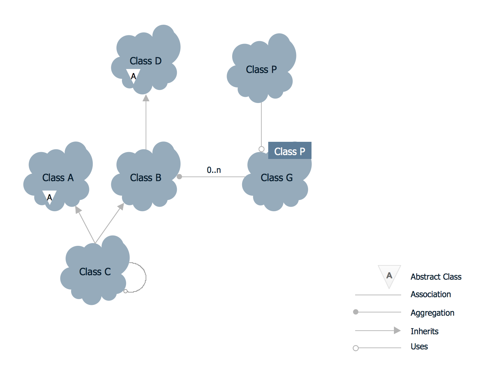
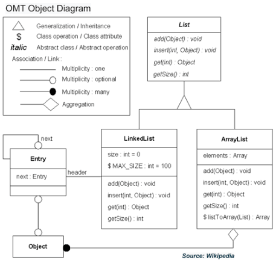
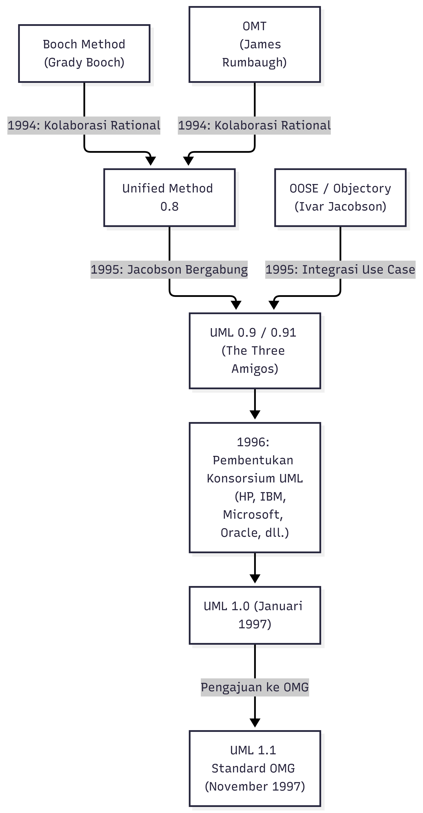
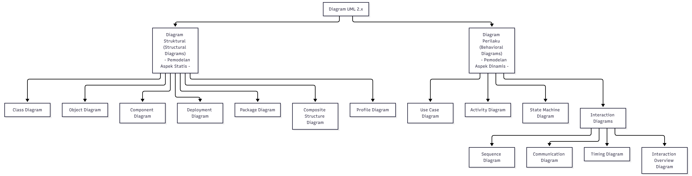
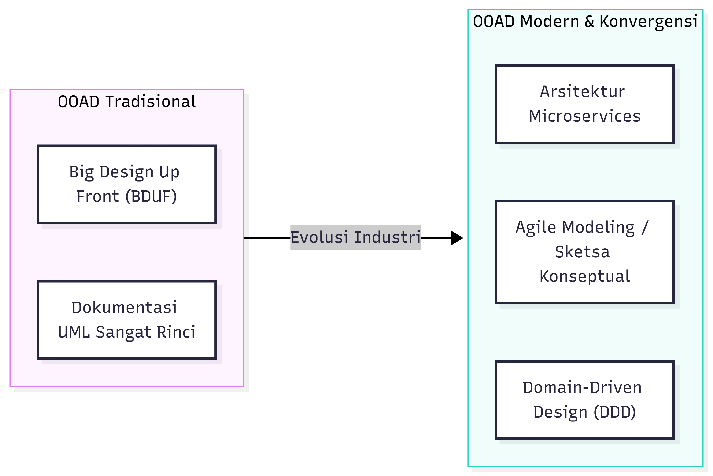

# Evolusi Metodologi OOAD & Standardisasi UML

## 1. Era Fragmentasi Metodologi Pra-UML (_The Method Wars_)

Antara akhir tahun 1980-an hingga pertengahan 1990-an, adopsi pemrograman berorientasi objek memicu tumbuhnya berbagai metodologi analisis dan perancangan. Lebih dari 50 bahasa pemodelan dan metodologi berorientasi objek muncul di industri, yang masing-masing membawa notasi visual, terminologi, dan aturan sintaksisnya sendiri. Periode persaingan intensif ini dikenal dalam sejarah rekayasa perangkat lunak sebagai **The Method Wars**.

Fragmentasi ini menimbulkan hambatan komunikasi antar tim, ketidakmampuan pertukaran alat pemodelan (_tool interoperability_), serta risiko investasi bagi organisasi yang mengadopsi notasi tertentu yang tidak menjadi standar industri. Di antara puluhan metodologi tersebut, terdapat **tiga metodologi utama** yang paling dominan dan menjadi cikal bakal terbentuknya UML:

### A. Metodologi Booch _Grady Booch_)

- **Fokus Utama**: Menekankan pada perancangan arsitektur sistem secara rinci dan implementasi teknis (khususnya untuk bahasa seperti Ada dan C++).
- **Karakteristik Visual**: Terkenal dengan penggunaan simbol **notasi berbentuk awan** (_cloud notation_) untuk merepresentasikannya sebagai kelas dan objek.
- **Proses Pengembangan**: Membagi proses menjadi dua level:
    1. **Macro Process**: Kerangka kerja kontrol manajemen teknis yang mencakup _Conceptualization_, _Analysis_, _Design_, _Evolution_, dan _Maintenance_.
    2. **Micro Process**: Aktivitas harian pengembang untuk mengidentifikasi kelas, objek, semantik, relasi, serta antarmukanya.
- **Set Diagram**: Menyediakan _Class Diagram_, _Object Diagram_, _State Transition Diagram_, _Module Diagram_, _Process Diagram_, dan _Interaction Diagram_.

### B. Object Modeling Technique / OMT _James Rumbaugh et al_)

- **Fokus Utama**: Sangat unggul dalam analisis domain bisnis, pemodelan konseptual, dan sistem informasi berbasis data (_data-intensive systems_).
- **Pendekatan Tripartit**: Pemodelan OMT membagi pemahaman sistem ke dalam tiga sudut pandang utama:
    1. **Object Model**: Menggambarkan struktur statis entitas sistem (menggunakan _Class Diagram_ dan kamus data).
    2. **Dynamic Model**: Menggambarkan perilaku dinamis objek sepanjang waktu (menggunakan _State Diagram_ dan _Event Flow Diagram_).
    3. **Functional Model**: Menggambarkan transformasi aliran data fungsional (menggunakan _Data Flow Diagram_ / DFD).
- **Fase Utama**: Terdiri dari fase _Analysis_, _System Design_, _Object Design_, dan _Implementation_.

### C. Object-Oriented Software Engineering / OOSE _Ivar Jacobson et al_)

- **Fokus Utama**: Berasal dari industri telekomunikasi (metodologi _Objectory_) dan menitikberatkan pada penangkapan kebutuhan berdasarkan perspektif pengguna.
- **Inovasi Utama**: Mempelopori konsep **Use Case** dan **Actor** untuk mendorong (_drive_) seluruh siklus hidup pengembangan sistem, mulai dari analisis hingga pengujian.
- **Model Klasifikasi Objek**: Memperkenalkan pemisahan peran objek analisis menjadi tiga kategori utama: **Boundary**, **Control**, dan **Entity** (pola dasar MVC).

### D. Metodologi Pendukung Lainnya

Selain tiga metodologi besar di atas, era ini juga diwarnai oleh metodologi penting seperti:

- **Hierarchical Object-Oriented Design (HOOD)**: Dikembangkan untuk industri kedirgantaraan Eropa dengan penekanan pada dekomposisi hierarkis sistem _real-time_.
- **Responsibility-Driven Design (Wirfs-Brock)**: Memperkenalkan kartu _Class-Responsibility-Collaborator_ (CRC) untuk mengalokasikan tanggung jawab kelas.
- **Coad & Yourdon**: Menekankan pemodelan analisis berbasis lapisan (_subject, class-&-object, structure, attribute, service_).

---

## 2. Unifikasi Metodologi

Menyadari dampak buruk dari fragmentasi metodologi, langkah unifikasi dimulai ketika **Jim Rumbaugh** bergabung dengan **Grady Booch** di Rational Software Corporation pada bulan Oktober 1994. Keduanya mulai menggabungkan ide-ide terbaik dari OMT dan Booch Method untuk merancang bahasa pemodelan bersatu yang awalnya diberi nama _Unified Method_ (versi 0.8).

Pada tahun 1995, **Ivar Jacobson** ikut bergabung di Rational Software, membawa konsep _Use Case_ dari OOSE ke dalam proyek unifikasi tersebut. Ketiga metodolog ulung ini secara penuh kasih dijuluki oleh komunitas industri perangkat lunak sebagai **The Three Amigos**.

Kerja sama _The Three Amigos_ menghasilkan draf spesifikasi **Unified Modeling Language (UML)**. Notasi UML dirancang bukan sebagai sebuah metodologi proses pengembangan, melainkan sebagai sebuah **bahasa visual standar** untuk memvisualisasikan, menspesifikasikan, membangun, dan mendokumentasikan artefak sistem perangkat lunak.

---

## 3. Standardisasi dan Evolusi UML

Untuk menjadikan UML sebagai standar industri terbuka, Rational Software bersama konsorsium perusahaan teknologi terkemuka (seperti HP, IBM, Microsoft, Oracle, dan Digital) mengajukan UML kepada **Object Management Group (OMG)** pada tahun 1996.

OMG secara resmi mengadopsi **UML versi 1.1** sebagai standar pemodelan industri pada bulan November 1997. Sejak saat itu, OMG memegang kendali kepemilikan dan pemeliharaan standar UML.

**Evolusi Spesifikasi Versi UML:**

1. **Era UML 1.x (1997–2003)**:
    - **UML 1.1 (1997)**: Versi standar awal yang mengonsolidasikan notasi dari Booch, OMT, dan OOSE.
    - **UML 1.3 - 1.5 (1999–2003)**: Penyempurnaan rinci metamodel dan penambahan **Object Constraint Language (OCL)** untuk mengekspresikan batasan matematis/logis secara formal, serta format **XML Metadata Interchange (XMI)** untuk pertukaran model antar-alat pemodelan.
2. **Era UML 2.x (2005–Sekarang)**:
    - **UML 2.0 (2005)**: Rombakan arsitektural besar-besaran untuk mendukung pemodelan sistem terdistribusi, arsitektur berbasis komponen, serta alur kerja kompleks.
    - **Struktur Spesifikasi UML 2.x**: Spesifikasi UML 2.x diorganisasikan ke dalam dua dokumen utama:
        - **UML Infrastructure**: Mendefinisikan konstruk meta-metamodel dasar yang mendasari bahasa pemodelan (Meta Object Facility / MOF).
        - **UML Superstructure**: Mendefinisikan konstruk tingkat pengguna untuk diagram-diagram struktur dan perilaku.
    - **UML 2.5.1 (2017)**: Diterbitkan sebagai spesifikasi yang disederhanakan dan terstandarisasi secara internasional di bawah standar **ISO/IEC 19505**.

---

## 4. Taksonomi Pemodelan UML 2.x

UML 2.x menyediakan kerangka pemodelan kaya yang mencakup **13 hingga 14 jenis diagram** (tergantung tingkat pengelompokan spesifikasi). Keseluruhan diagram ini dibagi menjadi dua kategori utama berdasarkan sudut pandang pemodelan (_Structural vs. Behavioral Dualism_):

### A. Diagram Struktural _Structural Diagrams_)

Menggambarkan elemen-elemen sistem yang tidak bergantung pada waktu (konfigurasi statis dan organisasi arsitektur fisik maupun logis):

1. **Class Diagram**: Menggambarkan tipe kelas, atribut, operasi, antarmuka, serta relasi statis (asosiasi, agregasi, komposisi, generalisasi) dalam sistem.
2. **Object Diagram**: Menggambarkan _snapshot_ instansiasi objek dan nilai atribut aktual pada satu titik waktu eksekusi tertentu.
3. **Component Diagram**: Menggambarkan organisasi, antarmuka, dan ketergantungan antar modul/komponen perangkat lunak fisikal.
4. **Deployment Diagram**: Menggambarkan arsitektur fisik topologi jaringan, simpul komputasi (_hardware nodes_), serta artefak eksekusi yang di-deploy di atasnya.
5. **Package Diagram**: Pengelompokan logis elemen-elemen model ke dalam modul yang lebih tinggi untuk mengelola kompleksitas dependencies.
6. **Composite Structure Diagram**: Menggambarkan struktur internal dari suatu pengklasifikasi (_classifier_), termasuk bagian internal, _ports_, dan _connectors_.

### B. Diagram Perilaku (_Behavioral Diagrams_)

Menggambarkan dinamika eksekusi, aliran kontrol, perubahan status, serta interaksi pesan antar objek sepanjang waktu:

1. **Use Case Diagram**: Menggambarkan batas sistem (_system boundary_), aktor luar, dan fungsionalitas utama (_use cases_) yang disediakan sistem dari sudut pandang pengguna.
2. **Activity Diagram**: Menggambarkan alur kerja proses bisnis (_workflow_) atau alur kontrol fungsional paralel dan sekuensial (mendukung _fork/join_ dan _swimlanes_).
3. **State Machine Diagram**: Menggambarkan siklus hidup suatu objek tunggal, perubahan kondisi status (_states_), kejadian pemicu (_events_), transisi, dan kondisi _guard_.
4. **Interaction Diagrams (Sub-kategori)**:
    - **Sequence Diagram**: Berfokus pada urutan kronologis pertukaran pesan antar objek sepanjang garis waktu (_lifelines_).
    - **Communication Diagram** (sebelumnya _Collaboration Diagram_): Berfokus pada struktur hubungan kerja sama antar objek yang saling bertukar pesan.
    - **Timing Diagram**: Menggambarkan perubahan status objek sepanjang sumbu waktu linier yang presisi (sangat penting untuk sistem _real-time_).
    - **Interaction Overview Diagram**: Menyediakan gambaran umum tingkat tinggi dari alur kontrol interaksi menggunakan notasi yang mirip dengan _Activity Diagram_.

---

## 5. Relevansi OOAD & UML dalam Praktik Modern (_Agile, DDD, Microservices_)

Dalam perkembangan rekayasa perangkat lunak modern, praktik OOAD dan pemodelan UML telah mengalami evolusi dari pendekatan tradisional berbasis _dokumen tebal_ (_Big Design Up Front_ / BDUF) menuju pendekatan yang lebih adaptif:

- **Pemodelan Agile &** **Documentation-as-Code**: Industri modern menolak formalisasi berlebihan. UML saat ini digunakan secara efisien sebagai alat komunikasi konseptual (_sketching_ pada papan tulis) atau menggunakan alat _text-based modeling_ (seperti PlantUML dan Mermaid) yang terintegrasi langsung dalam repositori kode.
- **Domain-Driven Design (DDD)**: Konsep analisis domain berbasis kelas dan batas konteks (_Bounded Contexts_) dalam DDD secara langsung melanjutkan prinsip-prinsip abstraksi dan enkapsulasi objek untuk memetakan kebutuhan bisnis ke dalam struktur perangkat lunak.
- **Arsitektur Microservices**: Konsep pembagian komponen dengan kohesi tinggi (_high cohesion_) dan keterikatan rendah (_low coupling_) dalam OOAD kini menjadi fondasi utama dalam memecah sistem monolitik menjadi layanan terdistribusi (_microservices_).

---
---
