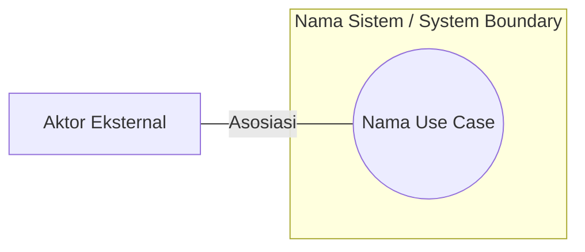
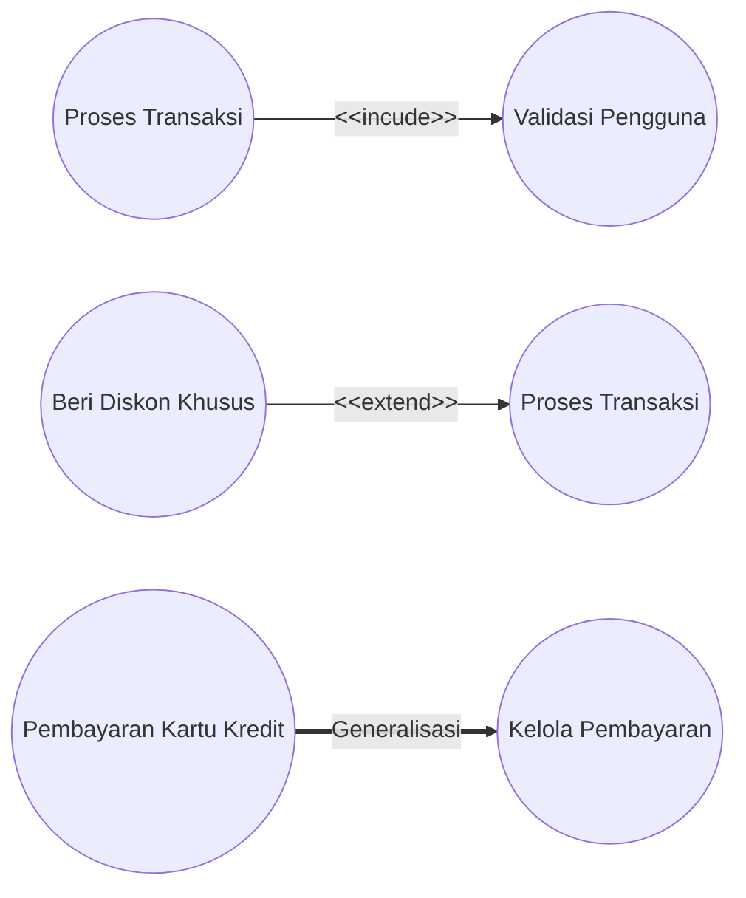
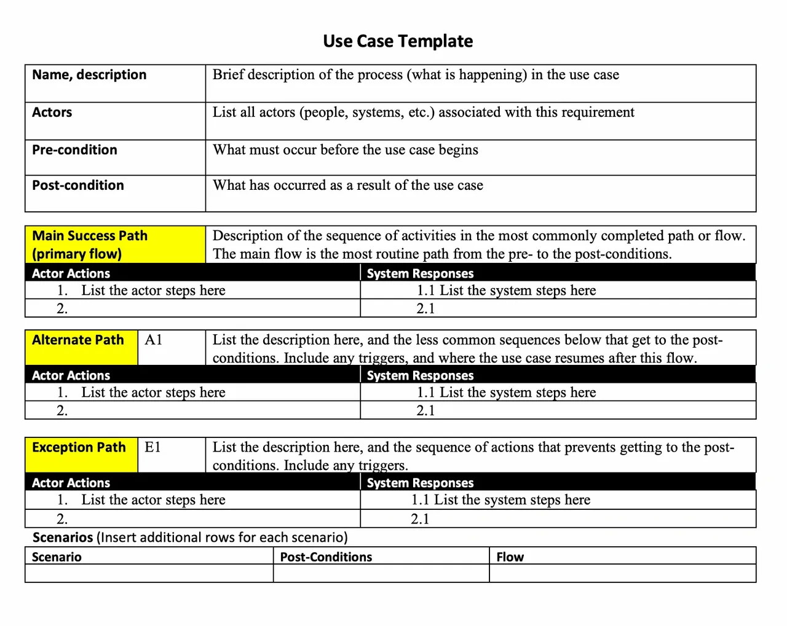

# Identifikasi Kebutuhan Sistem & Pemodelan Use Case

---

## 1. Identifikasi Kebutuhan Sistem (_System Requirements Elicitation_)

### 1.1. Konsep dan Pentingnya Identifikasi Kebutuhan

Dalam rekayasa perangkat lunak berorientasi objek (_Object-Oriented Software Engineering_), pembentukan sistem diawali dengan memahami masalah yang dihadapi oleh klien dan pengguna. **Identifikasi kebutuhan (_requirements elicitation_)** adalah proses komunikasi, eksplorasi, dan penemuan interaktif antara tim pengembang (_analyst/developer_), klien, dan pengguna akhir (_end-users_) untuk mengidentifikasi kebutuhan serta batasan sistem yang akan dibangun.

Tujuan utama dari fase ini adalah menjembatani jurang pemahaman (_domain gap_) antara pengguna yang menguasai domain bisnis dan pengembang yang menguasai teknologi perangkat lunak. Kesalahan atau ketidakjelasan pada tahap identifikasi yang baru terdeteksi pada tahap implementasi atau pengujian akan membutuhkan biaya perbaikan yang sangat mahal.

---

### 1.2. Taksonomi Kebutuhan: Fungsional vs Non-Fungsional

Kebutuhan sistem secara umum dikategorikan menjadi dua jenis utama:

1. **Kebutuhan Fungsional (_Functional Requirements_)**:
    
    - Menjelaskan fungsi, fitur, atau layanan spesifik yang harus mampu dilakukan oleh sistem.
    - Berfokus pada perilaku masukan dan keluaran (_input-output behavior_) sistem.
    - **Contoh**: _"Sistem harus dapat memproses pembayaran kartu kredit"_ atau _"Pengguna dapat mencari jadwal penerbangan"_.
2. **Kebutuhan Non-Fungsional (_Non-Functional Requirements / NFRs_)**:
    
    - Menentukan batasan (_constraints_) dan kualitas operasional tempat fungsi sistem berjalan.
    - Berfokus pada atribut kualitas software seperti performa, keamanan, keandalan, usabilitas, dan ketersediaan.
    - Klasifikasi umum NFRs sering menggunakan taksonomi **FURPS+** (_Functionality, Usability, Reliability, Performance, Supportability_).
    - **Contoh**: _"Waktu tanggap pencarian harus kurang dari 2 detik"_ (_Performance_) atau _"Sistem harus dapat beroperasi 99,9% dalam 24/7"_ (_Reliability_).

---

### 1.3. Teknik-Teknik Identifikasi Kebutuhan

Pengembang menggunakan beragam teknik untuk menggali kebutuhan secara efektif:

- **Wawancara Terstruktur dan Kuesioner**: Digunakan untuk mengumpulkan fakta, aturan bisnis, dan prioritas pengguna. Kuesioner efisien untuk mengjangkau banyak pengguna, sedangkan wawancara membantu mengklarifikasi jawaban yang ambigu.
- **Penggunaan Skenario (_Scenario-Based Elicitation_)**: Pengembang mengamati pengguna dan menyusun skenario proses bisnis saat ini (_as-is scenarios_) serta skenario masa depan yang ditargetkan (_visionary scenarios_).
- **Joint Application Design (JAD)**: Metode lokakarya (_workshop_) terstruktur yang mengumpulkan klien, pengguna, pengembang, dan fasilitator dalam satu ruangan untuk berdiskusi, bernegosiasi, dan menyepakati spesifikasi kebutuhan secara bersama-sama.
- **Analisis Dokumen dan Observasi (Etnografi)**: Mempelajari formulir operasional, manual prosedur bisnis, serta mengamati langsung alur kerja harian pengguna untuk menemukan kebutuhan implisit.

Hasil akhir dari kegiatan _requirements elicitation_ didokumentasikan dalam dokumen **Requirements Analysis Document (RAD)** atau **Software Requirements Specification (SRS)**.

---

## 2. Pemodelan Use Case (_Use Case Modeling_)

### 2.1. Konsep Dasar Use Case

Konsep _Use Case_ pertama kali diperkenalkan oleh **Ivar Jacobson** dalam metodologi _Object-Oriented Software Engineering_ (OOSE) / _Objectory_. _Use Case_ merupakan pendekatan utama dalam analisis berorientasi objek untuk menangkap kebutuhan fungsional dari sudut pandang pandang eksternal (pengguna).

- **Definisi**: Use case adalah abstraksi yang menggambarkan sekelompok skenario interaksi antara aktor luar dan sistem untuk mencapai suatu tujuan bernilai (_observable result of value_) bagi aktor tersebut.
- **Perspektif _Black-Box_**: Dalam pemodelan use case, sistem diperlakukan sebagai _black box_. Pemodelan hanya berfokus pada **apa (_what_)** yang dilakukan sistem, bukan **bagaimana (_how_)** struktur internal atau kode program mengimplementasikannya.
- **Batas Sistem (_System Boundary_)**: Pemodelan use case secara jelas mendefinisikan ruang lingkup sistem (_scope_); apa yang berada di dalam sistem (_use case_) dan apa yang berada di luar sistem (_aktor_).

---

### 2.2. Elemen-Elemen Utama Pemodelan Use Case

Diagram Use Case UML terdiri dari empat elemen pembentuk utama:



1. **Aktor (_Actor_)**:
    
    - Entitas di luar batas sistem yang berinteraksi langsung dengan sistem.
    - Aktor merepresentasikan **peran (_role_)**, bukan individu spesifik. Misal, seseorang bisa berperan sebagai _Mahasiswa_ pada satu waktu dan sebagai _Asisten Dosen_ pada waktu lain.
    - **Kategori Aktor**:
        - _Primary Actor_: Aktor utama yang menginisiasi _use case_ untuk mencapai tujuannya (misal: _Kasir_, _Nasabah_).
        - _Supporting/Secondary Actor_: Aktor yang menyediakan layanan atau bantuan kepada sistem (misal: _Payment Authorization Service_, _Database Server_).
        - _Offstage Actor_: Entitas yang memiliki kepentingan terhadap perilaku use case tetapi tidak berinteraksi langsung (misal: _Lembaga Pajak/Pemerintah_).
2. **Use Case**:
    
    - Digambarkan dalam bentuk elips vertikal atau horizontal.
    - **Aturan Penamaan**: Harus diawali dengan frasa kata kerja tindakan (_verb phrase_) yang mencerminkan tujuan aktor. Misal: `Proses Pembayaran`, `Cetak Transkrip`, `Lapor Darurat`.
3. **Batasan Sistem (_System Boundary_)**:
    
    - Digambarkan berupa kotak persegi yang membungkus semua use case.
    - Aktor diletakkan di luar kotak batas sistem.
4. **Hubungan Asosiasi (_Association Relationship_)**:
    
    - Garis lurus yang menghubungkan Aktor dengan Use Case untuk menunjukkan adanya komunikasi/interaksi dua arah.

---

## 3. Hubungan Antar Use Case (_Use Case Relationships_)

Untuk mengorganisasi dan menguraikan kompleksitas model use case, UML menyediakan tiga jenis relasi antar use case:



### 3.1. Relasi `<include>`

- **Konsep**: Digunakan ketika sebuah _use case_ dasar (_base use case_) secara **wajib** mengeksekusi dan menyertakan perilaku dari _use case_ lain (_included use case_) dalam alur jalannya.
- **Tujuan**: Mengekstrak fungsi terpisah yang sering berulang (_reusable sub-function_) di beberapa use case agar tidak terjadi redundansi teks.
- **Notasi**: Garis putus-putus berpanah terbuka dari _Base Use Case_ menuju ke _Included Use Case_ dengan label `<<include>>`.
- **Contoh**: Use Case `Proses Pemesanan` dan `Cek Riwayat` keduanya **mengikutsertakan** `Validasi Autentikasi`.

---

### 3.2. Relasi `<extend>`

- **Konsep**: Digunakan ketika sebuah _extending use case_ menambah perilaku **opsional** atau penanganan kondisi pengecualian (_exceptional flow_) ke _base use case_ pada titik tertentu yang disebut **Extension Point**.
- **Karakteristik**: _Base use case_ bersifat mandiri dan tetap dapat berjalan lengkap tanpa adanya eksekusi dari _extending use case_.
- **Notasi**: Garis putus-putus berpanah terbuka dari _Extending Use Case_ menunjuk kembali ke _Base Use Case_ dengan label `<<extend>>`.
- **Contoh**: Use Case `Koneksi Terputus` memperluas (_extend_) `Proses Transaksi` hanya ketika jaringan gagal.

---

### 3.3. Perbandingan Mendalam: Include vs Extend

Membedakan relasi `<include>` dan `<extend>` merupakan salah satu poin krusial dalam pemodelan use case:

|Atribut Perbandingan|Relasi `<include>`|Relasi `<extend>`|
|:--|:--|:--|
|**Sifat Eksekusi**|Wajib (_Mandatory_).|Opsional / Berdasarkan Kondisi (_Conditional_).|
|**Arah Panah**|Dari _Base Use Case_ \(\rightarrow\) _Included Use Case_.|Dari _Extending Use Case_ \(\rightarrow\) _Base Use Case_.|
|**Ketergantungan Pemahaman**|_Base use case_ membutuhkan _included use case_ agar selesai.|_Base use case_ tidak perlu tahu tentang adanya _extending use case_.|
|**Tujuan Utama**|Penggunaan ulang fungsi umum (_reusability_).|Memisahkan aliran pengecualian/opsional (_exception handling_).|

---

### 3.4. Generalisasi (_Generalization_)

- **Konsep**: Hubungan spesialisasi/pewarisan (_inheritance_) di mana _child use case_ mewarisi fitur, perilaku, dan relasi dari _parent use case_, serta dapat menambahkan atau menimpa (_override_) perilaku tersebut.
- **Generalisasi Aktor**: Beberapa aktor spesifik mewarisi peran dari super-aktor umum. Misal: Aktor `Dosen` dan `Asisten` mewarisi relasi dari super-aktor `Tenaga Pengajar`.
- **Notasi**: Garis lurus dengan ujung panah segitiga kosong mengarah ke super-element (_parent_).

---

## 4. Skenario Use Case

Dalam pengembangan perangkat lunak berorientasi objek (_Object-Oriented Software Engineering_), diagram _use case_ UML bertindak sebagai indeks visual dan gambaran tingkat tinggi (_black-box view_) yang menunjukkan batas sistem serta aktor eksternal yang terlibat. Namun, diagram visual saja tidak dapat menggambarkan seluruh detail langkah interaksi, aturan bisnis, dan kondisi batas fungsionalitas. Rincian kebutuhan fungsional secara komprehensif didokumentasikan melalui **Skenario Use Case**.

*Skenario Use Case* kadang dikenal juga dengan sebutan *Deskripsi Use Case*, *Narasi Use Case*, *Rincian Use Case*.

###  4.1. Penulisan Spesifikasi Use Case

Sebelum menerapkan templat tekstual, penting untuk memahami bahwa spesifikasi _use case_ dapat ditulis dalam tiga tingkat kedalaman (_formats_) yang berbeda:

1. **Format Ringkas (_Brief Format_)**: Terdiri dari satu paragraf ringkas yang merangkum tujuan dan alur utama interaksi. Biasanya disusun pada fase awal analisis (_inception_) untuk memetakan ruang lingkup sistem secara cepat.
2. **Format Informal (_Casual Format_)**: Ditulis dalam beberapa paragraf prosa bebas tanpa struktur penomoran yang ketat, mencakup alur sukses dan beberapa alur alternatif.
3. **Format Lengkap (_Fully Dressed / Expanded Format_)**: Format terstruktur paling detail yang memuat seluruh bidang elemen formal seperti prakondisi, paskakondisi, alur utama, alur perluasan/pengecualian, serta kebutuhan khusus.

---

### 4.2. Anatomi dan Elemen Spesifikasi Use Case Tekstual (_Fully Dressed_)

Templat spesifikasi tekstual _use case_ standar apa umumnya menggunakan *template Cockburn & Larman*. Template ini mengorganisasi informasi ke dalam beberapa bagian utama:

```
+-----------------------------------------------------------------------+
| NAMA USE CASE & IDENTIFIER                                            |
+-----------------------------------------------------------------------+
| HEADER                                               |
|  - Aktor Utama & Pendukung (Primary & Supporting Actors)              |
|  - Pemangku Kepentingan & Kepentingan (Stakeholders & Interests)      |
|  - Pemicu (Trigger)                                                   |
+-----------------------------------------------------------------------+
| KONDISI BATAS (CONDITIONS & GUARANTEES)                               |
|  - Prakondisi (Preconditions / Entry Conditions)                      |
|  - Paskakondisi (Postconditions / Success Guarantees / Exit Conditions)|
+-----------------------------------------------------------------------+
| ALUR UTAMA KESUKSESAN (MAIN SUCCESS SCENARIO / BASIC FLOW)            |
|  1. Aktor melakukan aksi...                                           |
|  2. Sistem memvalidasi dan merespons...                               |
+-----------------------------------------------------------------------+
| ALUR PERLUASAN & PENGECUALIAN (EXTENSIONS / ALTERNATE FLOWS)          |
|  3a. Kondisi Alternatif/Pengecualian:                                 |
|      1. Sistem menampilkan pesan...                                   |
+-----------------------------------------------------------------------+
| KEBUTUHAN KHUSUS & MATA RANTAI VARIASI (SPECIAL REQUIREMENTS)        |
|  - Atribut Kualitas / Non-fungsional Terikat                          |
|  - Variasi Data & Teknologi                                           |
+-----------------------------------------------------------------------+
| INFORMASI TAMBAHAN / METADATA                                         |
|  - Frekuensi Kejadian (Frequency of Occurrence)                       |
|  - Masalah Terbuka (Open Issues)                                      |
+-----------------------------------------------------------------------+
```

#### Header (_Preface Elements_)

Bagian header memuat informasi identifikasi awal sebelum alur interaksi dibaca:

- **Nama Use Case & ID**: Berupa frasa kata kerja tindakan (_verb phrase_) yang unik dan mencerminkan tujuan yang ingin dicapai oleh aktor utama (misal: `UC1: Proses Pemesanan Tiket`).
- **Aktor Utama (_Primary Actor_)**: Aktor yang menginisiasi interaksi untuk mencapai tujuan utamanya melalui sistem.
- **Aktor Pendukung (_Supporting / Secondary Actors_)**: Entitas luar atau sistem eksternal yang menyediakan layanan, data, atau verifikasi tambahan kepada sistem selama _use case_ berjalan (misal: _Sistem Otorisasi Pembayaran_).
- **Pemangku Kepentingan & Kepentingan (_Stakeholders and Interests List_)**: Daftar entitas atau pihak yang tidak selalu berinteraksi langsung dengan antarmuka sistem, namun memiliki kepentingan terhadap perilaku dan hasil dari _use case_ tersebut. Bagian ini penting untuk memastikan sistem memenuhi seluruh hak bisnis organisasi.
- **Pemicu (_Trigger_)**: Kejadian (_event_) awal yang menyebabkan _use case_ mulai dieksekusi, baik berupa tindakan langsung aktor maupun perubahan waktu/sistem.

#### Kondisi Batas (_Conditions & Guarantees_)

Kondisi batas menentukan status sistem sebelum dan sesudah _use case_ dijalankan:

- **Prakondisi (_Preconditions / Entry Conditions_)**:
    - Menyatakan fakta atau syarat yang **wajib bernilai BENAR** sebelum _use case_ dapat dimulai.
    - Prakondisi tidak diuji atau diperiksa di dalam alur _use case_ itu sendiri, melainkan dianggap sebagai asumsi dasar yang sudah terpenuhi (misal: _"Pengguna telah berhasil terautentikasi ke dalam sistem"_).
- **Paskakondisi (_Postconditions / Success Guarantees / Exit Conditions_)**:
    - Menyatakan jaminan kondisi sistem setelah _use case_ berhasil diselesaikan, baik melalui alur utama maupun alur alternatif.
    - Paskakondisi ditulis dalam kalimat berorientasi masa lalu (_past tense_) untuk menegaskan perubahan status sistem (misal: _"Data transaksi berhasil disimpan dan inventaris diperbarui"_).

---

#### Alur Utama Kesuksesan (_Main Success Scenario / Basic Flow / "Happy Path"_)

Alur utama mendeskripsikan urutan langkah interaksi ideal ketika segala sesuatunya berjalan lancar tanpa gangguan, kegagalan jaringan, atau kesalahan masukan (_happy path_).

Setiap langkah dalam alur utama bernomor runtut dan umumnya merepresentasikan salah satu dari tiga jenis kejadian:

1. **Interaksi antar Aktor dan Sistem**: Aktor memberikan masukan data atau memilih perintah; atau sistem menyajikan informasi kepada aktor.
2. **Validasi Internal**: Sistem melakukan verifikasi atau pengujian terhadap aturan bisnis (_business rules_).
3. **Perubahan Status Sistem (_State Change_)**: Sistem membuat, memperbarui, atau menyimpan data objek di dalam penyimpanan persisten.

---

#### Alur Perluasan & Pengecualian (_Extensions / Alternate Flows_)

Bagian alur perluasan adalah bagian yang paling kompleks dan krusial karena mencakup seluruh variasi skenario di luar alur utama. Penulisan alur perluasan menggunakan penomoran terikat yang merujuk pada nomor langkah di alur utama.

Perluasan dibagi menjadi dua jenis utama:

- **Variansi Fungsional (_Variants_)**: Jalur opsional yang dipilih oleh pengguna untuk menyelesaikan tujuan dengan cara berbeda tanpa menghentikan kesuksesan transaksi (ditandai dengan label seperti `3a`, `3b`).
- **Penanganan Pengecualian (_Exception Handling_)**: Alur yang dieksekusi saat timbul kendala, kesalahan validasi, atau kegagalan sistem luar (ditandai dengan label penanganan seperti `3a.1`, `E1`). Alur ini menentukan apakah sistem dapat pulih kembali ke alur utama atau berujung pada kegagalan transaksi (_use case fails_).

---

#### Kebutuhan Khusus & Variasi Teknologi (_Special Requirements & Variations_)

- **Kebutuhan Khusus (_Special Requirements / Quality Requirements_)**: Tempat mendokumentasikan kebutuhan non-fungsional (_non-functional requirements_), kualitas layanan (_quality attributes_), atau batasan desain yang terikat secara spesifik pada _use case_ tersebut. Contohnya mencakup batas waktu tanggap pemrosesan atau batasan perangkat keras antarmuka.
- **Variasi Data dan Teknologi (_Technology & Data Variations List_)**: Menjelaskan perbedaan teknis pada antarmuka masukan/keluaran atau metode pencatatan data tanpa mengubah alur logika utama (misal: _"Masukan kode barang dapat melalui pemindai barcode atau pengetikan manual"_).

---

#### Informasi Tambahan / Metadata

- **Frekuensi Kejadian (_Frequency of Occurrence_)**: Memetakan seberapa sering _use case_ ini diperkirakan akan dieksekusi dalam periode waktu tertentu untuk membantu tim arsitektur merancang kapasitas sistem.
- **Masalah Terbuka (_Open Issues_)**: Catatan pertanyaan bisnis atau teknis yang belum terintegrasi atau masih memerlukan konfirmasi lebih lanjut dari klien.

---

## 3. Gaya Penulisan dan Praktik Terbaik (_Best Practices_)

Dalam menyusun spesifikasi tekstual _use case_, terdapat beberapa pedoman penulisan profesional yang harus diperhatikan:

1. **Gaya Bebas Antarmuka / Esensial (_Essential / UI-Free Style_)**: Deskripsi alur harus berfokus pada **maksud aktor (_actor intent_)** dan **tanggung jawab sistem (_system responsibility_)**, bukan pada detail fisik antarmuka (_User Interface_) seperti tombol, warna, atau klik _mouse_.
2. **Pola Transaksi Berulang (_Alternating Pattern_)**: Alur disusun secara bergantian dengan pola _"Aktor menginformasikan... / Sistem menginformasikan..."_ untuk menjaga konsistensi transaksi dan memperjelas pertukaran informasi.
3. **Format Satu Kolom vs Dua Kolom**:
    - _Format Satu Kolom_: Lebih ringkas, fleksibel, dan umum digunakan dalam praktik industri modern.
    - _Format Dua Kolom_: Memisahkan langkah aksi aktor di kolom kiri dan respons sistem di kolom kanan secara visual.

---

## 4. Contoh Skenario Use Case

### Contoh 1: Template



---
### Contoh 2: Proses Pengajuan Cuti Karyawan

#### Identifikasi Kebutuhan

Berdasarkan hasil **identifikasi kebutuhan sistem** (_requirements identification/elicitation_), proses pengajuan cuti berada dalam cakupan modul manajemen waktu karyawan. Identifikasi ini menghasilkan pemetaan aktor dan batasan sistem sebagai berikut:

- **Aktor Utama (_Primary Actor_)**: **Karyawan (_Employee_)** – Pengguna yang menginisiasi pengajuan cuti untuk mendapatkan persetujuan.
- **Aktor Pendukung (_Supporting Actor_)**: **Atasan / Manajer (_Manager_)** – Menerima notifikasi dan melakukan verifikasi/persetujuan, serta **Sistem Email Perusahaan** – Layanan eksternal untuk pengiriman notifikasi.
- **Tujuan Utama (_User Goal_)**: Karyawan berhasil mengajukan permohonan cuti sesuai jatah yang tersedia dan terekam di sistem.

#### Spesifikasi Tekstual Use Case Lengkap (_Fully Dressed Format_)

Spesifikasi tekstual terstruktur (_fully dressed_) memuat seluruh bidang informasi yang dibutuhkan pengembang untuk memahami kebutuhan fungsional secara mendalam.

| Bidang Spesifikasi                                       | Deskripsi / Isi Dokumentasi                                                                                                                                                                                                                                                                            |
| :------------------------------------------------------- | :----------------------------------------------------------------------------------------------------------------------------------------------------------------------------------------------------------------------------------------------------------------------------------------------------- |
| **Nama Use Case**                                        | **Ajukan Cuti Karyawan (_Submit Vacation Request_)**                                                                                                                                                                                                                                                   |
| **ID Use Case**                                          | **UC-HR-01**                                                                                                                                                                                                                                                                                           |
| **Aktor Utama**                                          | Karyawan (_Employee_)                                                                                                                                                                                                                                                                                  |
| **Aktor Pendukung**                                      | Manajer (_Manager_), Sistem Email Eksternal                                                                                                                                                                                                                                                            |
| **Stakeholders & Interests**                             | - **Karyawan**: Ingin mengajukan cuti dengan mudah dan kepastian saldo cuti diperbarui secara akurat.- **Manajer**: Ingin menerima rincian pengajuan yang jelas untuk dasar keputusan persetujuan.- **Departemen HR**: Ingin memastikan pengajuan mematuhi aturan sisa kuota dan kebijakan perusahaan. |
| **Prakondisi (_Preconditions_)**                         | Karyawan telah terautentikasi (_login_) ke dalam sistem dan memiliki saldo cuti aktif yang bernilai positif.                                                                                                                                                                                           |
| **Paskakondisi (_Postconditions / Success Guarantees_)** | Permohonan cuti baru terbuat dengan status _"Pending Approval"_, saldo kuota cuti dikunci sementara, dan notifikasi email terkirim ke Manajer.                                                                                                                                                         |

#### Main Success Path

> Alur utama menggambarkan urutan langkah ideal ketika transaksi berjalan tanpa hambatan atau kegagalan. Alur ini disusun secara bergantian (_alternating pattern_) antara aksi aktor dan respons sistem

1. **Karyawan** memilih menu pengajuan cuti pada portal sistem.
2. **Sistem** menampilkan saldo cuti yang tersedia beserta kalender riwayat pengajuan cuti karyawan.
3. **Karyawan** memilih jenis cuti (misal: Cuti Tahunan) dan menentukan tanggal mulai serta tanggal selesai cuti.
4. **Sistem** menghitung total hari kerja yang diajukan dan memverifikasi ketersediaan saldo kuota cuti.
5. **Karyawan** memasukkan alasan/keterangan ringkas pengajuan cuti dan mengonfirmasi pengajuan.
6. **Sistem** menyimpan data permohonan cuti dengan status _"Pending Approval"_, mengunci jumlah kuota cuti sementara, dan mengirim notifikasi email ke Manajer.
7. **Sistem** menampilkan konfirmasi bahwa pengajuan berhasil dikirimkan beserta nomor referensi transaksi.

#### Alur Perluasan & Pengecualian (_Extensions / Alternate Flows_)

> Alur perluasan mencakup variasi kondisi atau penanganan kegagalan yang memotong langkah tertentu pada alur utama:

- **4a. Saldo kuota cuti tidak mencukupi:**    
    1. **Sistem** menampilkan pesan kesalahan bahwa jumlah hari cuti yang diajukan melebihi sisa saldo kuota.
    2. **Sistem** meminta Karyawan untuk mengubah rentang tanggal atau memilih jenis cuti lain.
    3. Alur kembali ke **Langkah 3** pada Alur Utama.
- **4b. Tanggal yang dipilih bertepatan dengan libur nasional atau akhir pekan:**    
    1. **Sistem** secara otomatis menyesuaikan dan mengabaikan hari libur dari perhitungan total hari cuti.
    2. Alur berlanjut ke **Langkah 5** pada Alur Utama.
- **5a. Karyawan membatalkan proses pengajuan sebelum mengonfirmasi:**    
    1. **Karyawan** memilih opsi batal.
    2. **Sistem** membersihkan formulir dan mengembalikan tampilan ke halaman utama tanpa menyimpan data.
    3. Use case berakhir dalam kondisi gagal/dibatalkan.
- **6a. Layanan pengiriman email (_Sistem Email_) mengalami kendala jaringan:**    
    1. **Sistem** tetap menyimpan permohonan cuti ke basis data dan mencatat antrean pengiriman email (_email queue_) untuk dikirim ulang secara otomatis.
    2. Alur berlanjut ke **Langkah 7** pada Alur Utama.

#### Kebutuhan Khusus / Non-Fungsional (_Quality Requirements_)

Kebutuhan non-fungsional terikat secara spesifik pada eksekusi _use case_ ini:

- **Performa**: Waktu pemrosesan validasi saldo dan penyimpanan transaksi harus kurang dari 2 detik.
- **Keamanan**: Seluruh komunikasi data pengajuan cuti wajib menggunakan enkripsi HTTPS.
- **Usabilitas**: Tampilan pemilihan tanggal harus menyediakan komponen kalender visual yang interaktif.

---
### Contoh 3: Proses Pemesanan Tiket

Berikut adalah contoh penerapan template _fully dressed_ untuk _use case_ **Proses Pemesanan Tiket**:

| Bidang Spesifikasi           | Detail Isi Dokumentasi                                                                                                                                                                                                                                                                                                                                                                                                                                                             |
| :--------------------------- | :--------------------------------------------------------------------------------------------------------------------------------------------------------------------------------------------------------------------------------------------------------------------------------------------------------------------------------------------------------------------------------------------------------------------------------------------------------------------------------- |
| **Nama Use Case**            | **UC-02: Proses Pemesanan Tiket Bus**                                                                                                                                                                                                                                                                                                                                                                                                                                              |
| **Aktor Utama**              | Penumpang                                                                                                                                                                                                                                                                                                                                                                                                                                                                          |
| **Aktor Pendukung**          | Sistem Gerbang Pembayaran (_Payment Gateway_)                                                                                                                                                                                                                                                                                                                                                                                                                                      |
| **Stakeholders & Interests** | - **Penumpang**: Ingin memesan kursi dengan cepat dan mendapat konfirmasi resmi.<br>- **Manajemen Otobus**: Ingin memastikan kapasitas kursi tercatat akurat dan pembayaran terverifikasi.                                                                                                                                                                                                                                                                                         |
| **Prakondisi**               | Penumpang telah masuk (_login_) ke aplikasi dan jadwal keberangkatan bus tersedia di katalog.                                                                                                                                                                                                                                                                                                                                                                                      |
| **Paskakondisi**             | Transaksi pemesanan tersimpan, status kursi diperbarui menjadi terpesan, dan bukti pemesanan diterbitkan.                                                                                                                                                                                                                                                                                                                                                                          |
| **Alur Utama Kesuksesan**    | 1. Penumpang memilih rute dan tanggal keberangkatan.<br>2. Sistem menampilkan daftar jadwal bus yang tersedia.<br>3. Penumpang memilih jadwal bus dan nomor kursi.<br>4. Sistem mengunci nomor kursi sementara dan menampilkan rincian total biaya.<br>5. Penumpang mengonfirmasi pemesanan dan memilih metode pembayaran.<br>6. Sistem memproses pembayaran melalui _Payment Gateway_.<br>7. Sistem memperbarui status transaksi menjadi sukses dan menerbitkan tiket elektronik. |
| **Exception/ Pengecualian**  | **3a. Kursi yang dipilih telah dipesan pengguna lain:**<br>1. Sistem menampilkan pesan peringatan bahwa kursi tidak lagi tersedia.    <br>2. Sistem memperbarui peta kursi dan meminta Penumpang memilih kursi lain.<br><br>**6a. Pembayaran mengalami kegagalan / batas waktu habis (_timeout_):**<br>1. Sistem membatalkan kuncian kursi sementara.<br>2. Sistem menginformasikan kegagalan pembayaran kepada Penumpang dan menghentikan transaksi.                              |
| **Kebutuhan Khusus**         | Otorisasi pembayaran harus mendapat konfirmasi dari _Payment Gateway_ dalam waktu kurang dari 15 detik.                                                                                                                                                                                                                                                                                                                                                                            |
| **Variasi Teknologi**        | Metode pemanduan pembayaran dapat menggunakan QRIS atau Transfer Bank Otomatis.                                                                                                                                                                                                                                                                                                                                                                                                    |

---

## 🎓 Diskusi & Tugas
### Soal Latihan 1: Pemodelan Diagram Use Case (Studi Kasus E-Commerce)

#### Deskripsi Studi Kasus

Sebuah perusahaan ritel ingin membangun platform e-commerce bernama **"TokoKita"**. Berdasarkan hasil identifikasi kebutuhan, sistem ini memfasilitasi transaksi jual-beli sebagai berikut:

1. **Pembeli** dapat menjelajahi katalog barang, memasukkan produk ke keranjang belanja, dan melakukan _checkout_.
2. Saat proses _checkout_, sistem secara otomatis mengeksekusi validasi ketersediaan stok produk di gudang serta perhitungan total biaya transaksi.
3. Pembeli melakukan pembayaran dengan terhubung ke **Sistem Payment Gateway Eksternal**.
4. Jika Pembeli memiliki _Voucher Diskon_, sistem memungkinkan Pembeli untuk mengklaim kode voucher tersebut sebagai potongan harga opsional saat _checkout_.
5. **Admin Toko** bertugas mengelola katalog produk (tambah, ubah, hapus produk) serta mengunduh laporan penjualan bulanan.
6. **Sistem Logistik Eksternal** menerima notifikasi alamat pengiriman secara otomatis dari sistem setelah pembayaran terverifikasi.

#### Pertanyaan / Instruksi Soal:

1. Identifikasi seluruh **Aktor** yang terlibat dan klasifikasikan ke dalam _Primary Actor_ atau _Supporting Actor_ beserta alasannya.
2. Tentukan **Batas Sistem (_System Boundary_)** dan daftar **Use Case** fungsional yang valid menggunakan kaidah penamaan frasa kata kerja berorientasi tujuan pengguna (_user goals_).
3. Analisis dan tentukan penggunaan relasi **`<<include>>`** dan **`<<extend>>`** pada studi kasus di atas.
4. Gambarkan atau deskripsikan hubungan skematik Diagram Use Case lengkap untuk Sistem TokoKita.

---

### Soal Latihan 2: Penyusunan Spesifikasi Use Case Tekstual (_Fully Dressed_)

#### Deskripsi Studi Kasus

Pada Sistem Informasi Akademik Perguruan Tinggi (_SIAKAD_), salah satu fungsi vital adalah **"Pengisian Kartu Rencana Studi (KRS)"** oleh Mahasiswa. Proses bisnisnya adalah sebagai berikut: Mahasiswa yang telah melunasi UKT masuk ke sistem untuk memilih mata kuliah. Sistem memeriksa prasyarat mata kuliah dan batas maksimal SKS berdasarkan IPS semester sebelumnya. Jika validasi berhasil, mata kuliah tersimpan dengan status _Draft_. Mahasiswa kemudian menekan tombol ajukan persetujuan. Sistem mengubah status KRS menjadi _Pending_ dan mengirimkan notifikasi ke Dosen Pembimbing Akademik (DPA). Jika SKS melebihi kuota atau prasyarat belum terpenuhi, sistem menampilkan pesan kesalahan dan meminta mahasiswa menyesuaikan pilihan.

#### Pertanyaan / Instruksi Soal:

Susunlah **Dokumen Spesifikasi Use Case Tekstual Lengkap (_Fully Dressed Format_)** untuk fungsi **"Isi Kartu Rencana Studi"** dengan memuat elemen-elemen berikut:

1. Header (Nama, ID, Primary Actor, Supporting Actor, Stakeholders & Interests, Trigger).
2. Kondisi Batas (_Preconditions_ dan _Postconditions_).
3. Alur Utama Kesuksesan (_Main Success Scenario / Happy Path_) tanpa pengondisian `if-else`.
4. Alur Perluasan & Pengecualian (_Extensions / Alternate Flows_).
5. Kebutuhan Non-Fungsional terikat (_Special Requirements_).

_Catatan untuk mahasiswa_: Gunakan gaya penulisan bebas antarmuka (_UI-free / Essential style_) yang berfokus pada maksud aktor dan respons sistem.

---

### Soal Latihan 3: Analisis Kesalahan & Evaluasi Kritis Pemodelan Use Case (_Anti-Patterns_)

#### Deskripsi Studi Kasus

Seorang analis sistem pemula membuat draf _Diagram Use Case_ untuk **Sistem Anjungan Tunai Mandiri (ATM)** seperti pada deskripsi berikut:

> **Draf Analis Pemula:**
> 
> - **Aktor yang diidentifikasi**: `Nasabah`, `Sistem ATM`, `Teknisi`.
> - **Use Case yang dibuat**:
>     1. `Masukkan Kartu dan PIN`
>     2. `Tekan Tombol Masukkan`
>     3. `Tampilkan Menu Utama`
>     4. `Verifikasi PIN di Database Bank`
>     5. `Tarik Tunai`
>     6. `Cetak Struk`
> - **Relasi yang digambarkan**:
>     - Aktor `Nasabah` dihubungkan langsung ke `Masukkan Kartu dan PIN`, `Tampilkan Menu Utama`, dan `Verifikasi PIN di Database Bank`.
>     - Terdapat relasi `<<include>>` dari `Tarik Tunai` menuju ke `Cetak Struk`.
>     - Aktor `Sistem ATM` diletakkan sebagai _Stick Figure_ di luar kotak batas sistem.

#### Pertanyaan / Instruksi Soal:

1. Analisis draf di atas dan sebutkan minimal **4 kesalahan metodologis/notasi UML** mendasar berdasarkan prinsip-prinsip pemodelan _Use Case_ OOAD.
2. Jelaskan alasan teoritis mengapa masing-masing poin tersebut dikategorikan sebagai kesalahan.
3. Lakukan **rekonstruksi (perbaikan)** dengan merevisi daftar Aktor, Use Case yang valid, dan relasi yang tepat untuk Sistem ATM tersebut.

---
---
