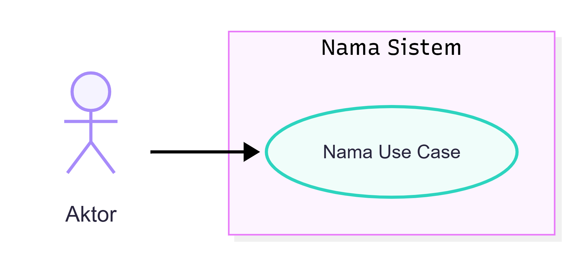
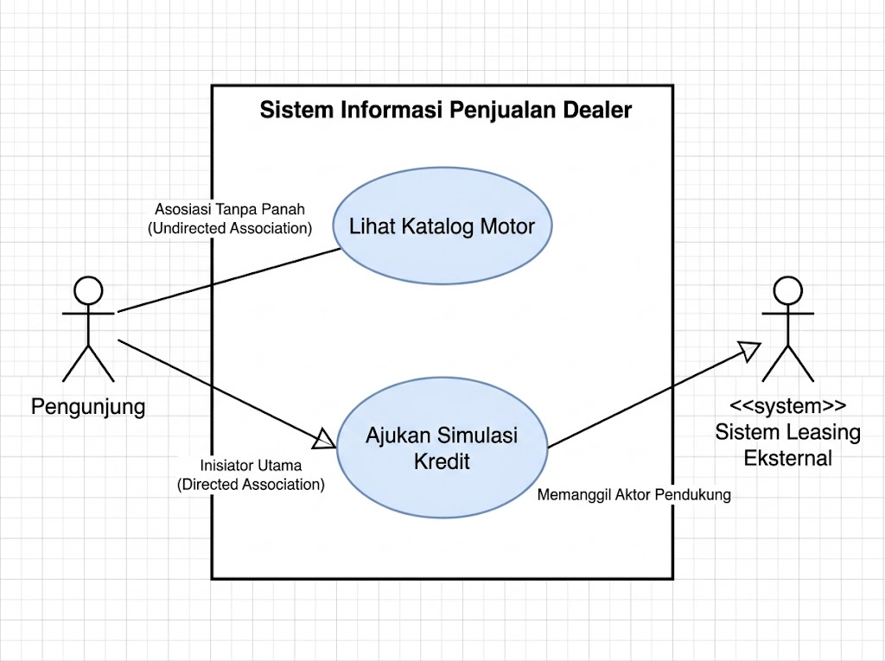
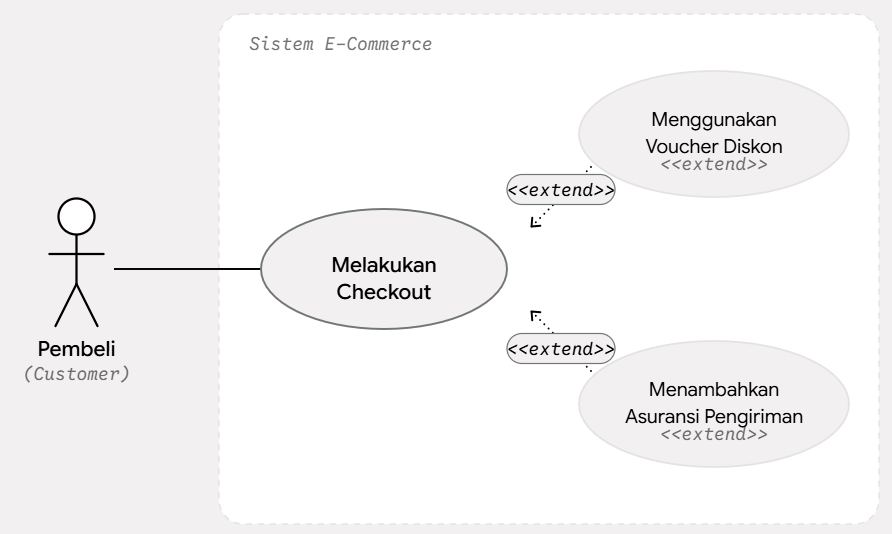
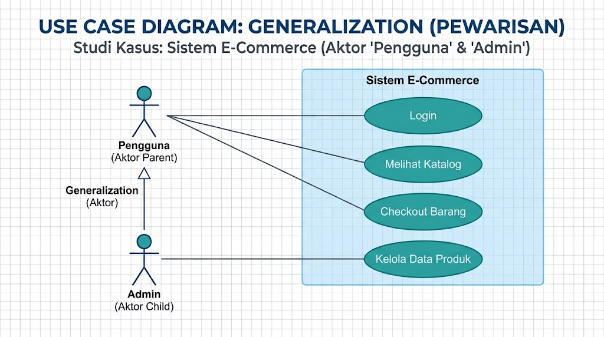
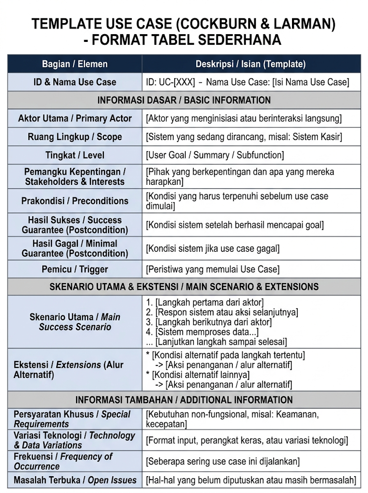
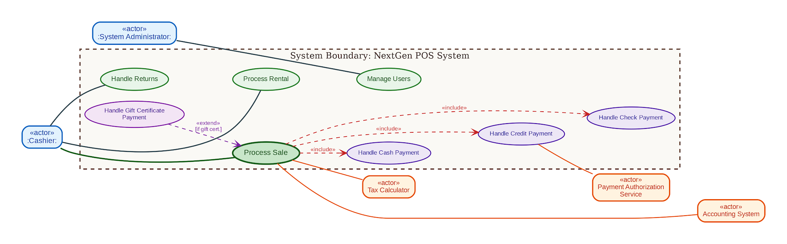
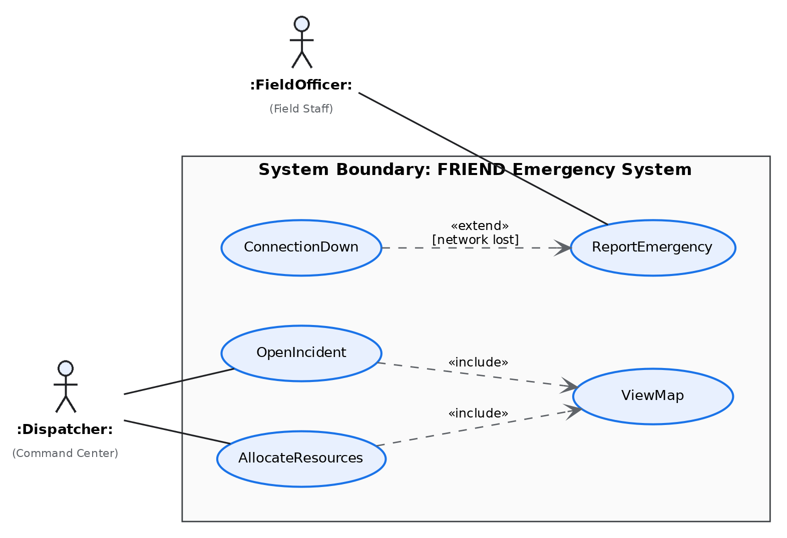

# Identifikasi Kebutuhan Sistem & Pemodelan Use Case

---

## 1. Identifikasi Kebutuhan Sistem (_System Requirements Elicitation_)

### 1.1. Konsep dan Pentingnya Identifikasi Kebutuhan

Dalam rekayasa perangkat lunak berorientasi objek (_Object-Oriented Software Engineering_), pembentukan sistem diawali dengan memahami masalah yang dihadapi oleh klien dan pengguna. **Identifikasi kebutuhan (_requirements elicitation_)** adalah proses komunikasi, eksplorasi, dan penemuan interaktif antara tim pengembang (_analyst/developer_), klien, dan pengguna akhir (_end-users_) untuk mengidentifikasi kebutuhan serta batasan sistem yang akan dibangun.

Tujuan utama dari fase ini adalah menjembatani jurang pemahaman (_domain gap_) antara pengguna yang menguasai domain bisnis dan pengembang yang menguasai teknologi perangkat lunak. Kesalahan atau ketidakjelasan pada tahap identifikasi yang baru terdeteksi pada tahap implementasi atau pengujian akan membutuhkan biaya perbaikan yang sangat mahal.

---

### 1.2. Taksonomi Kebutuhan: Fungsional vs Non-Fungsional

Kebutuhan sistem secara umum dikategorikan menjadi dua jenis utama:

1. **Kebutuhan Fungsional (_Functional Requirements_)**:
    - Menjelaskan fungsi, fitur, atau layanan spesifik yang harus mampu dilakukan oleh sistem.
    - Berfokus pada perilaku masukan dan keluaran (_input-output behavior_) sistem.
    - **Contoh**: _"Sistem harus dapat memproses pembayaran kartu kredit"_ atau _"Pengguna dapat mencari jadwal penerbangan"_.

2. **Kebutuhan Non-Fungsional (_Non-Functional Requirements / NFRs_)**:
    - Menentukan batasan (_constraints_) dan kualitas operasional tempat fungsi sistem berjalan.
    - Berfokus pada atribut kualitas software seperti performa, keamanan, keandalan, usabilitas, dan ketersediaan.
    - Klasifikasi umum NFRs sering menggunakan taksonomi **FURPS+** (_Functionality, Usability, Reliability, Performance, Supportability_).
    - **Contoh**: _"Waktu tanggap pencarian harus kurang dari 2 detik"_ (_Performance_) atau _"Sistem harus dapat beroperasi 99,9% dalam 24/7"_ (_Reliability_).

---

## 2. Pemodelan Use Case (_Use Case Modeling_)

### 2.1. Konsep Dasar Use Case

Konsep _Use Case_ pertama kali diperkenalkan oleh **Ivar Jacobson** dalam metodologi _Object-Oriented Software Engineering_ (OOSE) / _Objectory_. _Use Case_ merupakan pendekatan utama dalam analisis berorientasi objek untuk menangkap kebutuhan fungsional dari sudut pandang pandang eksternal (pengguna).

- **Definisi**: Use case adalah abstraksi yang menggambarkan sekelompok skenario interaksi antara aktor luar dan sistem untuk mencapai suatu tujuan bernilai (_observable result of value_) bagi aktor tersebut.
- **Perspektif _Black-Box_**: Dalam pemodelan use case, sistem diperlakukan sebagai _black box_. Pemodelan hanya berfokus pada **apa (_what_)** yang dilakukan sistem, bukan **bagaimana (_how_)** struktur internal atau kode program mengimplementasikannya.
- **Batas Sistem (_System Boundary_)**: Pemodelan use case secara jelas mendefinisikan ruang lingkup sistem (_scope_); apa yang berada di dalam sistem (_use case_) dan apa yang berada di luar sistem (_aktor_).

---

### 2.2. Elemen-Elemen Utama Pemodelan Use Case

Diagram Use Case UML terdiri dari empat elemen pembentuk utama:

1. **Aktor (_Actor_)**:
    - Entitas di luar batas sistem yang berinteraksi langsung dengan sistem.
    - Aktor merepresentasikan **peran (_role_)**, bukan individu spesifik. Misal, seseorang bisa berperan sebagai _Mahasiswa_ pada satu waktu dan sebagai _Asisten Dosen_ pada waktu lain.
    - **Kategori Aktor**:
        - _Primary Actor_: Aktor utama yang menginisiasi _use case_ untuk mencapai tujuannya (misal: _Kasir_, _Nasabah_).
        - _Supporting/Secondary Actor_: Aktor yang menyediakan layanan atau bantuan kepada sistem (misal: _Payment Authorization Service_, _Database Server_).
        - _Offstage Actor_: Entitas yang memiliki kepentingan terhadap perilaku use case tetapi tidak berinteraksi langsung (misal: _Lembaga Pajak/Pemerintah_).

2. **Use Case**:
    - Digambarkan dalam bentuk elips vertikal atau horizontal.
    - **Aturan Penamaan**: Harus diawali dengan frasa kata kerja tindakan (_verb phrase_) yang mencerminkan tujuan aktor. Misal: `Proses Pembayaran`, `Cetak Transkrip`, `Lapor Darurat`.

3. **Batasan Sistem (_System Boundary_)**:
    - Digambarkan berupa kotak persegi yang membungkus semua use case.
    - Aktor diletakkan di luar kotak batas sistem.

4. **Hubungan Asosiasi (_Association Relationship_)**:
	- **Garis Solid** (Undirected Association): Menunjukkan bahwa ada komunikasi dua arah (dialog) antara Aktor dan Use Case. Sistem merespons tindakan aktor, dan aktor menerima balasan dari sistem.
		- Penggunaan: Digunakan ketika arah inisiasi sudah sangat jelas dari konteks (misalnya aktor berada di sebelah kiri sistem), atau ketika perancang sistem merasa tidak perlu terlalu kaku mendefinisikan siapa yang memicu siapa dalam level konseptual diagram ini.
		- _Contoh:_ Aktor `Kasir` --> Input Transaksi`. Kasir yang menekan tombol untuk memulai input.
	- **Garis Solid + Panah** (Directed Association / Navigability): Garis lurus yang ujungnya memiliki mata panah terbuka (bukan panah tertutup/segitiga pekat).
		- Penggunaan untuk Aktor Utama (Primary Actor): Panah digambar menunjuk dari Aktor menuju Use Case. Ini menegaskan bahwa aktor tersebutlah yang secara aktif memicu jalannya fungsi sistem.
		- _Contoh:_ Use case "Proses Pembayaran" `----->` Aktor "Server Bank". Sistem yang "mengetuk pintu" server bank untuk memvalidasi kartu kredit, bukan server bank yang tiba-tiba membuka aplikasi.

> 🚨 **Panah pada Use Case Diagram BUKAN aliran data (_Data Flow_).** Jangan pernah menggunakan arah panah untuk menggambarkan ke mana data mengalir (seperti pada DFD/Data Flow Diagram). Misalnya, meskipun sebuah sistem menampilkan data laporan (data mengalir dari sistem ke pengguna), arah panah asosiasinya tetap dari Pengguna ke Use Case "Lihat Laporan", karena penggunalah yang mengklik tombol untuk meminta laporan tersebut.

---

## 3. Hubungan Antar Use Case (_Use Case Relationships_)

Untuk mengorganisasi dan menguraikan kompleksitas model use case, UML menyediakan tiga jenis relasi antar use case:

### 3.1. Relasi `<include>`

![[files/03-uc-include-1.png|515]]

Fungsi `<<include>>` (termasuk) digunakan untuk **menunjukkan bahwa suatu use case dasar secara wajib (mutlak) akan menjalankan use case yang dituju** agar prosesnya bisa dianggap selesai atau sah.

Dalam UML, use case yang di-`include` (yang ditunjuk oleh arah panah putus-putus) bukan opsi opsional, melainkan bagian dari alur utama yang **selalu terjadi** setiap kali use case dasar dijalankan.

Berikut adalah penjelasan fungsi `<<include>>` spesifik dari contoh diagram tersebut:
  
#### Dari **"Melakukan Pembayaran"** ke **"Verifikasi Pembayaran"**

- **Fungsi:** Setiap kali pelanggan memilih untuk **Melakukan Pembayaran**, sistem secara otomatis dan wajib melakukan **Verifikasi Pembayaran** terlebih dahulu.
- **Penjelasan:** Proses pembayaran tidak akan pernah selesai atau dianggap berhasil tanpa adanya verifikasi. Jadi, verifikasi adalah bagian mutlak yang "disertakan" (included) di dalam proses pembayaran.

#### Dari **"Melakukan Pembayaran"** ke **"Kirim Email Konfirmasi"**

- **Fungsi:** Setelah pelanggan **Melakukan Pembayaran**, sistem secara otomatis harus selalu **Mengirim Email Konfirmasi** kepada pelanggan.
- **Penjelasan:** Pengiriman email ini adalah bagian standar dan wajib dari alur transaksi untuk memberikan bukti pembayaran.
    
#### Dari **"Membuat Pesanan"** ke **"Verifikasi Pembayaran"**

- **Fungsi:** Saat pelanggan ingin **Membuat Pesanan**, sistem juga secara wajib melakukan **Verifikasi Pembayaran** (misalnya untuk memastikan kesiapan dana atau otorisasi sebelum pesanan benar-benar dibuat dan diproses).
- **Penjelasan:** Sama seperti poin pertama, "Membuat Pesanan" tidak bisa tuntas tanpa adanya verifikasi pembayaran.
    
#### Mengapa Hubungan `<<include>>` Ini Sangat Berguna?

Ada dua alasan utama mengapa hubungan `<<include>>` digunakan pada contoh di atas:

1. **Menghindari Duplikasi (Reusability):** Perhatikan bahwa use case **"Verifikasi Pembayaran"** dibutuhkan oleh dua use case berbeda: _"Melakukan Pembayaran"_ dan _"Membuat Pesanan"_. Daripada kita menuliskan langkah-langkah verifikasi yang sama di dalam kedua proses tersebut, kita cukup membuat satu use case terpisah ("Verifikasi Pembayaran") lalu menghubungkannya dengan `<<include>>`. Ini membuat diagram dan dokumentasi sistem menjadi lebih ringkas dan efisien.
    
2. **Memecah Proses yang Rumit:** Dengan memisahkan "Kirim Email Konfirmasi" atau "Verifikasi Pembayaran" menjadi use case sendiri, kita bisa lebih mudah memahami detail teknis dari masing-masing tugas tersebut tanpa membuat use case utama (_Melakukan Pembayaran_) menjadi terlalu padat dan rumit.

---

### 3.2. Relasi `<extend>`

`<<extend>>` digunakan untuk menunjukkan bahwa sebuah Use Case (skenario) **dapat ditambahkan atau dipanggil secara opsional** ke dalam Use Case utama, asalkan syarat/kondisinya terpenuhi.

Use Case utama tetap bisa berjalan sampai selesai tanpa harus memanggil Use Case tambahan ini. Untuk contoh di atas, penjelasannya adalah sebagai berikut:

- **Skenario Utama (Base Use Case):** `Melakukan Checkout`
- **Extend Use Case (Opsional):** `Menggunakan Voucher Diskon`
    - **Penjelasan:** Pembeli tetap bisa melakukan checkout dan membayar pesanan tanpa menggunakan voucher. Fitur voucher hanya "memperluas" (_extend_) proses checkout _jika_ pembeli memilih untuk memasukkan kode promo.

---

### 3.3. Perbandingan Mendalam: Include vs Extend

Membedakan relasi `<include>` dan `<extend>` merupakan salah satu poin krusial dalam pemodelan use case:

| Atribut Perbandingan         | Relasi `<include>`                                            | Relasi `<extend>`                                                     |
| :--------------------------- | :------------------------------------------------------------ | :-------------------------------------------------------------------- |
| **Sifat Eksekusi**           | Wajib (_Mandatory_).                                          | Opsional / Berdasarkan Kondisi (_Conditional_).                       |
| **Arah Panah**               | Dari _Base Use Case_ ke _Included Use Case_.                  | Dari _Extending Use Case_ ke _Base Use Case_.                         |
| **Ketergantungan Pemahaman** | _Base use case_ membutuhkan _included use case_ agar selesai. | _Base use case_ tidak perlu tahu tentang adanya _extending use case_. |
| **Tujuan Utama**             | Penggunaan ulang fungsi umum (_reusability_).                 | Memisahkan aliran pengecualian/opsional (_exception handling_).       |

---

### 3.4. Generalisasi (_Generalization_)

- **Konsep**: Hubungan spesialisasi/pewarisan (_inheritance_) di mana _child use case_ mewarisi fitur, perilaku, dan relasi dari _parent use case_, serta dapat menambahkan atau menimpa (_override_) perilaku tersebut.
- **Generalisasi Aktor**: Beberapa aktor spesifik mewarisi peran dari super-aktor umum. Misal: Aktor `Admin` mewarisi relasi dari super-aktor `Pengguna`.
- **Notasi**: Garis lurus dengan ujung panah segitiga kosong mengarah ke super-element (_parent_).

Secara visual, generalisasi digambarkan dengan **garis lurus berujung panah segitiga kosong** yang ditarik dari elemen anak mengarah ke elemen induk. Generalisasi dapat diterapkan pada dua hal: **Aktor** dan **Use Case**.

Berikut adalah contoh penerapannya:

**Contoh Kasus: Sistem E-Commerce**

- **Parent Actor (Induk):** `Pengguna` (Bisa berupa siapa saja yang memiliki akun).
- **Child Actors (Anak):** `Pelanggan` dan `Admin`.

**Cara Kerjanya di Diagram:**
- Aktor `Pengguna` dihubungkan ke _use case_ dasar seperti **"Login"** dan **"Melihat Katalog"**.
- Ditarik panah generalisasi dari aktor `Pelanggan` dan `Admin` mengarah ke aktor `Pengguna`.
- Otomatis, `Pelanggan` dan `Admin` bisa melakukan "Login" dan "Melihat Katalog" tanpa perlu ditarik garis _use case_ baru.
- Kemudian, Anda hanya perlu menarik garis _use case_ spesifik untuk anak aktor. Aktor `Pelanggan` dihubungkan ke _use case_ **"Checkout Barang"**, sedangkan aktor `Admin` dihubungkan ke _use case_ **"Kelola Data Produk"**.

---

### Best Practice

 1. **Focus on Intent, Keep UI Out**: Hindari mencantumkan elemen antarmuka pengguna (seperti "Klik Tombol Submit", "Masukkan Password") sebagai _use case_. Fokuslah pada tujuan dan niat pengguna (_user goal_) seperti `Authenticate` atau `Process Sale`.
2. **Batasan Jumlah Node**: Sebuah _use case diagram_ idealnya berfungsi sebagai ringkasan tingkat tinggi (_high-level index_). Jika sistem sangat kompleks, kelompokkan _use case_ ke dalam **Package Diagram** berdasarkan domain fungsi.

> 👨‍🏫 *Use Case Diagram* itu adalah *bahasa visual* untuk menjelaskan suatu sistem. Sebagaimana ia adalah *bahasa*, tidak semua orang menggunakannya dengan sempurna. Jadi, tidak menutup kemungkinan mungkin Anda akan menemukan contoh use case diagram yang tidak sesuai aturan resmi. Jangan terlalu hiraukan ketidaksesuaian atau perbedaan tersebut. Yang paling penting Anda bisa menangkap maksud yang mau disampaikan diagram tersebut.

---

## 4. Skenario Use Case

Dalam pengembangan perangkat lunak berorientasi objek (_Object-Oriented Software Engineering_), diagram _use case_ UML bertindak sebagai indeks visual dan gambaran tingkat tinggi (_black-box view_) yang menunjukkan batas sistem serta aktor eksternal yang terlibat. Namun, diagram visual saja tidak dapat menggambarkan seluruh detail langkah interaksi, aturan bisnis, dan kondisi batas fungsionalitas. Rincian kebutuhan fungsional secara komprehensif didokumentasikan melalui **Skenario Use Case**.

*Skenario Use Case* kadang dikenal juga dengan sebutan *Deskripsi Use Case*, *Narasi Use Case*, *Rincian Use Case*.

###  4.1. Penulisan Spesifikasi Use Case

Sebelum menerapkan templat tekstual, penting untuk memahami bahwa spesifikasi _use case_ dapat ditulis dalam tiga tingkat kedalaman (_formats_) yang berbeda:

1. **Format Ringkas (_Brief Format_)**: Terdiri dari satu paragraf ringkas yang merangkum tujuan dan alur utama interaksi. Biasanya disusun pada fase awal analisis (_inception_) untuk memetakan ruang lingkup sistem secara cepat.
2. **Format Informal (_Casual Format_)**: Ditulis dalam beberapa paragraf prosa bebas tanpa struktur penomoran yang ketat, mencakup alur sukses dan beberapa alur alternatif.
3. **Format Lengkap (_Fully Dressed / Expanded Format_)**: Format terstruktur paling detail yang memuat seluruh bidang elemen formal seperti prakondisi, paskakondisi, alur utama, alur perluasan/pengecualian, serta kebutuhan khusus.

---

### 4.2. Anatomi dan Elemen Spesifikasi Use Case Tekstual (_Fully Dressed_)

Templat spesifikasi tekstual _use case_ standar apa umumnya menggunakan *template Cockburn & Larman*. Template ini mengorganisasi informasi ke dalam beberapa bagian utama:

Berikut adalah penjelasan rinci untuk masing-masing elemen penyusun dalam template _Fully Dressed Use Case_ standar Cockburn & Larman:

- **ID & Nama Use Case (Use Case Name & ID):** Identifikasi unik (misal: UC-001) dan nama deskriptif dari use case. Nama harus menggunakan format kata kerja aktif yang menunjukkan tujuan pengguna, seperti "Memproses Penjualan" atau "Mendaftar Mata Kuliah".
    
- **Aktor Utama (Primary Actor):** Pengguna (manusia) atau sistem eksternal yang memicu use case ini untuk mencapai tujuannya. Aktor utama adalah pihak yang mendapatkan nilai atau manfaat langsung dari eksekusi use case.
    
- **Ruang Lingkup (Scope):** Menentukan batas sistem yang sedang dirancang (_System Under Design_). Ini menjelaskan apakah use case ini berlaku untuk keseluruhan sistem (_enterprise-level_), satu aplikasi spesifik, atau hanya sebuah subsistem kecil.
    
- **Tingkat (Level):** Kategorisasi sasaran dari use case. Terdapat tiga tingkat utama:
    - _User Goal:_ Tujuan utama aktor (paling sering digunakan, misal: "Membayar Pesanan").
    - _Summary:_ Kumpulan dari beberapa _user goal_ yang lebih kecil (proses bisnis tingkat tinggi).
    - _Subfunction:_ Langkah operasional kecil yang mendukung _user goal_ dan sering dipanggil oleh use case lain (misal: "Otentikasi Login").
        
- **Pemangku Kepentingan & Kepentingannya (Stakeholders & Interests):** Daftar semua pihak yang peduli terhadap hasil dari use case ini, beserta apa yang mereka harapkan. Bagian ini sangat penting dalam metode Larman untuk memastikan tidak ada aturan bisnis atau persyaratan tersembunyi yang terlewat (misal: "Kasir ingin proses yang cepat; Bagian Pajak ingin setiap transaksi tercatat pajaknya").
    
- **Prakondisi (Preconditions):** Kondisi atau status sistem yang _wajib bernilai benar_ sebelum use case ini diizinkan untuk dimulai. Sistem tidak akan memvalidasi kondisi ini di dalam alur use case, melainkan mengasumsikannya sudah terpenuhi (misal: "Kasir sudah berhasil login ke dalam sistem").
    
- **Hasil Sukses / Jaminan Sukses (Success Guarantee / Postcondition):** Keadaan atau perubahan data pada sistem yang dijamin akan terjadi jika use case berhasil diselesaikan dengan sempurna (misal: "Stok barang berkurang, struk tercetak, dan total pendapatan harian diperbarui").
    
- **Hasil Gagal / Jaminan Minimal (Minimal Guarantee):** Janji sistem tentang apa yang akan terjadi jika use case gagal di tengah jalan. Biasanya berisi perlindungan keamanan atau integritas data (misal: "Transaksi dibatalkan, status stok dikembalikan, dan log error dicatat ke dalam database").
    
- **Pemicu (Trigger):** Peristiwa spesifik yang menyebabkan aktor memulai use case ini. Bisa berupa tindakan manual atau pemicu waktu (misal: "Pelanggan membawa barang ke meja kasir").
    
- **Skenario Utama (Main Success Scenario / Basic Flow):** Sering disebut _Happy Path_. Ini adalah langkah-langkah interaksi yang ideal, berurutan dari awal hingga akhir, di mana tidak ada error atau hambatan. Ditulis dalam bentuk interaksi aksi-reaksi antara Aktor dan Sistem.
    
- **Ekstensi (Extensions / Alternative Flows):** Skenario percabangan yang merujuk pada nomor langkah di Skenario Utama (misal: langkah 3a, 3b). Bagian ini menangani semua kondisi alternatif, error, kegagalan, atau pilihan jalan lain yang bisa terjadi pada langkah tersebut, beserta respon sistemnya.
    
- **Persyaratan Khusus (Special Requirements):** Kebutuhan non-fungsional yang terkait langsung dengan use case ini. Biasanya berkaitan dengan batasan kinerja, keamanan, atau UX (misal: "Pencarian data pelanggan harus selesai dalam waktu kurang dari 2 detik").
    
- **Variasi Teknologi & Data (Technology & Data Variations):** Catatan mengenai kemungkinan perbedaan format input, output, atau perangkat keras tanpa mengubah alur logika bisnis. (misal: "Pembayaran dapat menggunakan pemindai barcode, RFID, atau input manual via _keyboard_").
    
- **Frekuensi (Frequency of Occurrence):** Estimasi seberapa sering use case ini akan dijalankan (misal: "Hampir terus-menerus selama jam operasional" atau "Satu kali setiap akhir bulan"). Informasi ini krusial untuk merancang kapasitas server dan basis data.
    
- **Masalah Terbuka (Open Issues):** Daftar pertanyaan, keraguan, atau kebijakan bisnis yang belum memiliki jawaban pasti saat dokumen ini ditulis dan membutuhkan rapat atau konfirmasi lanjutan dengan klien.

---

## 3. Contoh Skenario Use Case

### Contoh Kasus 1: Sistem Point of Sale (NextGen POS)

#### A. Deskripsi Kasus

**NextGen POS** adalah sistem kasir ritel berorientasi objek yang digunakan untuk mengelola transaksi penjualan di toko, kalkulasi harga dan pajak, otorisasi pembayaran kartu, serta pembaruan data akuntansi dan inventaris secara _real-time_.

#### B. Identifikasi Aktor & Batas Sistem

- **Primary Actor**: `Cashier` (Kasir).
- **Supporting Actors**: `Payment Authorization Service`, `Tax Calculator`, `Accounting System`.
- **Administrative Actor**: `System Administrator`.

#### C. Spesifikasi Tekstual Use Case (UC1: Process Sale)

- **Primary Actor**: Kasir.
- **Main Success Scenario (Alur Utama)**:
    1. Pelanggan datang ke kasir membawa barang belanjaan.
    2. Kasir memulai transaksi penjualan baru.
    3. Kasir memasukkan ID barang; Sistem mencatat baris item dan menampilkan deskripsi serta harga running total.
    4. Kasir mengulang langkah 3 hingga selesai.
    5. Sistem menampilkan total harga beserta perhitungan pajak.
    6. Pelanggan melakukan pembayaran dan sistem memproses pembayaran.
    7. Sistem mencatat penjualan yang selesai dan mengirimkan data ke sistem Akuntansi dan Inventaris.
    8. Sistem mencetak struk/nota belanja.
- **Extensions (Alur Alternatif/Ekstensi)**:
    - `7a`. Pembayaran Tunai: Sistem memproses pembayaran tunai (_Handle Cash Payment_).
    - `7b`. Pembayaran Kredit: Sistem memanggil _subfunction use case_ pembacaan dan otorisasi kartu kredit (_Handle Credit Payment_).
    - `7c`. Pembayaran Sertifikat Hadiah: Jika pelanggan menggunakan kupon/hadiah, dipanggil fungsi ekstensi (_Handle Gift Certificate Payment_).

#### D. Use Case Diagram UML (NextGen POS)

---

### Contoh Kasus 2: Sistem Manajemen Insiden Tanggap Darurat (FRIEND)

#### A. Deskripsi Kasus

**FRIEND (First Responder Interactive Emergency Navigational Database)** adalah sistem informasi tanggap darurat terdistribusi untuk mengordinasikan penanganan insiden kecelakaan dan kebakaran di lapangan.

#### B. Identifikasi Aktor & Peran

- **FieldOfficer**: Petugas lapangan (polisi/pemadam) yang menggunakan perangkat _mobile_ untuk melaporkan darurat.
- **Dispatcher**: Petugas pusat komando yang membuka berkas insiden dan mengalokasikan unit armada emergency.

#### C. Penerapan Relasi `«include»` dan `«extend»`

1. **Relasi `«include»`**: _Use case_ `AllocateResources` dan `OpenIncident` membutuhkan tampilan peta lokasi insiden secara interaktif. Fungsi ini dipisahkan ke dalam _use case_ `ViewMap` yang di-`«include»` oleh keduanya untuk menghindari duplikasi fungsi.
2. **Relasi `«extend»`**: Ketika jaringan komunikasi nirkabel antara `FieldOfficer` dan `Dispatcher` terputus saat pelaporan insiden, _use case_ `ConnectionDown` diaktifkan secara opsional sebagai ekstensi dari `ReportEmergency` untuk menangani rekoveri koneksi.

#### D. Use Case Diagram (FRIEND System)

---

### Contoh Kasus 3: Proses Pengajuan Cuti Karyawan

#### Identifikasi Kebutuhan

Berdasarkan hasil **identifikasi kebutuhan sistem** (_requirements identification/elicitation_), proses pengajuan cuti berada dalam cakupan modul manajemen waktu karyawan. Identifikasi ini menghasilkan pemetaan aktor dan batasan sistem sebagai berikut:

- **Aktor Utama (_Primary Actor_)**: **Karyawan (_Employee_)** – Pengguna yang menginisiasi pengajuan cuti untuk mendapatkan persetujuan.
- **Aktor Pendukung (_Supporting Actor_)**: **Atasan / Manajer (_Manager_)** – Menerima notifikasi dan melakukan verifikasi/persetujuan, serta **Sistem Email Perusahaan** – Layanan eksternal untuk pengiriman notifikasi.
- **Tujuan Utama (_User Goal_)**: Karyawan berhasil mengajukan permohonan cuti sesuai jatah yang tersedia dan terekam di sistem.

#### Spesifikasi Tekstual Use Case Lengkap (_Fully Dressed Format_)

Spesifikasi tekstual terstruktur (_fully dressed_) memuat seluruh bidang informasi yang dibutuhkan pengembang untuk memahami kebutuhan fungsional secara mendalam.

| Bidang Spesifikasi                                       | Deskripsi / Isi Dokumentasi                                                                                                                                                                                                                                                                                    |
| :------------------------------------------------------- | :------------------------------------------------------------------------------------------------------------------------------------------------------------------------------------------------------------------------------------------------------------------------------------------------------------- |
| **Nama Use Case**                                        | **Ajukan Cuti Karyawan (_Submit Vacation Request_)**                                                                                                                                                                                                                                                           |
| **ID Use Case**                                          | **UC-HR-01**                                                                                                                                                                                                                                                                                                   |
| **Aktor Utama**                                          | Karyawan (_Employee_)                                                                                                                                                                                                                                                                                          |
| **Aktor Pendukung**                                      | Manajer (_Manager_), Sistem Email Eksternal                                                                                                                                                                                                                                                                    |
| **Stakeholders & Interests**                             | - **Karyawan**: Ingin mengajukan cuti dengan mudah dan kepastian saldo cuti diperbarui secara akurat. - **Manajer**: Ingin menerima rincian pengajuan yang jelas untuk dasar keputusan persetujuan. - **Departemen HR**: Ingin memastikan pengajuan mematuhi aturan sisa kuota dan kebijakan perusahaan. |
| **Prakondisi (_Preconditions_)**                         | Karyawan telah terautentikasi (_login_) ke dalam sistem dan memiliki saldo cuti aktif yang bernilai positif.                                                                                                                                                                                                   |
| **Paskakondisi (_Postconditions / Success Guarantees_)** | Permohonan cuti baru terbuat dengan status _"Pending Approval"_, saldo kuota cuti dikunci sementara, dan notifikasi email terkirim ke Manajer.                                                                                                                                                                 |

#### Main Success Path

> Alur utama menggambarkan urutan langkah ideal ketika transaksi berjalan tanpa hambatan atau kegagalan. Alur ini disusun secara bergantian (_alternating pattern_) antara aksi aktor dan respons sistem

1. **Karyawan** memilih menu pengajuan cuti pada portal sistem.
2. **Sistem** menampilkan saldo cuti yang tersedia beserta kalender riwayat pengajuan cuti karyawan.
3. **Karyawan** memilih jenis cuti (misal: Cuti Tahunan) dan menentukan tanggal mulai serta tanggal selesai cuti.
4. **Sistem** menghitung total hari kerja yang diajukan dan memverifikasi ketersediaan saldo kuota cuti.
5. **Karyawan** memasukkan alasan/keterangan ringkas pengajuan cuti dan mengonfirmasi pengajuan.
6. **Sistem** menyimpan data permohonan cuti dengan status _"Pending Approval"_, mengunci jumlah kuota cuti sementara, dan mengirim notifikasi email ke Manajer.
7. **Sistem** menampilkan konfirmasi bahwa pengajuan berhasil dikirimkan beserta nomor referensi transaksi.

#### Alur Perluasan & Pengecualian (_Extensions / Alternate Flows_)

> Alur perluasan mencakup variasi kondisi atau penanganan kegagalan yang memotong langkah tertentu pada alur utama:

- **4a. Saldo kuota cuti tidak mencukupi:**    
    1. **Sistem** menampilkan pesan kesalahan bahwa jumlah hari cuti yang diajukan melebihi sisa saldo kuota.
    2. **Sistem** meminta Karyawan untuk mengubah rentang tanggal atau memilih jenis cuti lain.
    3. Alur kembali ke **Langkah 3** pada Alur Utama.
- **4b. Tanggal yang dipilih bertepatan dengan libur nasional atau akhir pekan:**    
    1. **Sistem** secara otomatis menyesuaikan dan mengabaikan hari libur dari perhitungan total hari cuti.
    2. Alur berlanjut ke **Langkah 5** pada Alur Utama.
- **5a. Karyawan membatalkan proses pengajuan sebelum mengonfirmasi:**    
    1. **Karyawan** memilih opsi batal.
    2. **Sistem** membersihkan formulir dan mengembalikan tampilan ke halaman utama tanpa menyimpan data.
    3. Use case berakhir dalam kondisi gagal/dibatalkan.
- **6a. Layanan pengiriman email (_Sistem Email_) mengalami kendala jaringan:**    
    1. **Sistem** tetap menyimpan permohonan cuti ke basis data dan mencatat antrean pengiriman email (_email queue_) untuk dikirim ulang secara otomatis.
    2. Alur berlanjut ke **Langkah 7** pada Alur Utama.

#### Kebutuhan Khusus / Non-Fungsional (_Quality Requirements_)

Kebutuhan non-fungsional terikat secara spesifik pada eksekusi _use case_ ini:

- **Performa**: Waktu pemrosesan validasi saldo dan penyimpanan transaksi harus kurang dari 2 detik.
- **Keamanan**: Seluruh komunikasi data pengajuan cuti wajib menggunakan enkripsi HTTPS.
- **Usabilitas**: Tampilan pemilihan tanggal harus menyediakan komponen kalender visual yang interaktif.

---
### Contoh Kasus 4: Proses Pemesanan Tiket

Berikut adalah contoh penerapan template _fully dressed_ untuk _use case_ **Proses Pemesanan Tiket**:

| Bidang Spesifikasi           | Detail Isi Dokumentasi                                                                                                                                                                                                                                                                                                                                                                                                                                                             |
| :--------------------------- | :--------------------------------------------------------------------------------------------------------------------------------------------------------------------------------------------------------------------------------------------------------------------------------------------------------------------------------------------------------------------------------------------------------------------------------------------------------------------------------- |
| **Nama Use Case**            | **UC-02: Proses Pemesanan Tiket Bus**                                                                                                                                                                                                                                                                                                                                                                                                                                              |
| **Aktor Utama**              | Penumpang                                                                                                                                                                                                                                                                                                                                                                                                                                                                          |
| **Aktor Pendukung**          | Sistem Gerbang Pembayaran (_Payment Gateway_)                                                                                                                                                                                                                                                                                                                                                                                                                                      |
| **Stakeholders & Interests** | - **Penumpang**: Ingin memesan kursi dengan cepat dan mendapat konfirmasi resmi. - **Manajemen Travel**: Ingin memastikan kapasitas kursi tercatat akurat dan pembayaran terverifikasi.                                                                                                                                                                                                                                                                                         |
| **Prakondisi**               | Penumpang telah masuk (_login_) ke aplikasi dan jadwal keberangkatan bus tersedia di katalog.                                                                                                                                                                                                                                                                                                                                                                                      |
| **Paskakondisi**             | Transaksi pemesanan tersimpan, status kursi diperbarui menjadi terpesan, dan bukti pemesanan diterbitkan.                                                                                                                                                                                                                                                                                                                                                                          |
| **Alur Utama Kesuksesan**    | 1. Penumpang memilih rute dan tanggal keberangkatan. 2. Sistem menampilkan daftar jadwal bus yang tersedia. 3. Penumpang memilih jadwal bus dan nomor kursi. 4. Sistem mengunci nomor kursi sementara dan menampilkan rincian total biaya. 5. Penumpang mengonfirmasi pemesanan dan memilih metode pembayaran. 6. Sistem memproses pembayaran melalui _Payment Gateway_. 7. Sistem memperbarui status transaksi menjadi sukses dan menerbitkan tiket elektronik. |
| **Exception/ Pengecualian**  | **3a. Kursi yang dipilih telah dipesan pengguna lain:** 1. Sistem menampilkan pesan peringatan bahwa kursi tidak lagi tersedia.     2. Sistem memperbarui peta kursi dan meminta Penumpang memilih kursi lain.  **6a. Pembayaran mengalami kegagalan / batas waktu habis (_timeout_):** 1. Sistem membatalkan kuncian kursi sementara. 2. Sistem menginformasikan kegagalan pembayaran kepada Penumpang dan menghentikan transaksi.                              |
| **Kebutuhan Khusus**         | Otorisasi pembayaran harus mendapat konfirmasi dari _Payment Gateway_ dalam waktu kurang dari 15 detik.                                                                                                                                                                                                                                                                                                                                                                            |
| **Variasi Teknologi**        | Metode pemanduan pembayaran dapat menggunakan QRIS atau Transfer Bank Otomatis.                                                                                                                                                                                                                                                                                                                                                                                                    |

---

## 🎓 Diskusi & Tugas
### Soal Latihan 1: Pemodelan Diagram Use Case (Studi Kasus E-Commerce)

#### Deskripsi Studi Kasus

Sebuah perusahaan ritel ingin membangun platform e-commerce bernama **"TokoKita"**. Berdasarkan hasil identifikasi kebutuhan, sistem ini memfasilitasi transaksi jual-beli sebagai berikut:

1. **Pembeli** dapat menjelajahi katalog barang, m ja, dan melakukan _checkout_.
2. Saat proses _checkout_, sistem secara otomatis mengeksekusi validasi ketersediaan stok produk di gudang serta perhitungan total biaya transaksi.
3. Pembeli melakukan pembayaran dengan terhubung ke **Sistem Payment Gateway Eksternal**.
4. Jika Pembeli memiliki _Voucher Diskon_, sistem memungkinkan Pembeli untuk mengklaim kode voucher tersebut sebagai potongan harga opsional saat _checkout_.
5. **Admin Toko** bertugas mengelola katalog produk (tambah, ubah, hapus produk) serta mengunduh laporan penjualan bulanan.
6. **Sistem Logistik Eksternal** menerima notifikasi alamat pengiriman secara otomatis dari sistem setelah pembayaran terverifikasi.

#### Pertanyaan / Instruksi Soal:

1. Identifikasi seluruh **Aktor** yang terlibat dan klasifikasikan ke dalam _Primary Actor_ atau _Supporting Actor_ beserta alasannya.
2. Tentukan **Batas Sistem (_System Boundary_)** dan daftar **Use Case** fungsional yang valid menggunakan kaidah penamaan frasa kata kerja berorientasi tujuan pengguna (_user goals_).
3. Analisis dan tentukan penggunaan relasi **`<<include>>`** dan **`<<extend>>`** pada studi kasus di atas.
4. Gambarkan atau deskripsikan hubungan skematik Diagram Use Case lengkap untuk Sistem TokoKita.

---

### Soal Latihan 2: Penyusunan Spesifikasi Use Case Tekstual (_Fully Dressed_)

#### Deskripsi Studi Kasus

Pada Sistem Informasi Akademik Perguruan Tinggi (_SIAKAD_), salah satu fungsi vital adalah **"Pengisian Kartu Rencana Studi (KRS)"** oleh Mahasiswa. Proses bisnisnya adalah sebagai berikut: Mahasiswa yang telah melunasi UKT masuk ke sistem untuk memilih mata kuliah. Sistem memeriksa prasyarat mata kuliah dan batas maksimal SKS berdasarkan IPS semester sebelumnya. Jika validasi berhasil, mata kuliah tersimpan dengan status _Draft_. Mahasiswa kemudian menekan tombol ajukan persetujuan. Sistem mengubah status KRS menjadi _Pending_ dan mengirimkan notifikasi ke Dosen Pembimbing Akademik (DPA). Jika SKS melebihi kuota atau prasyarat belum terpenuhi, sistem menampilkan pesan kesalahan dan meminta mahasiswa menyesuaikan pilihan.

#### Pertanyaan / Instruksi Soal:

Susunlah **Dokumen Spesifikasi Use Case Tekstual Lengkap (_Fully Dressed Format_)** untuk fungsi **"Isi Kartu Rencana Studi"** dengan memuat elemen-elemen berikut:

1. Header (Nama, ID, Primary Actor, Supporting Actor, Stakeholders & Interests, Trigger).
2. Kondisi Batas (_Preconditions_ dan _Postconditions_).
3. Alur Utama Kesuksesan (_Main Success Scenario / Happy Path_) tanpa pengondisian `if-else`.
4. Alur Perluasan & Pengecualian (_Extensions / Alternate Flows_).
5. Kebutuhan Non-Fungsional terikat (_Special Requirements_).

_Catatan untuk mahasiswa_: Gunakan gaya penulisan bebas antarmuka (_UI-free / Essential style_) yang berfokus pada maksud aktor dan respons sistem.

---

### Soal Latihan 3: Analisis Kesalahan & Evaluasi Kritis Pemodelan Use Case (_Anti-Patterns_)

#### Deskripsi Studi Kasus

Seorang analis sistem pemula membuat draf _Diagram Use Case_ untuk **Sistem Anjungan Tunai Mandiri (ATM)** seperti pada deskripsi berikut:

> **Draf Analis Pemula:**
> 
> - **Aktor yang diidentifikasi**: `Nasabah`, `Sistem ATM`, `Teknisi`.
> - **Use Case yang dibuat**:
>     1. `Masukkan Kartu dan PIN`
>     2. `Tekan Tombol Masukkan`
>     3. `Tampilkan Menu Utama`
>     4. `Verifikasi PIN di Database Bank`
>     5. `Tarik Tunai`
>     6. `Cetak Struk`
> - **Relasi yang digambarkan**:
>     - Aktor `Nasabah` dihubungkan langsung ke `Masukkan Kartu dan PIN`, `Tampilkan Menu Utama`, dan `Verifikasi PIN di Database Bank`.
>     - Terdapat relasi `<<include>>` dari `Tarik Tunai` menuju ke `Cetak Struk`.
>     - Aktor `Sistem ATM` diletakkan sebagai _Stick Figure_ di luar kotak batas sistem.

#### Pertanyaan / Instruksi Soal:

1. Analisis draf di atas dan sebutkan minimal **4 kesalahan metodologis/notasi UML** mendasar berdasarkan prinsip-prinsip pemodelan _Use Case_ OOAD.
2. Jelaskan alasan teoritis mengapa masing-masing poin tersebut dikategorikan sebagai kesalahan.
3. Lakukan **rekonstruksi (perbaikan)** dengan merevisi daftar Aktor, Use Case yang valid, dan relasi yang tepat untuk Sistem ATM tersebut.

---

### Soal Latihan 4: Sistem Pemesanan Makanan Online (Food Delivery)

**Deskripsi Sistem:**

Sebuah perusahaan rintisan sedang mengembangkan aplikasi pemesanan makanan online. Dalam aplikasi ini, pelanggan harus membuat akun dan _login_ untuk dapat mencari restoran, melihat menu, dan memasukkan makanan ke keranjang belanja. Saat melakukan _checkout_, pelanggan harus melakukan pembayaran melalui sistem terintegrasi (transfer bank, kartu kredit, atau dompet digital).

Restoran mitra yang terdaftar dapat mengelola menu mereka (menambah/mengubah harga) dan akan menerima notifikasi jika ada pesanan masuk. Pihak restoran berhak menerima atau menolak pesanan. Jika pesanan diterima, restoran akan menyiapkan makanan tersebut.

Sistem kemudian akan mencarikan pengemudi (_driver_) terdekat secara otomatis. Pengemudi dapat menerima pesanan, mengambil makanan di restoran, dan memperbarui status pengantaran hingga makanan sampai di tangan pelanggan. Di balik layar, terdapat Admin aplikasi yang bertugas memverifikasi pendaftaran akun restoran baru dan menonaktifkan akun pengguna yang melanggar aturan.

**Diskusi:**
- Siapa saja _Actor_ manusia dan _Actor_ sistem yang terlibat?
- Aktivitas apa yang wajib menyertakan (_include_) proses _login_?
- Aktivitas apa yang merupakan opsi tambahan (_extend_) dari proses pemesanan makanan?
    
---

### Soal Latihan 5: Sistem Manajemen Perpustakaan Universitas

**Deskripsi Sistem:**

Sebuah universitas ingin mendigitalisasi perpustakaannya. Sistem informasi ini akan digunakan oleh Mahasiswa, Dosen, dan Pustakawan (staf).

Mahasiswa dan Dosen bertindak sebagai Anggota perpustakaan. Mereka dapat menggunakan sistem untuk mencari katalog buku, melihat ketersediaan stok, dan melakukan reservasi peminjaman secara _online_. Anggota juga dapat mengecek riwayat peminjaman dan total denda keterlambatan jika ada.

Pustakawan memiliki hak akses khusus untuk mengelola data buku (menambah, mengubah, menghapus), mengelola data anggota, serta memproses transaksi peminjaman fisik dan pengembalian buku di meja sirkulasi. Jika ada keterlambatan, Pustakawan akan menerima pembayaran denda dari Anggota.

Sebagai fitur tambahan, sistem perpustakaan dirancang agar dapat bekerja secara otomatis setiap pukul 08:00 pagi untuk mengecek _database_ peminjaman. Sistem akan mengirimkan email peringatan (_reminder_) secara otomatis kepada anggota yang masa pinjam bukunya akan habis dalam 24 jam atau sudah jatuh tempo.

**Diskusi:**

- Bagaimana Anda merepresentasikan _Sistem Penjadwalan_ (waktu otomatis) sebagai _Actor_?
- Apa saja _Use Case_ utama untuk Pustakawan dibandingkan dengan Anggota biasa?
- Gambarkan batasan sistem (_System Boundary_) yang membungkus semua _Use Case_ tersebut.

---
---
