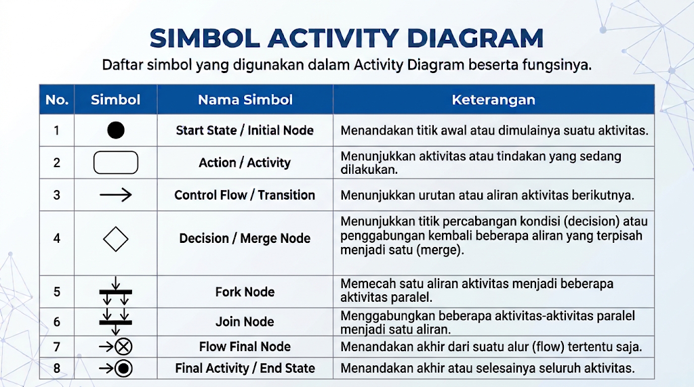
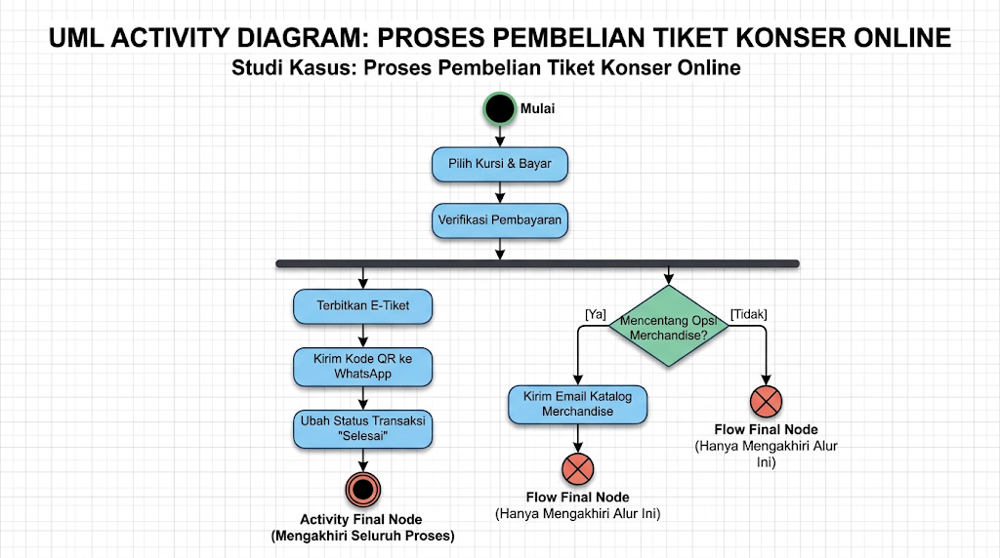
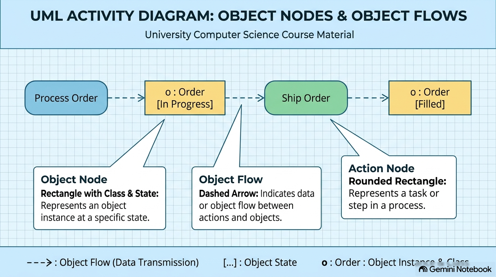
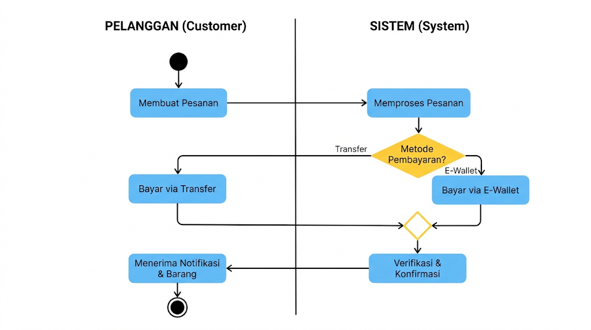
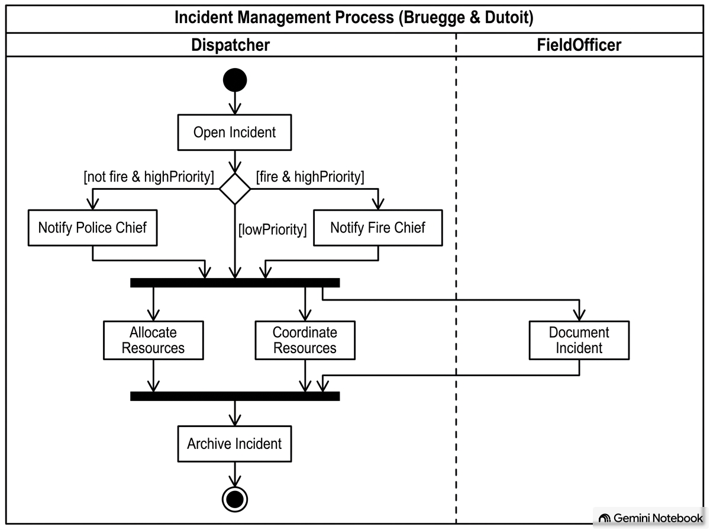
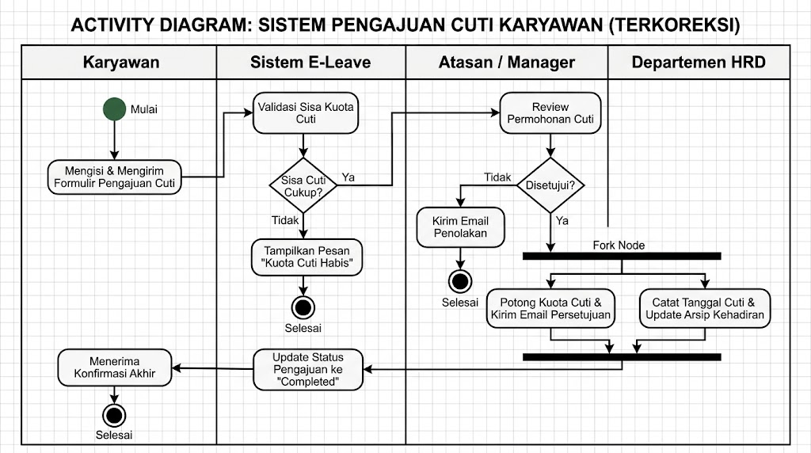
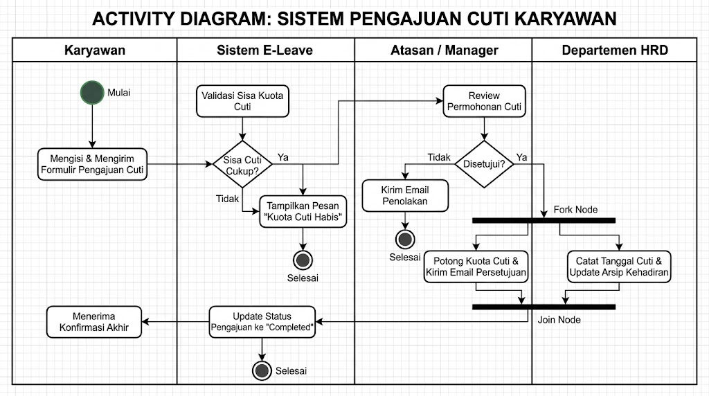
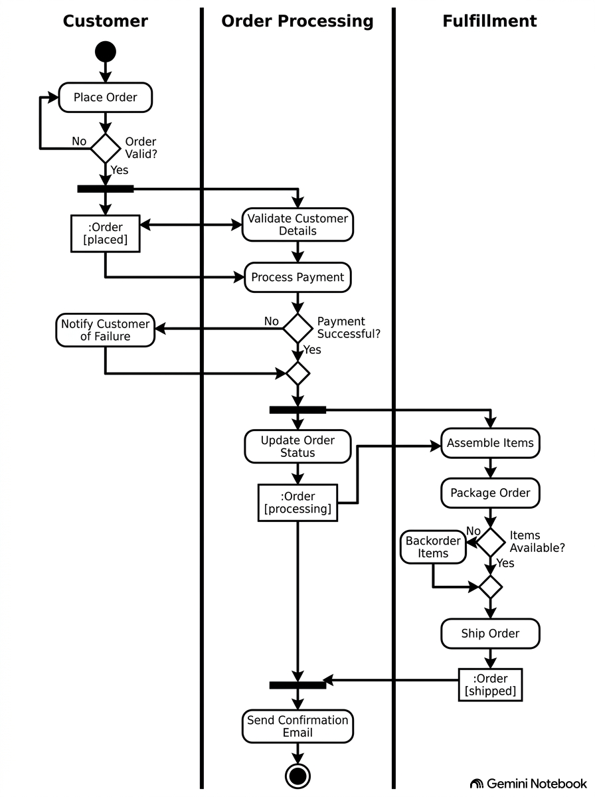

# Pemodelan Alur Kerja Bisnis & Activity Diagram

---

## 1. Pengantar dan Konsep Dasar Activity Diagram

Dalam pengembangan sistem berorientasi objek (_Object-Oriented Analysis and Design_ / OOAD), pemodelan sistem tidak hanya berfokus pada struktur statis (seperti entitas data dan kelas), tetapi juga pada dinamika perilaku (_behavioral dynamics_) dan alur kerja (_workflows_). **Activity Diagram** merupakan salah satu dari diagram perilaku utama dalam _Unified Modeling Language_ (UML) yang dirancang untuk menggambarkan alur kontrol (_control flow_) dan alur data (_data flow_) dari suatu proses, algoritma, atau alur kerja bisnis (_business workflow_).

Secara konseptual dan sejarah metodologis, Activity Diagram diposisikan sebagai bentuk khusus dari _Statechart Diagram_ (diagram mesin status) di mana status-statusnya mewakili tindakan (_actions_), dan transisi antar tindakan dipicu secara otomatis begitu suatu tindakan selesai dilakukan. 

### Peran Activity Diagram dalam Disiplin Pemodelan Bisnis (_Business Modeling_)

Dalam kerangka kerja _Unified Process_ (UP) maupun _Rational Unified Process_ (RUP), pemodelan bisnis (_Business Modeling_) bertujuan untuk memahami dan mengomunikasikan struktur serta dinamika organisasi tempat sistem perangkat lunak akan dideploy. Activity Diagram menjadi instrumen utama dalam tahapan ini untuk:

1. **Memodelkan alur kerja bisnis lintas fungsi (_cross-functional business process_)** yang melibatkan banyak aktor, unit organisasi, dan sistem pendukung.
2. **Memodelkan rincian skenario _Use Case_** untuk menggambarkan tahapan-tahapan aksi secara lebih terstruktur dibandingkan deskripsi teks naratif biasa.
3. **Memodelkan logika komputasi atau algoritma kompleks** pada tingkat detail metode di dalam kelas.

### Komparasi: Activity Diagram vs. Flowchart Konvensional

Meskipun secara visual tampak mirip dengan bagat alir (_flowchart_) tradisional, Activity Diagram memiliki keunggulan semantik yang jauh lebih kaya dan formal:

- **Dukungan Konkurensi Paralel (_True Concurrency_)**: Flowchart bersifat sekuensial tunggal, sedangkan Activity Diagram mampu memodelkan beberapa alur eksekusi yang berjalan secara bersamaan (paralel) menggunakan notasi _Fork_ dan _Join_.
- **Partisi / Swimlanes**: Activity Diagram mendefinisikan partisi tanggung jawab (_swimlanes_) secara formal untuk memperlihatkan siapa (aktor, departemen, atau sistem) yang mengeksekusi setiap tindakan.
- **Alur Objek (_Object Flow_)**: Selain mengalirkan kontrol eksekusi, Activity Diagram dapat memperlihatkan bagaimana objek atau data ditransformasikan dan berpindah antar aktivitas.
- **Dekomposisi Hirarkis**: Suatu tindakan dalam Activity Diagram dapat merujuk ke sub-aktivitas terpisah (_call behavior action_), memungkinkan pemodelan pada berbagai tingkat abstraksi.

---

## 2. Notasi dan Elemen Utama Activity Diagram

Notasi UML Activity Diagram terbagi menjadi empat kategori elemen utama: _Action Nodes_, _Control Nodes_, _Object Nodes_, dan _Activity Partitions / Swimlanes_.

### A. Action Nodes & Activity Nodes

- **Action (Tindakan)**: Unit perilaku elementer yang bersifat atomik dan tidak dapat dipecah lagi (_non-decomposable_). Digambarkan sebagai persegi panjang dengan sudut membulat (_rounded rectangle_).
- **Activity (Aktivitas)**: Kumpulan dari beberapa aksi atau alur tindakan yang lebih luas.
- **Call Behavior Action**: Tindakan yang memanggil aktivitas terpisah yang sudah didefinisikan sebelumnya. Notasinya ditandai dengan ikon garpu terbalik (_rake symbol_) di pojok kanan bawah.

### B. Control Nodes (Simpul Kontrol)

Simpul kontrol mengordinasikan alur kontrol eksekusi di dalam diagram:
 

#### Contoh

## C. Object Nodes & Object Flows

- **Object Node**: Mewakili entitas objek atau data yang diproduksi, dikonsumsi, atau ditransformasikan oleh suatu tindakan. Objek node bisa dilengkapi dengan status objek dalam kurung siku `[state]`.
- **Object Flow**: Garis putus-putus atau panah berarah yang menghubungkan tindakan dengan simpul objek untuk memperlihatkan perubahan status data.
- **Action Node**: Mewakili action/proses

### D. Activity Partitions / Swimlanes

- **Activity Partitions (Swimlanes)** membagi diagram menjadi kolom atau baris vertikal/horizontal.
- **Fungsi**: Memperjelas penetapan tanggung jawab (_responsibility assignment_) dengan menetapkan setiap tindakan ke dalam partisi milik aktor, unit organisasi, atau bagian sistem tertentu.
- **Titik Koordinasi Lintas Partisi**: Panah transisi yang menyeberangi garis partisi mengindikasikan adanya titik serah-terima (_handoff_) atau interaksi antar entitas bisnis.

---

## 3. Metodologi Pemodelan Alur Kerja Bisnis

Untuk membangun Activity Diagram yang akurat dan komunikatif dalam tahap analisis proses bisnis, ikuti tahapan metodologis berikut:

1. **Tentukan Fokus dan Batasan Proses Bisnis**: Identifikasi proses bisnis utama yang akan dimodelkan (misalnya: _Pemrosesan Pesanan_, _Klaim Asuransi_, atau _Pengajuan Pinjaman_) serta tentukan prakondisi (_preconditions_) dan pascakondisi (_postconditions_) proses.
2. **Identifikasi Entitas dan Aktor Penanggung Jawab**: Tentukan aktor bisnis, departemen, atau sistem internal yang terlibat, lalu buatlah kolom-kolom partisi (_swimlanes_) untuk setiap entitas tersebut.
3. **Petakan Alur Sekuensial Utama (_Main Success Scenario_)**: Identifikasi aksi-aksi utama dan susun urutan eksekusinya secara kronologis dari atas ke bawah atau dari kiri ke kanan di dalam partisi yang sesuai.
4. **Tambahkan Logika Percabangan (_Branching_)**: Identifikasi titik-titik pengambilan keputusan dan buat _Decision Node_ dengan _guard conditions_ yang bersifat mutually exclusive (_saling lepas_) dan collectively exhaustive (_mencakup seluruh kemungkinan_).
5. **Identifikasi Eksekusi Paralel (_Concurrency_)**: Cari tindakan-tindakan yang dapat dilakukan bersamaan tanpa saling menunggu, lalu gunakan _Fork Node_ untuk memisahkan alur dan _Join Node_ untuk menyatukannya kembali.
6. **Integrasikan Alur Objek (_Object Flow_) jika Relevan**: Jika terdapat dokumen atau data penting yang berubah status sepanjang proses, tambahkan _Object Node_ untuk memperjelas kondisi data tersebut.

---

## 4. Studi Kasus

### 4.1 Kasus: Incident Management Process

Gambar diagram aktivitas di bawah ini diambil dari studi kasus **Penanganan Insiden (_Incident Management System_)**. Activity Diagram ini menggambarkan alur kerja (_workflow_) penanganan insiden darurat, mulai dari pelaporan awal hingga pengarsipan dokumen. Diagram ini memodelkan eksekusi sekuensial, percabangan logika, serta konkurensi paralel antar dua entitas penanggung jawab.

#### Penjelasan dan Pembedahan Semantik Activity Diagram

##### 1. Partisi Responsibilitas (_Activity Partitions / Swimlanes_)

Diagram ini dibagi secara vertikal menjadi dua kolom partisi (_swimlanes_) untuk memperlihatkan pembagian tanggung jawab (_responsibility assignment_):

- **`Dispatcher`**: Mengontrol alur kerja utama di pusat kendali, mulai dari pembukaan insiden, evaluasi prioritas, notifikasi pejabat, alokasi sumber daya, hingga pengarsipan.
- **`FieldOfficer`**: Mengendalikan tindakan di lapangan, yaitu pendokumentasian insiden secara langsung oleh petugas lapangan (seperti polisi atau pemadam kebakaran).

##### 2. Rincian Elemen Notasi dan Alur Eksekusi

1. **Initial Node (Simpul Awal)**:
    - Dilambangkan dengan **lingkaran hitam padat** di bagian atas partisi `Dispatcher`, yang menandai titik mulai dimulainya eksekusi aktivitas penanganan insiden.
2. **Action Node (`Open Incident`)**:
    - Digambarkan sebagai **persegi panjang dengan sudut membulat**. Tindakan pertama yang dilakukan oleh `Dispatcher` adalah membuka laporan insiden ke dalam sistem.
3. **Decision Node & Guard Conditions (Simpul Keputusan)**:
    - Dilambangkan dengan **bentuk belah ketupat (_diamond_)**.
    - Alur eksekusi dievaluasi berdasarkan tiga kondisi penjaga (_guard conditions_) yang bersifat saling lepas (_mutually exclusive_):
        - **`[fire & highPriority]`**: Jika insiden merupakan kebakaran berprioritas tinggi, alur mengarah ke aksi **`Notify Fire Chief`**.
        - **`[not fire & highPriority]`**: Jika insiden berprioritas tinggi namun bukan kebakaran, alur mengarah ke aksi **`Notify Police Chief`**.
        - **`[lowPriority]`**: Jika insiden berprioritas rendah, notifikasi ke atasan dilewati dan alur langsung menuju alokasi sumber daya.
4. **Fork Node (Batang Percabangan Paralel)**:
    - Dilambangkan dengan **batang garis tebal horizontal (_synchronization bar_)**.
    - Menerima satu alur masuk setelah tahap notifikasi/evaluasi selesai, lalu memecahnya menjadi tiga alur eksekusi paralel (_concurrent threads_) yang berjalan secara bersamaan:
        - **`Allocate Resources`** (diekskusi oleh `Dispatcher`).
        - **`Coordinate Resources`** (diekskusi oleh `Dispatcher`).
        - **`Document Incident`** (diekskusi secara independen oleh `FieldOfficer` di lapangan).
5. **Join Node (Batang Sinkronisasi Paralel)**:
    - Dilambangkan dengan **batang garis tebal horizontal kedua**.
    - Bertindak sebagai titik sinkronisasi. Alur eksekusi berikutnya tidak akan berjalan sebelum **ketiga** alur paralel di atas selesai dieksekusi.
6. **Action Node (`Archive Incident`) & Activity Final Node**:
    - Setelah seluruh tindakan alokasi, koordinasi, dan dokumentasi selesai (_Join_), `Dispatcher` melakukan pengarsipan insiden (**`Archive Incident`**).
    - Eksekusi diakhiri pada **Activity Final Node** yang dilambangkan dengan **simbol _bull's eye_ (lingkaran hitam di dalam lingkaran putih)**.

---

### 4.2 Sistem Pengajuan Cuti Karyawan

---

## 5. _Best Practices_

Dalam menyusun Activity Diagram ada beberapa kaidah-kaidah yang penting untuk kita perhatikan:

- **Kejelasan Titik Awal dan Titik Akhir (Initial & Final Nodes)**
	- Setiap diagram aktivitas yang lengkap dan valid wajib memiliki titik awal (start point) dan titik akhir (end point) yang didefinisikan secara eksplisit untuk menjaga kejelasan batasan eksekusi proses
- **Prinsip Mutually Exclusive pada Guard Conditions**:
    - Kondisi pada setiap alur keluar dari _Decision Node_ harus saling lepas (_mutually exclusive_) dan mencakup seluruh kemungkinan (_collectively exhaustive_). Gunakan kondisi `[else]` untuk menangani kondisi yang tersisa.
- **Keseimbangan Fork dan Join**:
    - Setiap _Fork Node_ yang memecah alur menjadi $N$ alur paralel harus dipasangkan dengan _Join Node_ yang sesuai untuk memastikan seluruh thread sinkron sebelum proses berlanjut.
- **Penggunaan Swimlanes yang Jelas**:
    - Pastikan setiap tindakan diletakkan dalam _swimlane_ entitas yang benar-benar mengeksekusinya, sehingga titik serah-terima (_handoff_) antar aktor atau sistem terlihat eksplisit.
- **Hindari Detail Teknis Berlebihan pada Pemodelan Bisnis**:
    - Pada tahap analisis bisnis, fokuslah pada alur kerja tingkat tinggi dan hindari memasukkan detail implementasi bahasa pemrograman atau kueri basis data

---

## 🎓 Diskusi & Tugas

### Soal 1: Pemodelan Registrasi Mata Kuliah Online (Tingkat Dasar — Branching & Decision)

#### Deskripsi Kasus

Pada awal semester, mahasiswa melakukan KRS Online. Proses dimulai saat mahasiswa melakukan _login_ ke portal akademik. Sistem kemudian memvalidasi hak akses mahasiswa. Jika _login_ gagal, sistem menampilkan pesan kesalahan dan mengembalikan mahasiswa ke halaman _login_. Jika _login_ berhasil, mahasiswa memilih menu "Pengisian KRS".

Sistem akan memeriksa status pembayaran UKT mahasiswa:

- Jika UKT **belum lunas**, sistem menampilkan notifikasi penangguhan dan proses pengisian KRS dihentikan.
- Jika UKT **sudah lunas**, sistem menampilkan daftar mata kuliah yang dapat diambil.

Mahasiswa memilih mata kuliah yang diinginkan dan menekan tombol "Simpan". Sistem memvalidasi apakah kuota kelas dan prasyarat mata kuliah terpenuhi:

- Jika prasyarat/kuota **tidak memenuhi**, sistem meminta mahasiswa memilih ulang mata kuliah.
- Jika **memenuhi**, sistem menyimpan data KRS dan mencetak bukti KRS sementara. Proses selesai.

#### Instruksi Soal

1. Identifikasi _Initial Node_, _Action Nodes_, _Decision Nodes_, _Merge Nodes_, dan _Final Node_.
2. Pastikan setiap kondisi penjaga (_guard condition_) pada _Decision Node_ bersifat _mutually exclusive_ dan _collectively exhaustive_.
3. Gambarkan Activity Diagram yang memodelkan alur kerja di atas.

---

### Soal 2: Pemodelan Pengajuan & Approval Cuti Pegawai (Tingkat Menengah — Swimlanes & Concurrency)

#### Deskripsi Kasus

Sebuah perusahaan memodelkan alur kerja pengajuan cuti tahunan yang melibatkan tiga entitas: **Pegawai**, **Manajer HRD**, dan **Atasan Langsung**.

1. **Pegawai** mengisi formulir pengajuan cuti dan mengirimkannya melalui sistem HRM.
2. Setelah formulir dikirim, sistem memicu eksekusi **paralel** (_Fork_):
    - **Manajer HRD** memeriksa sisa kuota cuti tahunan pegawai.
    - **Atasan Langsung** memeriksa jadwal operasional tim untuk memastikan ketersediaan personel.
3. Setelah **kedua** pemeriksaan tersebut selesai (_Join_), **Atasan Langsung** membuat keputusan persetujuan:
    - Jika **ditolak**, sistem mengirimkan notifikasi penolakan ke Pegawai dan alur berakhir.
    - Jika **disetujui**, **Manajer HRD** mencatat pengurangan kuota cuti pegawai dan **Sistem HRM** secara otomatis menerbitkan Surat Izin Cuti digital serta memperbarui kalender kerja.
4. **Pegawai** menerima dokumen Surat Izin Cuti dan proses selesai.

#### Instruksi Soal

1. Buatlah _Activity Partitions_ (_Swimlanes_) untuk memisahkan tanggung jawab masing-masing entitas.
2. Gunakan notasi _Fork Node_ dan _Join Node_ secara tepat untuk memodelkan proses verifikasi yang berlangsung serentak (_concurrent_).
3. Gambarkan Activity Diagram yang memenuhi kriteria di atas.

---

### Soal 3: Pemodelan Transaksi E-Commerce & Logistik (Tingkat Lanjut — Object Flow & Exception Handling)

#### Deskripsi Kasus

Sebuah platform _e-commerce_ memodelkan transaksi pembelian barang yang melibatkan alur data objek (_Object Flow_):

1. **Pelanggan** memilih produk dan melakukan _Checkout_, sehingga menghasilkan objek `:Pesanan [status: Dibuat]`.
2. **Sistem E-Commerce** meminta otorisasi pembayaran ke **Payment Gateway**.
3. **Payment Gateway** memproses pembayaran pelanggan:
    - Jika **gagal** (misal: saldo tidak cukup atau _timeout_), sistem mengubah status objek menjadi `:Pesanan [status: Dibatalkan]`, mengirim notifikasi kegagalan ke pelanggan, dan alur berhenti.
    - Jika **berhasil**, status objek berubah menjadi `:Pesanan [status: Terbayar]`.
4. Setelah pembayaran berhasil, alur terpecah dua (_Fork_):
    - **Sistem E-Commerce** mencetak kuitansi pembayaran digital dan mengirimkannya via e-mail ke pelanggan.
    - **Staf Gudang** mengambil barang, mengemasnya, dan memperbarui status menjadi `:Pesanan [status: Dikemas]`.
5. Setelah pengemasan dan pencetakan kuitansi selesai (_Join_), **Kurir Logistik** mengambil paket dan mengantarkannya ke alamat pelanggan.
6. Status objek diperbarui menjadi `:Pesanan [status: Diterima]` setelah **Pelanggan** menandatangani resi penerimaan. Proses selesai.

#### Instruksi Soal

1. Buatlah Activity Diagram lengkap dengan _Swimlanes_ untuk **Pelanggan**, **Sistem E-Commerce**, **Payment Gateway**, **Gudang**, dan **Kurir**.
2. Sertakan _Object Nodes_ (`:Pesanan`) yang memperlihatkan transisi status objek (_state transition_) sepanjang alur proses.
3. Petakan kondisi pengecualian (_exception/failure flow_) pada proses pembayaran.

---

### Soal 4: **Studi Kasus Proses Transaksi Servis Motor di Bengkel**

Proses transaksi servis motor dimulai saat pelanggan datang ke bengkel dan mendaftarkan kendaraannya di meja penerimaan. Petugas penerima mencatat data pelanggan, identitas sepeda motor, serta keluhan atau jenis layanan yang diinginkan ke dalam sistem, lalu mencetak formulir perintah kerja.

Petugas penerima menyerahkan formulir perintah kerja tersebut kepada mekanik. Mekanik kemudian membawa sepeda motor ke area pengerjaan dan melakukan pemeriksaan awal. Pada tahap ini, terdapat kondisi pengecekan kondisi kendaraan.

Jika mekanik menemukan adanya kerusakan tambahan di luar keluhan awal yang memerlukan penggantian suku cadang, mekanik menginformasikannya kepada petugas penerima. Petugas penerima lalu menghubungi pelanggan untuk meminta persetujuan estimasi biaya dan tindakan perbaikan tambahan. Apabila pelanggan menolak, mekanik hanya mengerjakan servis sesuai kesepakatan awal. Sebaliknya, jika pelanggan menyetujui, daftar perbaikan tambahan langsung dimasukkan ke dalam rincian pengerjaan.

Setelah rencana perbaikan dipastikan, proses berlanjut ke dua aktivitas yang berjalan secara bersamaan. Aktivitas pertama adalah mekanik melakukan tindakan servis dan perbaikan pada motor. Aktivitas kedua adalah petugas bagian suku cadang mengambil komponen yang dibutuhkan dari gudang dan menginput rincian barang tersebut ke dalam sistem tagihan.

Kedua aktivitas paralel tersebut bertemu kembali setelah mekanik selesai memperbaiki motor serta melakukan uji coba kelayakan, dan petugas suku cadang telah menyelesaikan pencatatan komponen. Mekanik menyerahkan motor ke area penyerahan dan memberikan berkas pengerjaan yang sudah selesai ke meja kasir.

Kasir mencetak struk tagihan akhir yang mencakup biaya jasa dan harga suku cadang. Pelanggan dipanggil menuju kasir untuk melakukan pembayaran secara tunai atau non-tunai. Setelah pembayaran berhasil diverifikasi, kasir menyerahkan kuitansi pembayaran beserta kunci motor. Pelanggan mengambil sepeda motor dan meninggalkan lokasi bengkel, menandai seluruh rangkaian transaksi servis telah selesai.

#### Instruksi Soal

1. Buatlah Activity Diagram lengkap dengan _Swimlane_

---
### Soal 5: Analisa Activity Diagram

Analisa activity diagram berikut.

#### Instruksi Soal
1. cari apa yang menjadi kesalahan dari activity diagram di atas

---
---
