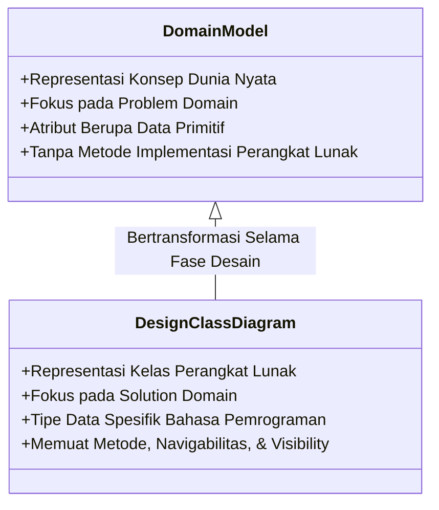

# Domain Model & Activity Diagram
---

## 1. Pendahuluan: Conceptual Modeling

Dalam tahapan **Object-Oriented Analysis (OOA)**, fokus utama pengembang adalah memahami dan memodelkan masalah bisnis atau ranah aplikasi (problem domain) dari sudut pandang entitas nyata, tanpa terdistraksi oleh rincian implementasi perangkat lunak seperti basis data, antarmuka pengguna, atau manajemen memori.

**Model Domain** (sering disebut juga sebagai _Conceptual Model_ atau _Analysis Object Model_) adalah representasi visual dari kelas-kelas konseptual atau objek-objek dunia nyata dalam ranah perhatian tertentu. Model ini berfungsi sebagai kamus visual yang mendefinisikan kosa kata, abstraksi, dan relasi yang dipahami oleh pakar domain dan pengguna sistem.



### Perbedaan Utama: Domain Model vs. Design Class Diagram (DCD)

Memahami batas antara lapis analisis dan lapis desain sangat krusial untuk mencegah pemodelan yang prematur (_premature design_):

- **Domain Model:**
    - Memodelkan **hal-hal riil di dunia nyata** (misalnya `Penjualan`, `Pelanggan`, `Kasir`, `Barang`).
    - Hanya memuat **atribut berorientasi data murni** (tipe data primitif seperti angka, teks, tanggal).
    - **TIDAK mencantumkan metode perangkat lunak** (seperti _getter/setter_, `print()`, atau `saveToDatabase()`).
    - Arah panah navigabilitas dan visibilitas perangkat lunak umumnya diabaikan.

- **Design Class Diagram / DCD:** 
    - Memodelkan **komponen perangkat lunak** dan pustaka solusi (seperti `DatabaseAdapter`, `SaleWindow`, `Controller`).
    - Menypesifikasikan **tipe data spesifik bahasa pemrograman** (misal `java.util.Date`, `ArrayList<Item>`).
    - Mencantumkan **metode, parameter, tipe kembalian, visibilitas (`+`, `-`, `#`), dan navigabilitas terarah**.

### Anatomi Class

Secara formal, sebuah **kelas konseptual** dapat dipahami melalui tiga dimensi utama:

1. **Symbol (Simbol):** Nama atau label yang mewakili konsep tersebut (contoh: `Sale` atau `Penjualan`).
2. **Intension (Intensi):** Definisi, makna, dan batas atribut dari konsep tersebut (contoh: _"Penjualan mewakili kejadian transaksi pembelian yang memiliki tanggal dan waktu"_).
3. **Extension (Ekstensi):** Himpunan seluruh contoh spesifik (_instances_) atau objek konkret yang termasuk dalam konsep tersebut di dunia nyata (contoh: transaksi penjualan `sale-1`, `sale-2`, dst.).

---

## 2. Strategi Mengidentifikasi Kelas Konseptual

Untuk mengidentifikasi kelas konseptual yang relevan dari skenario penggunaan (_use case_) atau dokumen kebutuhan, pengembang dapat menerapkan dua teknik analisis utama:

### A. Analisis Frasa Kata Benda (Noun Phrase Identification)

Dalam skenario _use case_ atau teks deskripsi sistem, kata benda (_nouns_) dan frasa kata benda (_noun phrases_) cenderung merepresentasikan kelas konseptual atau atribut.

- **Kata benda murni/kompleks:** Berpotensi menjadi **Kelas Konseptual** (misalnya `Pelanggan`, `Transaksi`, `Faktur`, `Laporan`).
- **Kata benda sederhana/nilai atribut:** Berpotensi menjadi **Atribut** dari kelas (misalnya `namaPelanggan`, `tanggalTransaksi`, `totalHarga`).
- **Frasa kata kerja (verb phrases):** Berpotensi menjadi **Asosiasi** atau relasi antar kelas.

### B. Daftar Kategori Kelas Konseptual (Conceptual Class Category List)

Pengembang juga dapat memindai domain masalah menggunakan daftar kategori standar untuk memastikan tidak ada entitas penting yang terlewat:

|Kategori Kelas Konseptual|Contoh Ranah Retail / POS|Contoh Ranah Penerbangan / Rumah Sakit|
|:--|:--|:--|
|**Benda Fisik / Tangible Objects**|`MesinKasir`, `Barang`|`Pesawat`, `PeralatanMedis`|
|**Spesifikasi / Deskripsi Benda**|`SpesifikasiProduk`|`DeskripsiPenerbangan`|
|**Lokasi / Tempat (Places)**|`Toko`, `Gudang`|`Bandara`, `KamarRawat`|
|**Transaksi (Transactions)**|`Penjualan`, `Pembayaran`|`Reservasi`, `TindakanMedis`|
|**Rincian Transaksi (Line Items)**|`ItemPenjualan`|`RincianReservasi`|
|**Peran Manusia (Roles of People)**|`Kasir`, `Pelanggan`|`Pilot`, `Dokter`, `Pasien`|
|**Wadah (Containers)**|`Toko`, `Rak`|`Pesawat`, `Bangsal`|
|**Sistem Eksternal**|`SistemOtorisasiKredit`|`SistemSITA`, `SistemBPJS`|

### Aturan Penetapan Atribut pada Lapis Analisis

Dalam model domain, atribut harus dipatuhkannya aturan keterbatasan berikut:

- **Gunakan Tipe Data Sederhana/Primitif:** Atribut harus berupa angka (_number_), string (_text_), tanggal (_date_), atau nilai boolean.
- **Jangan Jadikan Kelas Kompleks Sebagai Atribut:** Jika sebuah konsep merupakan entitas kompleks yang memiliki atribut tersendiri di dunia nyata, **hubungkan melalui Asosiasi**, bukan dijadikan tipe atribut internal kelas lain. Contoh: `TujuanPenerbangan` bukanlah atribut string pada kelas `Penerbangan`, melainkan relasi asosiasi ke kelas `Bandara`.

---

## 3. Konsep Relasi Antar Kelas (Class Relationships)

Di dalam diagram kelas lapis analisis, hubungan keterkaitkan antar entitas dimodelkan menggunakan konsep relasi struktural. Terdapat empat jenis relasi utama: **Asosiasi**, **Agregasi**, **Komposisi**, dan **Generalisasi/Spesialisasi**.

```
classDiagram
    class RelasiUML {
        <<Abstract>>
    }
    class Asosiasi {
        +Hubungan Struktural Umum
        +Garis Polos Tanpa Diamond
    }
    class Agregasi {
        +Hubungan Whole-Part Lemah
        +Belah Ketupat Kosong (Hollow Diamond)
    }
    class Komposisi {
        +Hubungan Whole-Part Kuat
        +Belah Ketupat Isi (Filled Diamond)
    }
    class Generalisasi {
        +Hubungan Subtipe / Inheritance ("Is-A")
        +Garis dengan Segitiga Kosong
    }

    RelasiUML <|-- Asosiasi
    RelasiUML <|-- Agregasi
    RelasiUML <|-- Komposisi
    RelasiUML <|-- Generalisasi
```

---

### 3.1. Asosiasi (Association)

**Asosiasi** adalah hubungan struktural yang menggambarkan keterikatan semantik antara dua kelas atau lebih. Asosiasi menunjukkan bahwa terjadi hubungan logis yang perlu direkam atau diingat oleh sistem dalam jangka waktu tertentu (_need-to-know relationship_).

#### Komponen Utama Asosiasi:

1. **Nama Asosiasi (Association Name):** Diberi kata kerja yang menjelaskan makna hubungan, diawali dengan huruf kapital dan dapat dilengkapi panah penunjuk arah baca (contoh: `Dicatat-pada >`).
2. **Peran (Role Name):** Menjelaskan fungsi spesifik suatu kelas dalam konteks relasi tersebut (contoh: kelas `Kasir` berperan sebagai `pencatat` pada relasi penjualan).
3. **Kardinalitas / Multiplisitas (Multiplicity):** Menentukan berapa banyak instansi dari satu kelas yang dapat terhubung dengan satu instansi kelas lainnya.

|Notasi Multiplisitas|Makna Kuantitas|
|:--|:--|
|`1`|Tepat satu instansi|
|`0..1`|Nol atau satu instansi (opsional)|
|`*` atau `0..*`|Nol atau banyak instansi|
|`1..*`|Satu atau banyak instansi (minimal satu)|
|`m..n`|Antara \(m\) hingga \(n\) instansi spesifik|

#### Prinsip _Need-to-Know_ vs. _Comprehension_

Saat membuat model domain, sertakan asosiasi yang wajib diingat oleh sistem untuk memenuhi kebutuhan informasi (_need-to-know_). Hindari menambahkan seluruh relasi yang mungkin terjadi secara berlebihan (_visual noise_). Namun, asosiasi yang memperjelas pemahaman ranah bisnis secara signifikan (_comprehension_) tetap diperbolehkan.

---

### 3.2. Agregasi (Shared Aggregation)

**Agregasi** (sering disebut _shared aggregation_) adalah bentuk khusus dari asosiasi yang menyatakan hubungan **keseluruhan-bagian (_whole-part_)** atau _"has-a"_.

#### Karakteristik Agregasi:

- **Sifat Hubungan:** Lemah (_weak assembly_).
- **Ketergantungan Siklus Hidup:** **Independen**. Bagian (_part_) dapat berdiri sendiri dan tetap eksis meskipun keseluruhan (_whole_) dihapus atau dihancurkan.
- **Kepemilikan:** Bagian (_part_) dapat dimiliki atau menjadi bagian dari beberapa entitas _whole_ lain secara bersamaan (_shared_).
- **Notasi UML:** Garis dengan **belah ketupat kosong (hollow diamond)** pada ujung kelas keseluruhan (_whole_).

> **Contoh Dunia Nyata:** Relasi antara `Fakultas` dan `Dosen`, atau `Klub` dan `Anggota`. Jika entitas `Klub` dibubarkan, entitas `Anggota` (mahasiswa/orang) tidak ikut hancur dan tetap ada di dalam sistem.

---

### 3.3. Komposisi (Composite Aggregation)

**Komposisi** adalah bentuk agregasi yang sangat kuat (_strong whole-part relationship_) di mana entitas bagian (_part_) secara eksklusif dimiliki oleh entitas keseluruhan (_composite/whole_).

#### Karakteristik Komposisi:

- **Sifat Hubungan:** Sangat kuat (_strong containment_).
- **Ketergantungan Siklus Hidup (_Create-Delete Dependency_):** **Dependen**. Keberadaan bagian (_part_) terikat penuh pada siklus hidup _composite_. Jika entitas _composite_ dihapus, maka seluruh entitas _part_ di dalamnya ikut terhapus secara otomatis (_cascading delete_).
- **Kepemilikan Eksklusif:** Suatu instansi _part_ hanya boleh menjadi anggota dari **tepat satu** objek _composite_ pada satu waktu (multiplisitas pada sisi _whole_ harus `1` atau `0..1`).
- **Notasi UML:** Garis dengan **belah ketupat hitam penuh (filled diamond)** pada ujung kelas _composite_.

> **Contoh Dunia Nyata:** Relasi antara `Penjualan` (_Sale_) dan `RincianPenjualan` (_SalesLineItem_), atau `Rumah` dan `Kamar`. Rincian barang belanjaan tidak memiliki arti dan tidak dapat berdiri sendiri tanpa adanya transaksi `Penjualan` induknya.

#### Tabel Perbandingan: Agregasi vs. Komposisi

|Dimensi Evaluasi|Agregasi (Shared Aggregation)|Komposisi (Composite Aggregation)|
|:--|:--|:--|
|**Kekuatan Ikatan**|Lemah (_Weak Part-Whole_)|Sangat Kuat (_Strong Ownership_)|
|**Notasi UML**|Belah Ketupat Kosong (\(\diamond\))|Belah Ketupat Hitam Penuh (\(\blackdiamond\))|
|**Siklus Hidup Part**|Independen dari _Whole_|Terikat (_Create-Delete Dependency_) pada _Whole_|
|**Kepemilikan Part**|Boleh dibagikan (_Shared_) ke _Whole_ lain|Eksklusif untuk 1 _Composite_ pada satu waktu|
|**Multiplisitas Sisi Whole**|Boleh `*`, `1..*`, atau `0..1`|Wajib `1` atau `0..1`|

---

### 3.4. Generalisasi dan Spesialisasi (Generalization / Inheritance)

**Generalisasi** adalah relasi taksonomi antara konsep yang lebih umum (_superclass_) dan konsep yang lebih spesifik (_subclass_). Relasi ini mencerminkan konsep pewarisan (_inheritance_) dan hubungan **"Is-A"**.

```
classDiagram
    class Pembayaran {
        +jumlah: Double
        +tanggal: Date
    }
    class PembayaranTunai {
        +uangDiterima: Double
    }
    class PembayaranKredit {
        +nomorKartu: String
        +kodeOtorisasi: String
    }
    Pembayaran <|-- PembayaranTunai
    Pembayaran <|-- PembayaranKredit
```

#### Aturan Pengujian Subkelas yang Valid:

Saat membuat tingkatan generalisasi dalam model domain, gunakan dua kriteria uji berikut:

1. **Aturan 100% (100% Rule):** Subkelas harus mewarisi dan mematuhi 100% atribut dan asosiasi yang didefinisikan pada superkelasnya.
2. **Aturan Is-A (Is-A Rule):** Pernyataan natural _"Subkelas adalah Superkelas"_ harus bernilai benar dan logis secara domain bisnis. (Contoh: _"PembayaranKredit adalah Pembayaran"_ bernilai benar).

#### Notasi UML:

Digambarkan dengan garis lurus berujung **panah segitiga kosong tertutup (solid line with hollow arrowhead)** yang menunjuk dari subkelas ke superkelas.

---

### 3.5. Kelas Asosiasi (Association Class)

**Kelas Asosiasi** adalah elemen pemodelan yang memiliki sifat ganda: berfungsi sebagai relasi asosiasi sekaligus memiliki properti sebagai kelas konseptual.

#### Kapan Kelas Asosiasi Dibutuhkan?

1. Terdapat atribut yang melekat secara langsung pada **hubungan** itu sendiri, bukan pada salah satu kelas yang berhubungan.
2. Hubungan bersifat **banyak-ke-banyak (_many-to-many_)** dan membawa informasi riwayat atau transaksi.
3. Instansi dari kelas asosiasi memiliki siklus hidup yang bergantung pada keberadaan hubungan tersebut.

> **Contoh:** Relasi antara `Mahasiswa` dan `MataKuliah` yang memiliki asosiasi _banyak-ke-banyak_. Atribut `nilaiAkhir` atau `indeksPrestasi` tidak bisa diletakkan di kelas `Mahasiswa` saja (karena mahasiswa punya banyak nilai) dan tidak bisa diletakkan di `MataKuliah` saja. Oleh karena itu, dibuat kelas asosiasi `KRS` atau `Pendaftaran` yang menyimpan `nilaiAkhir`.

#### Notasi UML:

Digambarkan sebagai kotak kelas terpisah yang dihubungkan dengan **garis putus-putus** ke garis asosiasi utama.

---

## 4. Contoh Studi Kasus Sintaksis Diagram Kelas Lapis Analisis (Mermaid.js)

Berikut adalah diagram kelas lapis analisis terintegrasi untuk **Sistem Kasir Penjualan (NextGen Point of Sale)** yang menggabungkan seluruh konsep relasi (Asosiasi, Agregasi, Komposisi, Generalisasi, dan Kelas Asosiasi) dalam format `mermaid.js`:

```
classDiagram
    %% Tinjauan Kelas Konseptual Lapis Analisis (Domain Model)

    class Toko {
        +nama: String
        +alamat: String
    }

    class MesinKasir {
        +nomorSeri: String
    }

    class KatalogProduk {
        +namaKatalog: String
    }

    class SpesifikasiProduk {
        +itemID: String
        +harga: Double
        +deskripsi: String
    }

    class Penjualan {
        +tanggal: Date
        +waktu: Time
        +status: String
    }

    class RincianPenjualan {
        +kuantitas: Integer
        +subtotal: Double
    }

    class Pembayaran {
        <<Abstract>>
        +jumlah: Double
    }

    class PembayaranTunai {
        +uangDiterima: Double
    }

    class PembayaranKredit {
        +nomorKartu: String
        +tipeKartu: String
        +kodeOtorisasi: String
    }

    class Pelanggan {
        +nama: String
        +nomorMember: String
    }

    class KontrakLayanan {
        +idKontrak: String
        +tanggalMulai: Date
    }

    %% Definisi Relasi Struktural Lapis Analisis

    %% 1. Agregasi (Shared Aggregation): Toko memiliki MesinKasir & KatalogProduk
    Toko "1" o-- "1..*" MesinKasir : Memiliki
    Toko "1" o-- "1" KatalogProduk : Menggunakan

    %% 2. Komposisi (Composite Aggregation): KatalogProduk berisi SpesifikasiProduk
    KatalogProduk "1" *-- "1..*" SpesifikasiProduk : Memuat

    %% 3. Komposisi (Composite Aggregation): Penjualan memiliki RincianPenjualan (Create-Delete Dependency)
    Penjualan "1" *-- "1..*" RincianPenjualan : Terdiri-atas

    %% 4. Asosiasi Standar: RincianPenjualan mencatat SpesifikasiProduk
    RincianPenjualan "*" -- "1" SpesifikasiProduk : Mencatat-deskripsi-dari

    %% 5. Asosiasi Komposisi Pembayaran pada Penjualan
    Penjualan "1" *-- "1" Pembayaran : Dilunasi-dengan

    %% 6. Generalisasi (Inheritance): Subtipe Pembayaran
    Pembayaran <|-- PembayaranTunai
    Pembayaran <|-- PembayaranKredit

    %% 7. Asosiasi Biasa: Penjualan dicatat pada MesinKasir & diinisiasi oleh Pelanggan
    MesinKasir "1" -- "*" Penjualan : Mencatat
    Pelanggan "0..1" -- "*" Penjualan : Melakukan

    %% 8. Kelas Asosiasi (Association Class): KontrakLayanan antara Toko dan Pihak Bank/Penyedia Kredit
    (Toko, PembayaranKredit) .. KontrakLayanan
```

---

## 5. Rangkuman & Pedoman Praktis Pemodelan Lapis Analisis

1. **Jaga Abstraksi Lapis Analisis:** Jangan memasukkan metode perangkat lunak, visibilitas private/protected, atau tipe data spesifik bahasa pemrograman ke dalam Model Domain.
2. **Identifikasi Konsep Secara Objektif:** Gunakan teknik kata benda (_noun phrase_) dan daftar kategori kelas konseptual untuk menjaring calon kelas konseptual.
3. **Bedakan Komposisi dan Agregasi Secara Cermat:** Gunakan **Komposisi** hanya jika terdapat ketergantungan siklus hidup (_create-delete dependency_) dan kepemilikan eksklusif. Jika entitas bagian dapat berdiri sendiri atau dibagikan, gunakan **Agregasi** atau **Asosiasi** biasa.
4. **Terapkan Uji Generalisasi:** Pastikan subkelas memenuhi **Aturan 100%** dan **Aturan Is-A** secara konsisten terhadap superkelasnya.
5. **Gunakan Kelas Asosiasi Saat Perlu:** Jika sebuah atribut logis dimiliki oleh _hubungan banyak-ke-banyak_ itu sendiri, hasilkan Kelas Asosiasi alih-alih memaksakan atribut ke salah satu kelas induk.

---

💡 _Apakah Anda ingin melanjutkan pembahasan dengan latihan pembuatan Use Case Realization dan Communication Diagram berdasarkan Class Diagram Lapis Analisis ini?_