# Conceptual Modeling & Class Diagram

## 1. Class Diagram
### 1.1. Pengertian dan Peran Class Diagram dalam OOAD

**Class Diagram** (Diagram Kelas) merupakan jenis diagram struktural utama dalam **Unified Modeling Language (UML)**. Diagram ini menggambarkan struktur statis suatu sistem perangkat lunak dengan menampilkan kelas-kelas sistem, atribut, operasi (metode), serta hubungan (_relationships_) antar objek yang membentuk arsitektur sistem tersebut.

Dalam siklus pengembangan perangkat lunak berbasis objek (OOAD), **Class Diagram** memiliki peran krusial sebagai jembatan antara analisis kebutuhan domain (_domain model_) dan arsitektur kode program (_implementation model_). 

---

### 1.2. Anatomi dan Notasi Dasar Kelas (Class Structure)

Di dalam UML, sebuah kelas digambarkan dalam bentuk **kotak persegi panjang yang terbagi menjadi tiga kompartemen utama**:

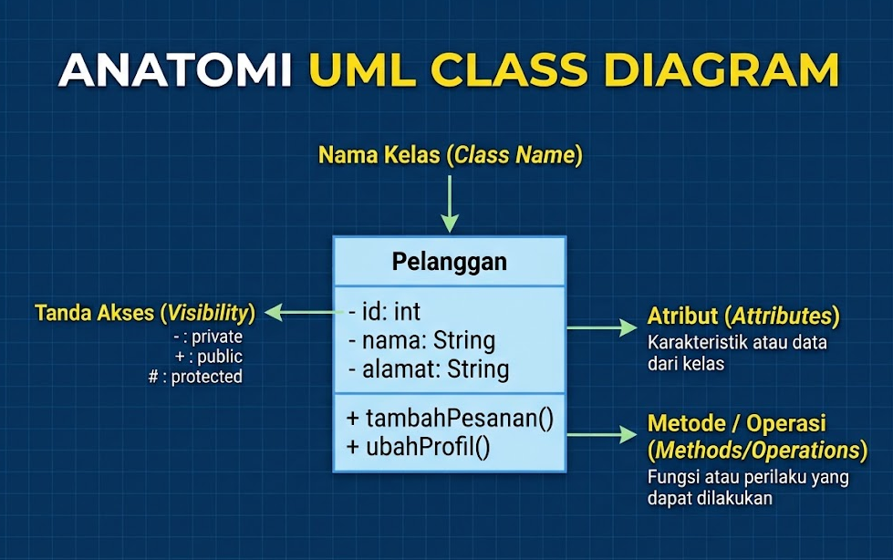

1. **Kompartemen Nama Kelas (_Class Name_)**
	- Terletak di kompartemen paling atas.
	- Nama kelas berupa **kata benda tunggal (_singular noun_)**, diawali dengan huruf kapital (**PascalCase**), dan dicetak tebal di posisi tengah.
	- Apabila kelas bersifat **Abstrak (_Abstract Class_)**, nama kelas ditulis dengan huruf miring (_italic_) atau ditambahi penanda katakunci `{abstract}`.
2. Kompartemen Atribut (_Attributes_)
	- Terletak di kompartemen tengah.
	- Atribut merepresentasikan **keadaan (_state_) atau properti data** yang disimpan oleh setiap objek dari kelas tersebut.
3. Kompartemen Operasi / Metode (_Operations_)
	- Terletak di kompartemen bawah.
	- Operasi merepresentasikan **perilaku (_behavior_) atau fungsi/layanan** yang dapat dieksekusi oleh kelas untuk memanipulasi data.

#### Indikator Visibilitas (_Visibility Modifiers_)

Visibilitas mengatur tingkat aksesibilitas anggota kelas (atribut dan operasi) dari luar kelas tersebut:

|Simbol|Tingkat Visibilitas|Keterangan Aksesibilitas|
|:-:|:-:|:--|
|**`+`**|**Public**|Anggota dapat diakses oleh semua kelas lain secara bebas.|
|**`-`**|**Private**|Anggota disembunyikan dan hanya dapat diakses dari dalam kelas itu sendiri (**Enkapsulasi**).|
|**`#`**|**Protected**|Anggota dapat diakses oleh kelas itu sendiri dan seluruh subkelas turunannya (_inheritance_).|
|**`~`**|**Package**|Anggota dapat diakses oleh seluruh kelas yang berada dalam satu paket (_package_) yang sama.|

#### Abstraksi Khusus: Abstract Class & Interface

- **Kelas Abstrak (_Abstract Class_)**: Kelas yang tidak dapat diinstansiasi secara langsung menjadi objek dan berfungsi sebagai cetak biru bagi subkelasnya. Metode abstrak juga ditulis dalam format huruf miring (_italic_) atau dengan _tag_ `{abstract}`.
- **Antarmuka (_Interface_)**: Abstraksi murni yang hanya mendeklarasikan sekumpulan operasi tanpa menyediakan implementasi kode. Diberi stereotipe `<<interface>>` di atas nama antarmuka.

---

### 1.3. Relasi Antar Kelas (Class Relationships)

Kelas-kelas di dalam sistem tidak berdiri sendiri, melainkan saling berkolaborasi melalui berbagai tipe relasi struktural dan fungsional.

```
┌────────────────────────────────────────────────────────────┐
│                  TIPE RELASI CLASS DIAGRAM                 │
├──────────────┬──────────────┬─────────────┬────────────────┤
│ Association  │ Aggregation  │ Composition │ Generalization │
│   ( ─── )    │   ( ──◇ )    │   ( ──◆ )   │    ( ───▷ )    │
└──────────────┴──────────────┴─────────────┴────────────────┘
```

#### A. Asosiasi (_Association_)

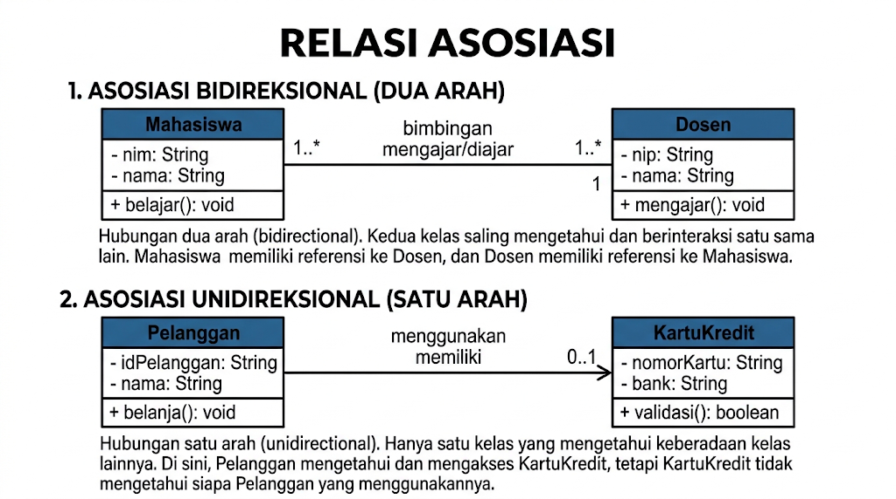

- **Definisi**: Menunjukkan hubungan struktural statis atau koneksi semantik antar instansi kelas yang berbeda.
- **Arah Navigasi (_Navigability_)**:
    - **Bidireksional**: Garis lurus tanpa panah, menandakan kedua kelas saling mengetahui eksistensi satu sama lain.
    - **Unidireksional**: Garis lurus berujung panah terbuka, menandakan hanya satu kelas yang menyimpan referensi ke kelas lainnya.
- **Multiplisitas (_Multiplicity_)**: Menyatakan rentang jumlah instansi yang terlibat dalam relasi:
    - `1` : Tepat satu instansi.
    - `0..1` : Nol atau satu instansi (opsional).
    - `*` atau `0..*` : Nol hingga banyak instansi.
    - `1..*` : Minimal satu hingga banyak instansi.
    - `m..n` : Rentang spesifik dari \(m\) hingga \(n\).
- **Kelas Asosiasi (_Association Class_)**: Digunakan ketika hubungan asosiasi antara dua kelas itu sendiri memiliki atribut atau operasi tambahan. Digambarkan dengan kotak kelas yang dihubungkan menggunakan garis putus-putus ke garis asosiasi utama.

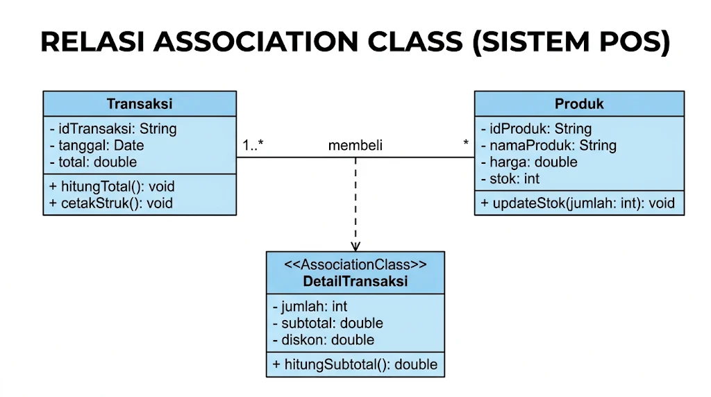
Kelas Asosiasi ini biasanya hanya digunakan dalam fase analisis. Ketika dikomunikasikan ke tim teknis, maka diagram tersebut biasanya dipecah menjadi relasi *one-to-many*.

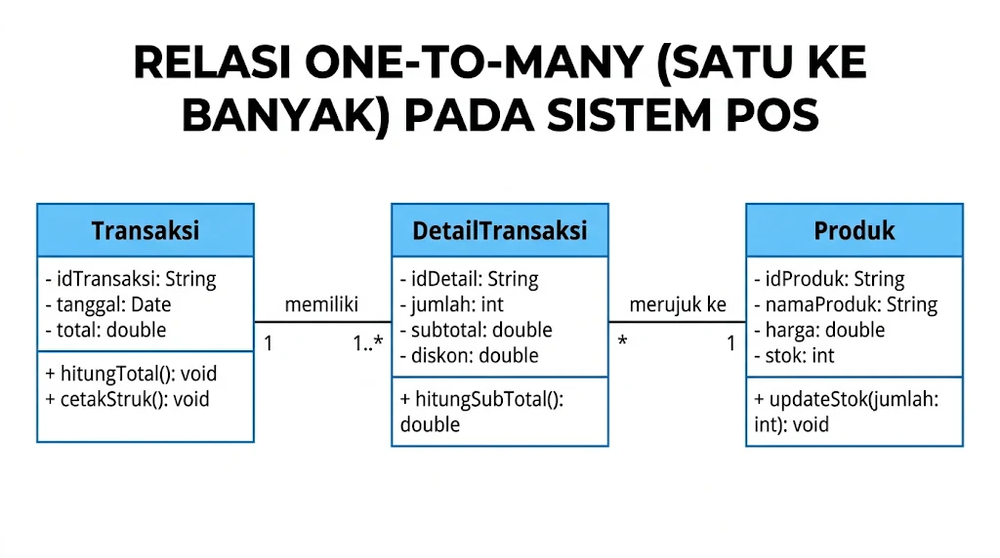

---

#### B. Agregasi (_Shared Aggregation_)

**Shared Aggregation (Agregasi)** adalah jenis relasi dalam class diagram UML yang menggambarkan hubungan bagian dari keseluruhan (_whole-part_) atau hubungan _"has-a"_ yang bersifat **lemah** (_weak relationship_).

Karakteristik utamanya meliputi:
- **Siklus Hidup Independen:** Objek bagian (_part_) tidak bergantung secara penuh pada objek keseluruhan (_whole_). Jika objek keseluruhan dihancurkan atau dihapus, objek bagian tetap ada (_exist_).
- **Dapat Berbagi (_Shared_):** Objek bagian dapat dihubungkan atau dimiliki oleh lebih dari satu objek keseluruhan secara bersamaan.
- **Notasi UML:** Digambarkan dengan garis lurus berujung **simbol belah ketupat / diamond kosong (`♢`)** di sisi kelas yang bertindak sebagai keseluruhan (_whole_).

**Contoh:** Relasi antara **Jurusan** ♢— **Dosen**. Jurusan memiliki dosen, namun jika sebuah jurusan dibubarkan, objek Dosen tidak ikut terhapus dan tetap dapat mengajar atau terhubung ke jurusan lainnya.
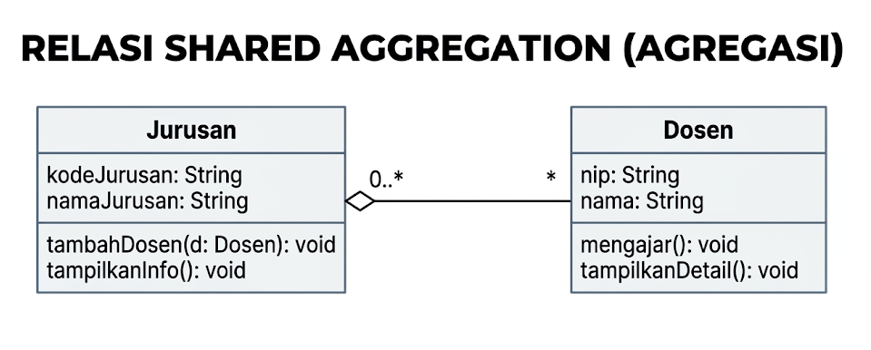

---

#### C. Komposisi (_Composite Aggregation_)

- **Definisi**: Bentuk agregasi yang bersifat **sangat kuat** (_strong ownership_) dan menyatakan hubungan bagian-keseluruhan yang erat.
- **Sifat Lifecycle**: Terdapat **ketergantungan eksistensi (_existential dependency_)**. Objek bagian (_part_) dimiliki secara eksklusif oleh satu objek induk (_whole_). **Jika objek induk dihapus, secara otomatis seluruh objek bagian di dalamnya akan ikut terhapus (_coincident lifetime_)**.
- **Notasi**: Garis lurus dengan belah ketupat terisi penuh (_filled diamond_) pada sisi kelas induk (_whole_).

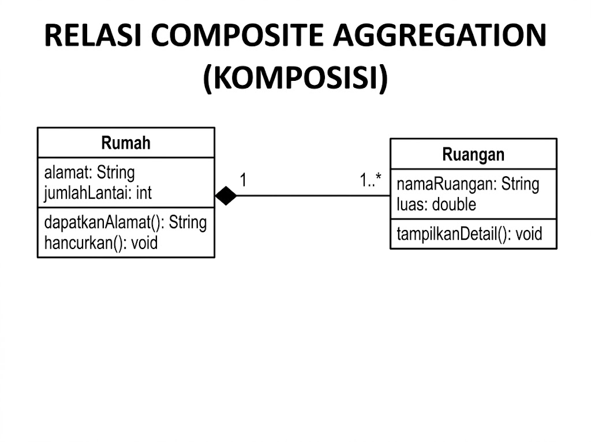

---

#### D. Generalisasi / Pewarisan (_Generalization / Inheritance_)

- **Definisi**: Hubungan hirarki klasifikasi yang menyatakan hubungan **"is-a"** antara kelas umum (_superclass_) dan kelas yang lebih spesifik (_subclass_).
- **Sifat**: Subkelas mewarisi seluruh atribut, operasi, dan relasi dari superkelasnya, serta dapat menambahkan atribut/metode baru atau melakukan _override_.
- **Notasi**: Garis lurus dengan panah segitiga kosong (_hollow triangular arrowhead_) menunjuk ke arah superkelas.

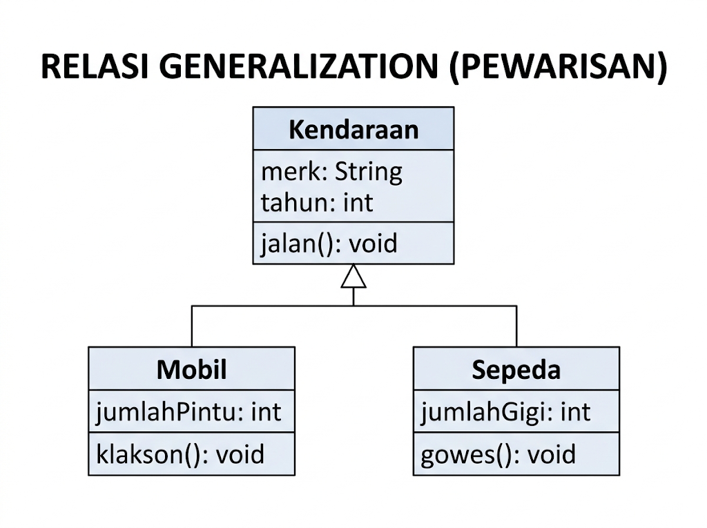

---

#### E. Dependensi (_Dependency_)

- **Definisi**: Hubungan ketergantungan temporer (**"uses-a"**) di mana perubahan pada spesifikasi suatu kelas dapat mempengaruhi kelas lain yang menggunakannya.
- **Penggunaan**: Umumnya digunakan ketika suatu kelas menggunakan kelas lain sebagai parameter metode, variabel lokal deklaratif, atau tipe pengembalian temporer.
- **Notasi**: Garis putus-putus dengan panah terbuka (_dashed line with open arrowhead_) menunjuk ke kelas yang dibutuhkan.

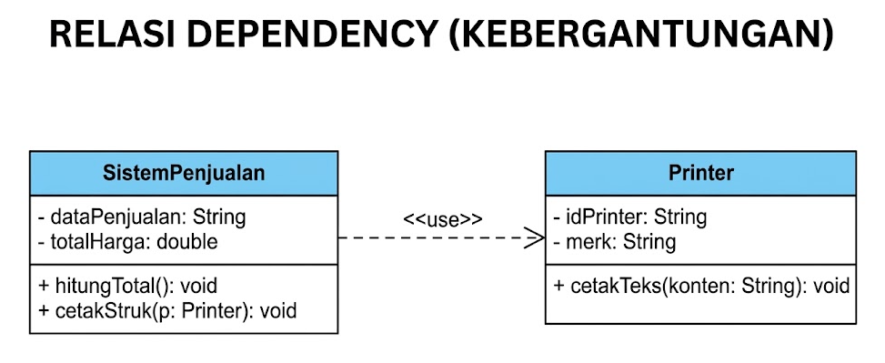

---

#### F. Realisasi (_Realization_)

- **Definisi**: Hubungan semantik di mana suatu kelas atau komponen mengimplementasikan kontrak atau spesifikasi yang ditetapkan oleh sebuah _interface_.
- **Notasi**: Garis putus-putus dengan panah segitiga kosong (_dashed line with hollow triangle_) menunjuk ke arah antarmuka (_interface_).

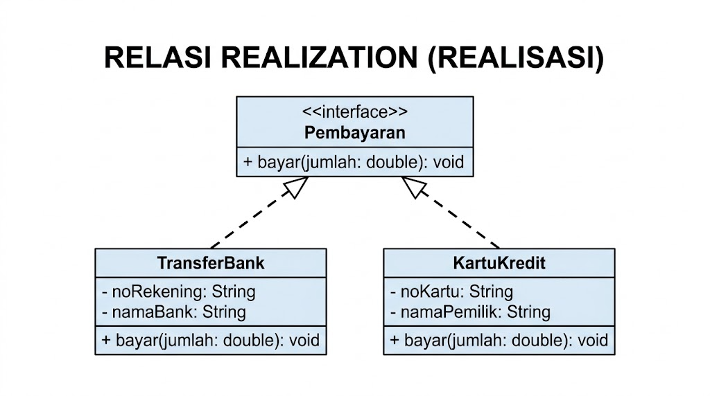

---

### 1.4. Contoh Pemodelan Class Diagram

Berikut adalah contoh pemodelan **Class Diagram** terpadu untuk Sistem Akademik Perguruan Tinggi yang mencakup seluruh notasi dan relasi UML di atas:

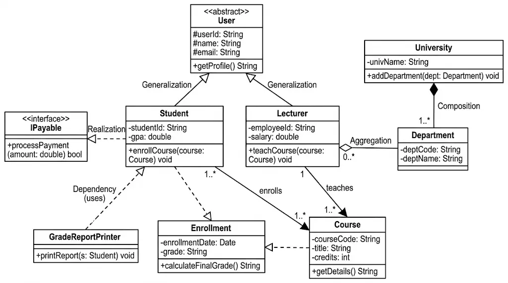

---

## 1.5. Metodologi Praktis Merancang Class Diagram

Dalam proses rekayasa perangkat lunak berorientasi objek (OOAD), pembuatan **Class Diagram** dilakukan secara iteratif melalui langkah-langkah berikut:

1. **Ekstraksi Kata Benda (_Noun Phrase Identification_)**: Menganalisis dokumen deskripsi sistem atau skenario _Use Case_ untuk menemukan semua kata benda (_nouns_) yang berpotensi menjadi kandidat kelas (_Candidate Classes_).
2. **Eliminasi dan Filter Kelas**: Menyaring kata benda yang tidak relevan, redundan, berupa atribut sederhana, atau terletak di luar batasan sistem.
3. **Pendefinisian Atribut dan Operasi**: Menentukan informasi status (_state_) yang harus disimpan oleh kelas sebagai atribut serta layanan (_service/behavior_) yang dapat dieksekusi sebagai metode.
4. **Identifikasi Relasi dan Multiplisitas**: Menentukan keterhubungan antar kelas (Asosiasi, Agregasi, Komposisi, Generalisasi, atau Dependensi) serta menetapkan batas multiplisitasnya secara presisi.
5. **Penerapan Prinsip Desain (GRASP & SOLID)**:
    - **GRASP (_General Responsibility Assignment Software Patterns_)**: Mengalokasikan tanggung jawab kelas berdasarkan prinsip _Information Expert, Controller, Low Coupling,_ dan _High Cohesion_.
    - **SOLID**: Menerapkan prinsip _Single Responsibility_ dan _Dependency Inversion_ untuk memastikan arsitektur kelas mudah dipelihara (_maintainable_), fleksibel, dan memiliki tingkat keterikatan antar komponen yang rendah.

---

## 2. Conceptual Modeling

### 2.1 Definisi dan Padanan Istilah

Dalam disiplin _Object-Oriented Analysis and Design_ (OOAD), istilah **Conceptual Model** (Model Konseptual), **Analysis Object Model** (AOM / Model Objek Analisis), dan **Domain Model** (Model Domain) sering digunakan secara berdampingan oleh para pakar (seperti Craig Larman, Bernd Bruegge, dan Ivar Jacobson) untuk merujuk pada artefak yang sama.

_Conceptual Model_ atau _Analysis Object Model_ adalah **visualisasi struktur statis dari entitas-entitas konseptual atau objek-objek dunia nyata yang ada dalam domain aplikasi/masalah**. Model ini bertindak sebagai **kamus visual** (_visual dictionary_) yang mendokumentasikan kosakata, konsep-konsep kunci, serta hubungan antarentitas yang relevan dan dipahami langsung oleh pemangku kepentingan (_stakeholders_) maupun pengguna akhir (_end-users_).

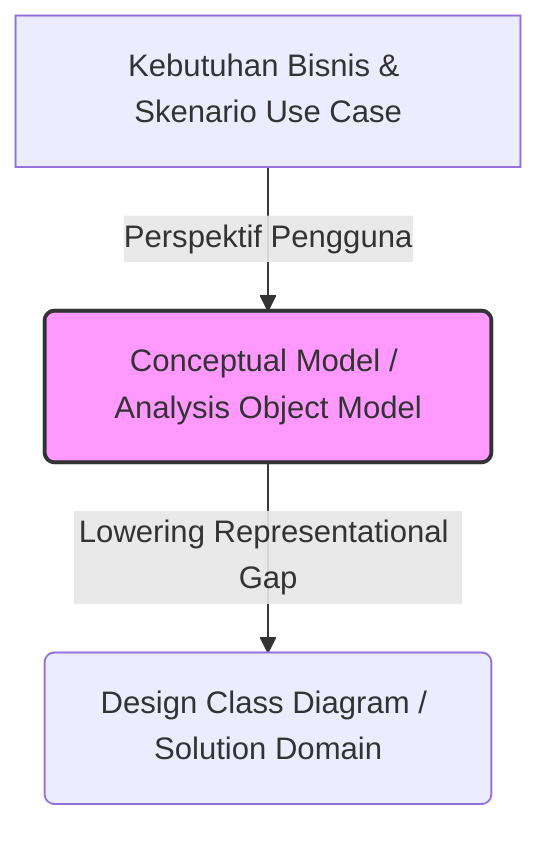

Salah satu keuntungan terbesar dari paradigma berorientasi objek adalah kemampuannya memperkecil kesenjangan representasi antara pemahaman abstrak dunia nyata dan abstraksi perangkat lunak. Dengan membangun _Conceptual Model_ yang kaya, kelas-kelas perangkat lunak yang dirancang pada tahap desain (_Design Model_) dapat mengambil inspirasi nama dan struktur langsung dari domain nyata. Hal ini membuat kode program menjadi lebih intuitif, mudah dilacak (_traceable_), dan adaptif terhadap perubahan bisnis.

---

### 2.2. Notasi


Secara formal, sebuah kelas konseptual (_conceptual class_) di dalam _Conceptual Model_ tidak sekadar berupa kotak nama, melainkan gabungan dari tiga dimensi pemikiran konseptual (konsep Martin & Odell):

1. **Simbol (_Symbol_)**: Nama atau kata benda yang digunakan untuk mengidentifikasi konsep tersebut.
    - _Contoh_: `Sale` (Penjualan), `Payment` (Pembayaran), `Flight` (Penerbangan).
2. **Intensi (_Intension_)**: Definisi semantik, makna, dan aturan-aturan yang menjelaskan apa yang dimaksud dengan konsep tersebut di dunia nyata.
    - _Contoh_: _"Penjualan mewakili peristiwa transaksi pembelian barang oleh pelanggan yang mencatat tanggal dan waktu terjadinya transaksi."_
3. **Ekstensi (_Extension_)**: Himpunan seluruh contoh konkret atau _instance_ objek nyata yang termasuk ke dalam konsep tersebut.
    - _Contoh_: Penjualan transaksi nomor #001 hari ini, transaksi nomor #002, dan seterusnya (`sale-1`, `sale-2`, `sale-3`).


Pemodelan konseptual (_conceptual modeling_) atau _Domain Modeling_ menggunakan seperangkat notasi grafik dari **Unified Modeling Language (UML) Class Diagram** untuk merepresentasikan entitas, karakteristik, dan hubungan yang ada dalam domain masalah (_problem domain_).

Meskipun menggunakan notasi diagram kelas UML yang sama dengan perancangan perangkat lunak, pemodelan konseptual diterapkan dari **perspektif konseptual/esensial** (_conceptual perspective_). 

>  🧑‍🏫 Dengan demikian *Conceptual Modeling* mirip dengan class diagram yang disederhanakan. Konsep atau kelas konseptual digambarkan menggunakan simbol kotak persegi seperti class diagram, tanpa method. Ia hanya terdiri dari kotak untuk Nama Kelas dan Atribut.

### 2.3. Karakteristik dan Batasan Notasi Model Konseptual

Pemodelan konseptual menggunakan notasi diagram kelas UML (_UML Class Diagram_), tetapi dengan aturan penyaringan (_filtering rules_) yang ketat agar tidak tercemar oleh detail teknis.

#### Elemen yang BOLEH Ada dalam Conceptual Model

1. **Kelas Konseptual (_Conceptual Classes_)**: Dinyatakan dengan kotak berisikan nama kelas tunggal (menggunakan kata benda _PascalCase_).
2. **Atribut Konseptual (_Conceptual Attributes_)**: Karakteristik data bernilai tunggal dan bersifat primitif (seperti `String`, `Number`, `Date`, `Boolean`).
3. **Asosiasi Statis (_Static Associations_)**: Garis yang menggambarkan hubungan keterikatan logis antar-konsep di dunia nyata, dilengkapi nama asosiasi, peran (_role_), dan multiplisitas (`1`, `*`, `0..1`).

#### Elemen yang harus Dihindari dalam Conceptual Model

- **Tidak Ada Operasi / Metode (_No Operations / Methods_)**: Metode adalah konsep komputasi murni dari domain solusi perangkat lunak. Kompartemen ketiga (kompartemen bawah) pada kotak kelas UML **harus dikosongkan atau ditiadakan**.
- **Tidak Ada Atribut Kunci Asing (_No Foreign Key Attributes_)**: Dalam model data relasional, kunci asing (_foreign key_) digunakan untuk menghubungkan tabel. Namun pada model konseptual berorientasi objek, keterhubungan antar-objek dicerminkan secara langsung oleh **garis asosiasi**, bukan atribut variabel _foreign key_.
- **Tidak Memuat Pustaka Komponen Solusi (_No Software Artifacts_)**: Dilarang memasukkan objek seperti `DatabaseConnection`, `PrintWindow`, `ArrayList`, atau kelas penampung variabel teknis.

---

### 2.4. _Conceptual Class Identification_

Untuk membangun _Conceptual Model_, analis dapat menggunakan tiga strategi utama:

#### Ekstraksi Frasa Kata Benda (_Noun Phrase Identification / Abbott's Heuristics_)

Teknik ini menganalisis dokumen teks kebutuhan atau skenario _Use Case_. Kata benda (_nouns_) dan frasa kata benda (_noun phrases_) yang muncul diekstraksi dan dikategorikan:

- Kata benda yang merujuk pada konsep kompleks dijadikan **Kandidat Kelas Konseptual** (misal `Sale`, `Customer`).
- Kata benda yang merujuk pada nilai sederhana dijadikan **Atribut** (misal `date`, `amount`).
- Kata kerja (_verbs_) digunakan untuk mengidentifikasi kandidat **Asosiasi**.

#### Penggunaan Daftar Kategori Kelas Konseptual (_Category List_)

Analis meninjau daftar kategori umum untuk memicu penemuan kelas konseptual:

- **Objek Fisik**: `Register`, `Airplane`.
- **Spesifikasi / Deskripsi**: `ProductSpecification`, `FlightDescription`.
- **Tempat**: `Store`, `Airport`.
- **Transaksi**: `Sale`, `Payment`, `Reservation`.
- **Rincian Transaksi**: `SalesLineItem`.
- **Peran Orang**: `Cashier`, `Customer`, `Pilot`.
- **Wadah & Isi**: `Store` menampung `Item`, `Airplane` menampung `Passenger`.

#### Strategi Pembuat Peta (_Mapmaker Strategy_)

Dalam pemodelan konseptual, bertindaklah seperti pembuat peta:

1. Gunakan nama kata benda yang ada dalam kosakata domain bisnis pengguna.
2. **Prinsip _Overspecification_**: Lebih baik memasukkan banyak kelas konseptual halus (_fine-grained_) daripada terlalu sedikit (_underspecify_). Kelas tanpa atribut atau kelas yang berperan murni dalam perilaku bisnis tetap valid dimasukkan ke dalam _Conceptual Model_.

---
#### 2.5. Contoh Conceptual Model

##### E-commerce System
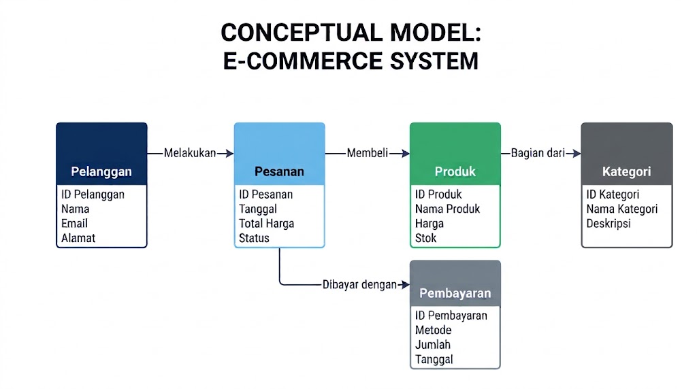
##### Sistem Akademik
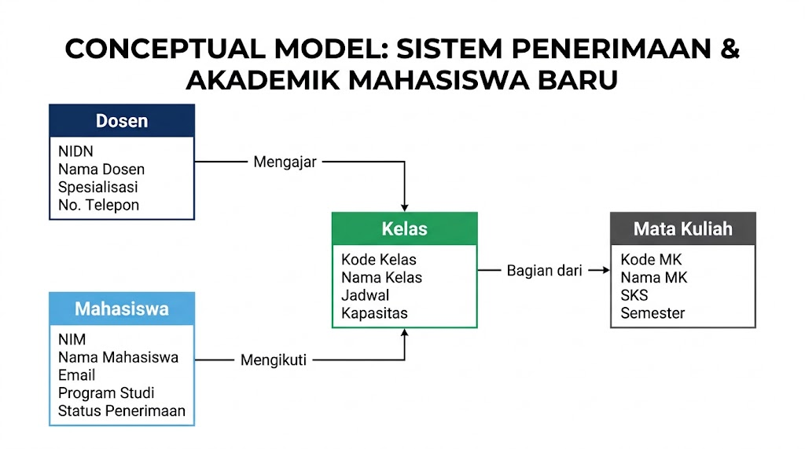


---

## 3. Perbandingan: Conceptual Model (CM) vs. Design Class Diagram (DCD)

Tabel berikut menunjukkan evolusi dan perbedaan mendasar antara _Conceptual Model_ yang dihasilkan pada tahap Analisis dan _Design Class Diagram_ (DCD) yang dihasilkan pada tahap Desain:

|Dimensi Evaluasi|Conceptual Model / Analysis Object Model|Design Class Diagram (DCD)|
|:--|:--|:--|
|**Tahap Siklus Hidup**|Tahap Analisis (_Object-Oriented Analysis / OOA_).|Tahap Desain (_Object-Oriented Design / OOD_).|
|**Fokus Ranah**|Domain Masalah / Bisnis (_Problem Domain_).|Domain Solusi / Teknis (_Solution Domain_).|
|**Tipe Objek**|_Entity Objects_ (Entitas Konseptual Domain).|_Entity_, _Boundary_, _Control_, & _Solution Objects_.|
|**Kompartemen Metode**|**Kosong / Ditiadakan**.|**Wajib mencantumkan signature metode** lengkap.|
|**Tipe Data Atribut**|Primitif / Konseptual (misal: `String`, `Date`, `Money`).|Spesifik Bahasa Pemrograman (misal: `java.util.Date`, `float`).|
|**Navigasi (_Navigability_)**|Asosiasi tanpa arah (dua arah secara konseptual).|Menunjukkan panah navigasi satu arah (_unidirectional_).|
|**Visibilitas Akses**|Ditiadakan / Tidak relevan.|Dicantumkan secara eksplisit (`+`, `-`, `#`, `~`).|
|**Persistensi & Pustaka**|Bebas dari skema basis data dan pustaka teknis.|Memuat detail persistensi, koleksi data (`List`), dan _framework_.|

### Perbandingan Diagram

#### Conceptual Model / Analysis Object Model (Tahap Analisis)

_Ciri: Tanpa operasi/metode, tanpa visibilitas, hanya nama kelas konseptual, atribut primitif, dan garis asosiasi._

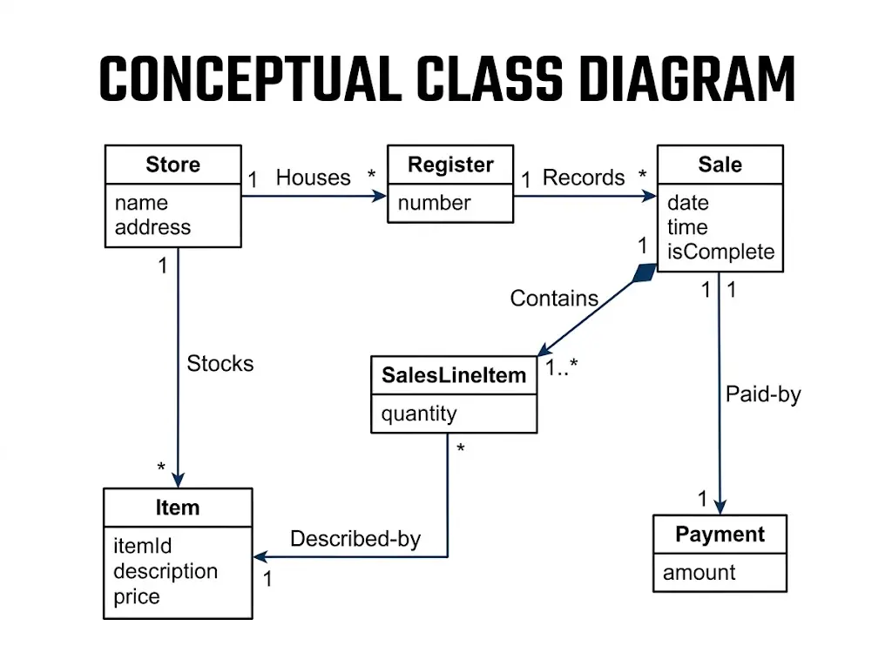
#### Design Class Diagram / DCD (Tahap Desain)

_Ciri: Memuat visibilitas akses (`-`, `+`), tipe data teknis, metode/operasi lengkap beserta parameter, dan panah arah navigasi._

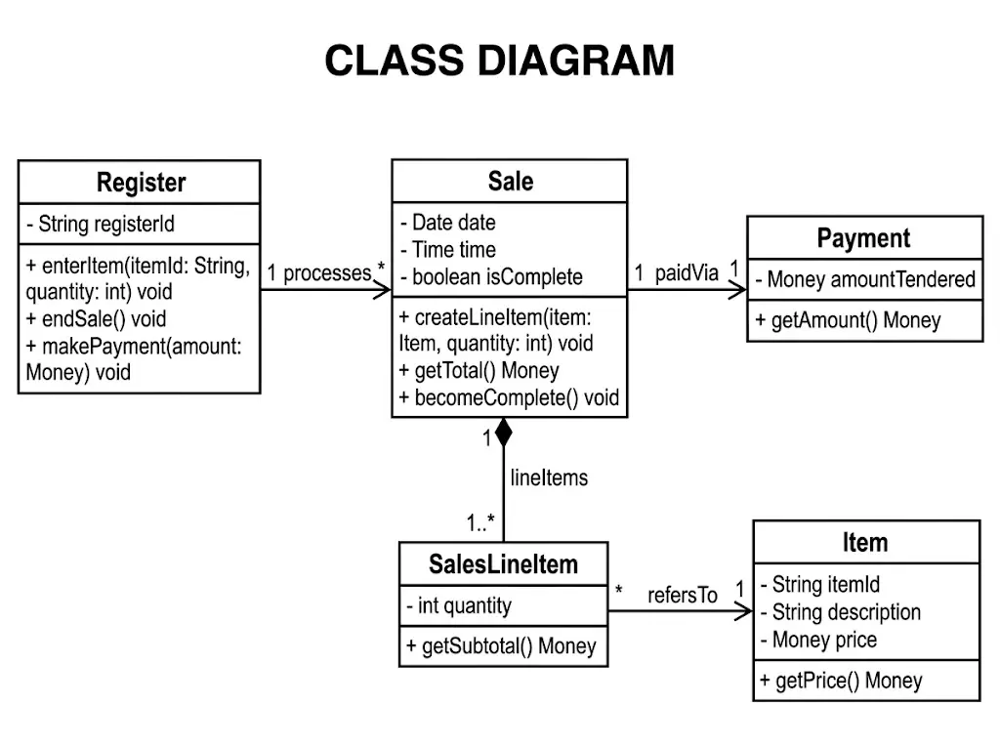


---

## 4. Contoh Studi Kasus

### Soal 1
Berikut adalah diagram diagram untuk **Sistem Kasir Penjualan (NextGen Point of Sale)** yang menggabungkan seluruh konsep relasi (Asosiasi, Agregasi, Komposisi, Generalisasi, dan Kelas Asosiasi):

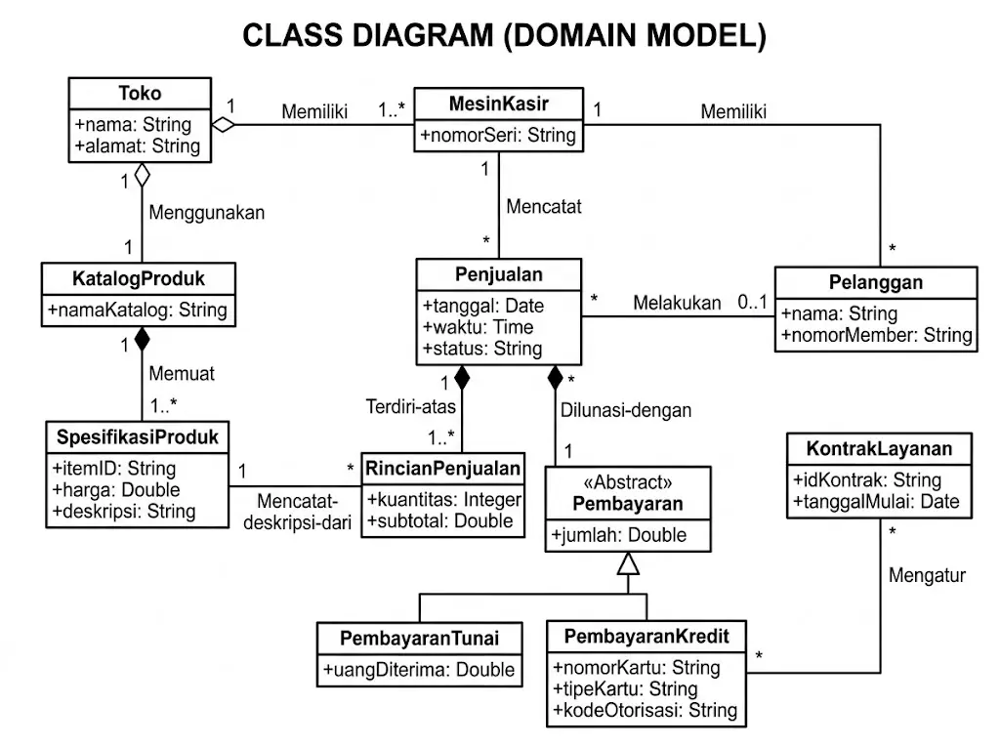

Berikut adalah 5 poin pertanyaan diskusi untuk mahasiswa berdasarkan UML Class Diagram tersebut:

1. **Analisis Siklus Hidup Objek:** Berdasarkan diagram, apa yang akan terjadi pada data `MesinKasir` dan `RincianPenjualan` jika entitas induknya (`Toko` dan `Penjualan`) dihapus dari sistem? Jelaskan alasan Anda berdasarkan simbol relasi yang digunakan!
    
2. **Keterbatasan Kardinalitas:** Mengacu pada relasi antara `Penjualan` dan `Pembayaran` (1 ke 1), apakah sistem saat ini memungkinkan pelanggan membayar menggunakan kombinasi uang tunai dan kartu kredit sekaligus (_split payment_)? Jika tidak, bagaimana Anda akan merombak relasi tersebut agar fitur _split payment_ dapat dilakukan?
    
3. **Penerapan Prinsip _Open/Closed_:** Jika manajemen toko ingin menambahkan metode pembayaran digital baru seperti QRIS atau E-Wallet (misalnya GoPay/OVO), kelas baru apa yang harus Anda buat dan ke mana kelas tersebut harus dihubungkan agar tidak merusak struktur sistem yang sudah ada?
    
4. **Pemisahan Kategori Data:** Dari seluruh kelas yang terdapat pada diagram tersebut, entitas mana saja yang bertindak sebagai _Master Data_ (data referensi statis) dan mana yang merupakan _Transaction Data_ (data historis yang terus bertambah)? Berikan argumen yang mendasari klasifikasi Anda!
    
5. **Identifikasi Kesenjangan Sistem:** Diagram ini belum mencakup beberapa elemen krusial dari sistem _Point of Sale_ (POS) di dunia nyata. Jika Anda diminta untuk menambahkan fitur "Manajemen Stok Barang", "Diskon/Promo", serta "Pencatatan Staf Kasir", di kelas mana Anda akan meletakkan atribut tersebut, atau kelas baru apa yang perlu ditambahkan?

---
### Soal 2
Enkapsulasi, Atribut, dan Operasi Dasar Sebuah sistem perbankan memiliki entitas `Rekening`. Setiap rekening menyimpan informasi nomor rekening, saldo, dan nama pemilik. Sistem harus bisa melakukan operasi setor tunai, tarik tunai, dan cek saldo. Berdasarkan deskripsi tersebut: a. Tentukan tipe data yang tepat untuk masing-masing atribut dan tipe kembalian (_return type_) untuk setiap operasi/method. b. Tentukan tingkat visibilitas (_public, private, protected_) yang paling sesuai untuk setiap atribut dan method berdasarkan prinsip enkapsulasi. c. Gambarkan entitas tersebut ke dalam satu blok Class Diagram yang standar.

---
### Soal 3
Analisis Relasi Agregasi dan Komposisi Dalam perancangan sistem akademik, terdapat entitas `Universitas`, `Fakultas`, dan `Dosen`. a. Jelaskan perbedaan mendasar antara relasi **Agregasi (_Aggregation_)** dan **Komposisi (_Composition_)** dalam konteks _Object-Oriented_. b. Buatlah Class Diagram sederhana yang mengilustrasikan kedua relasi tersebut menggunakan ketiga entitas di atas. Tentukan class mana yang menjadi _whole_ (keseluruhan) dan _part_ (bagian), serta lengkapi diagram dengan _multiplicity_ (kardinalitas) yang rasional.

---

### Soal 4
Studi Kasus Sistem Manajemen Rumah Sakit Rancanglah sebuah Class Diagram berdasarkan aturan bisnis rumah sakit berikut ini:
- Seorang `Pasien` dapat membuat banyak `Janji Temu`, tetapi satu `Janji Temu` hanya ditujukan untuk satu `Pasien`.
- Seorang `Dokter` dapat memiliki banyak `Janji Temu` dengan pasien yang berbeda-beda.
- Class `Dokter` dan `Perawat` merupakan bentuk spesialisasi (turunan) dari class `Pegawai` yang memiliki atribut dasar NIP, Nama, dan Gaji. Gambarkan Class Diagram lengkap yang memuat nama class, atribut utama di setiap class, jenis relasi (seperti _Association_ atau _Generalization_), dan _multiplicity_ antar class.

### Soal 5
[Soal Latihan 4: Sistem Pemesanan Makanan Online (Food Delivery)](03-use-case.md)
