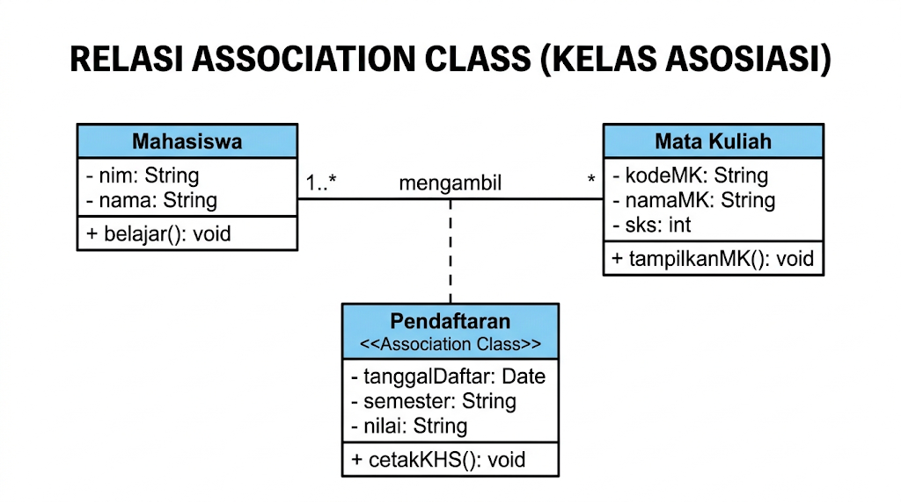
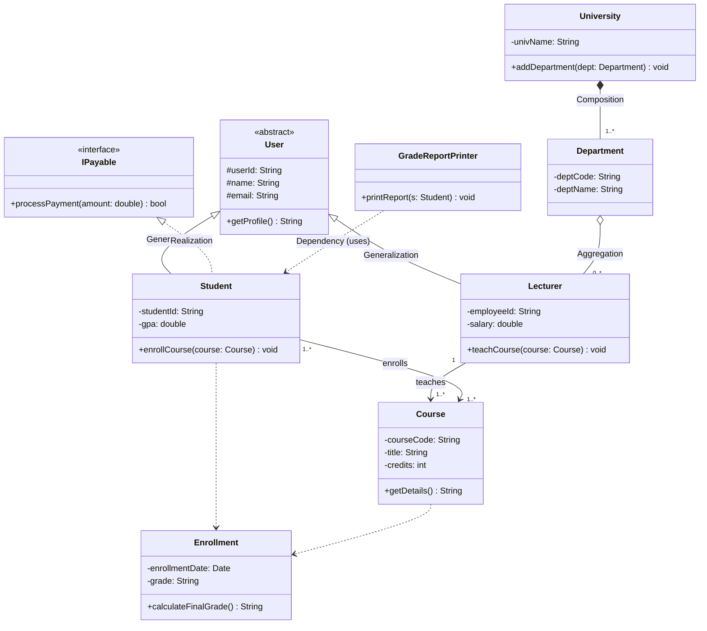
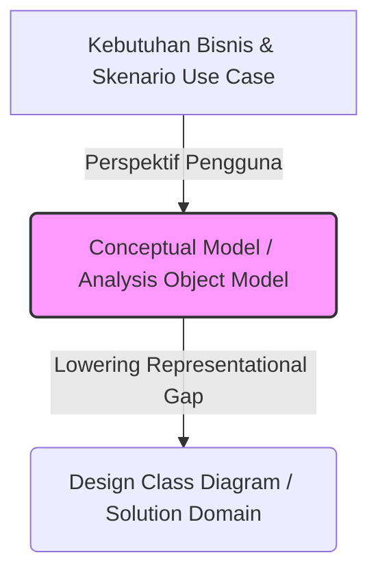
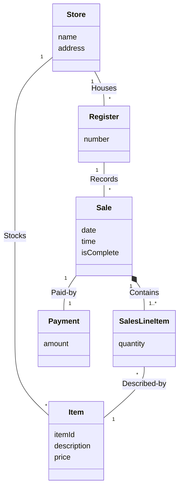

# Conceptual Modeling & Class Diagram

## 1. Class Diagram
### 1.1. Pengertian dan Peran Class Diagram dalam OOAD

**Class Diagram** (Diagram Kelas) merupakan jenis diagram struktural utama dalam **Unified Modeling Language (UML)**. Diagram ini menggambarkan struktur statis suatu sistem perangkat lunak dengan menampilkan kelas-kelas sistem, atribut, operasi (metode), serta hubungan (_relationships_) antar objek yang membentuk arsitektur sistem tersebut.

Dalam siklus pengembangan perangkat lunak berbasis objek (OOAD), **Class Diagram** memiliki peran krusial sebagai jembatan antara analisis kebutuhan domain (_domain model_) dan arsitektur kode program (_implementation model_). 

---

### 1.2. Anatomi dan Notasi Dasar Kelas (Class Structure)

Di dalam UML, sebuah kelas digambarkan dalam bentuk **kotak persegi panjang yang terbagi menjadi tiga kompartemen utama**:

```
+----------------------------------------+
|              Nama Kelas                |  <-- Kompartemen 1: Nama Kelas
+----------------------------------------+
| - atribut1 : tipeData                  |  <-- Kompartemen 2: Atribut
| # atribut2 : tipeData = nilaiAwal      |
+----------------------------------------+
| + operasi1(param : tipe) : return type |  <-- Kompartemen 3: Method
| + operasi2() : void                    |
+----------------------------------------+
```

1. **Kompartemen Nama Kelas (_Class Name_)**
	- Terletak di kompartemen paling atas.
	- Nama kelas berupa **kata benda tunggal (_singular noun_)**, diawali dengan huruf kapital (**PascalCase**), dan dicetak tebal di posisi tengah.
	- Apabila kelas bersifat **Abstrak (_Abstract Class_)**, nama kelas ditulis dengan huruf miring (_italic_) atau ditambahi penanda katakunci `{abstract}`.
2. Kompartemen Atribut (_Attributes_)
	- Terletak di kompartemen tengah.
	- Atribut merepresentasikan **keadaan (_state_) atau properti data** yang disimpan oleh setiap objek dari kelas tersebut.
3. Kompartemen Operasi / Metode (_Operations_)
	- Terletak di kompartemen bawah.
	- Operasi merepresentasikan **perilaku (_behavior_) atau fungsi/layanan** yang dapat dieksekusi oleh kelas untuk memanipulasi data.

#### Indikator Visibilitas (_Visibility Modifiers_)

Visibilitas mengatur tingkat aksesibilitas anggota kelas (atribut dan operasi) dari luar kelas tersebut:

|Simbol|Tingkat Visibilitas|Keterangan Aksesibilitas|
|:-:|:-:|:--|
|**`+`**|**Public**|Anggota dapat diakses oleh semua kelas lain secara bebas.|
|**`-`**|**Private**|Anggota disembunyikan dan hanya dapat diakses dari dalam kelas itu sendiri (**Enkapsulasi**).|
|**`#`**|**Protected**|Anggota dapat diakses oleh kelas itu sendiri dan seluruh subkelas turunannya (_inheritance_).|
|**`~`**|**Package**|Anggota dapat diakses oleh seluruh kelas yang berada dalam satu paket (_package_) yang sama.|

#### Abstraksi Khusus: Abstract Class & Interface

- **Kelas Abstrak (_Abstract Class_)**: Kelas yang tidak dapat diinstansiasi secara langsung menjadi objek dan berfungsi sebagai cetak biru bagi subkelasnya. Metode abstrak juga ditulis dalam format huruf miring (_italic_) atau dengan _tag_ `{abstract}`.
- **Antarmuka (_Interface_)**: Abstraksi murni yang hanya mendeklarasikan sekumpulan operasi tanpa menyediakan implementasi kode. Diberi stereotipe `<<interface>>` di atas nama antarmuka.

---

### 1.3. Relasi Antar Kelas (Class Relationships)

Kelas-kelas di dalam sistem tidak berdiri sendiri, melainkan saling berkolaborasi melalui berbagai tipe relasi struktural dan fungsional.

```
┌────────────────────────────────────────────────────────────┐
│                  TIPE RELASI CLASS DIAGRAM                 │
├──────────────┬──────────────┬─────────────┬────────────────┤
│ Association  │ Aggregation  │ Composition │ Generalization │
│   ( ─── )    │   ( ──◇ )    │   ( ──◆ )   │    ( ───▷ )    │
└──────────────┴──────────────┴─────────────┴────────────────┘
```

#### A. Asosiasi (_Association_)


- **Definisi**: Menunjukkan hubungan struktural statis atau koneksi semantik antar instansi kelas yang berbeda.
- **Arah Navigasi (_Navigability_)**:
    - **Bidireksional**: Garis lurus tanpa panah, menandakan kedua kelas saling mengetahui eksistensi satu sama lain.
    - **Unidireksional**: Garis lurus berujung panah terbuka, menandakan hanya satu kelas yang menyimpan referensi ke kelas lainnya.
- **Multiplisitas (_Multiplicity_)**: Menyatakan rentang jumlah instansi yang terlibat dalam relasi:
    - `1` : Tepat satu instansi.
    - `0..1` : Nol atau satu instansi (opsional).
    - `*` atau `0..*` : Nol hingga banyak instansi.
    - `1..*` : Minimal satu hingga banyak instansi.
    - `m..n` : Rentang spesifik dari \(m\) hingga \(n\).
- **Kelas Asosiasi (_Association Class_)**: Digunakan ketika hubungan asosiasi antara dua kelas itu sendiri memiliki atribut atau operasi tambahan. Digambarkan dengan kotak kelas yang dihubungkan menggunakan garis putus-putus ke garis asosiasi utama.



---

#### B. Agregasi (_Shared Aggregation_)

**Shared Aggregation (Agregasi)** adalah jenis relasi dalam class diagram UML yang menggambarkan hubungan bagian dari keseluruhan (_whole-part_) atau hubungan _"has-a"_ yang bersifat **lemah** (_weak relationship_).

Karakteristik utamanya meliputi:
- **Siklus Hidup Independen:** Objek bagian (_part_) tidak bergantung secara penuh pada objek keseluruhan (_whole_). Jika objek keseluruhan dihancurkan atau dihapus, objek bagian tetap ada (_exist_).
- **Dapat Berbagi (_Shared_):** Objek bagian dapat dihubungkan atau dimiliki oleh lebih dari satu objek keseluruhan secara bersamaan.
- **Notasi UML:** Digambarkan dengan garis lurus berujung **simbol belah ketupat / diamond kosong (`♢`)** di sisi kelas yang bertindak sebagai keseluruhan (_whole_).

**Contoh:** Relasi antara **Jurusan** ♢— **Dosen**. Jurusan memiliki dosen, namun jika sebuah jurusan dibubarkan, objek Dosen tidak ikut terhapus dan tetap dapat mengajar atau terhubung ke jurusan lainnya.


---

#### C. Komposisi (_Composite Aggregation_)

- **Definisi**: Bentuk agregasi yang bersifat **sangat kuat** (_strong ownership_) dan menyatakan hubungan bagian-keseluruhan yang erat.
- **Sifat Lifecycle**: Terdapat **ketergantungan eksistensi (_existential dependency_)**. Objek bagian (_part_) dimiliki secara eksklusif oleh satu objek induk (_whole_). **Jika objek induk dihapus, secara otomatis seluruh objek bagian di dalamnya akan ikut terhapus (_coincident lifetime_)**.
- **Notasi**: Garis lurus dengan belah ketupat terisi penuh (_filled diamond_) pada sisi kelas induk (_whole_).


---

#### D. Generalisasi / Pewarisan (_Generalization / Inheritance_)

- **Definisi**: Hubungan hirarki klasifikasi yang menyatakan hubungan **"is-a"** antara kelas umum (_superclass_) dan kelas yang lebih spesifik (_subclass_).
- **Sifat**: Subkelas mewarisi seluruh atribut, operasi, dan relasi dari superkelasnya, serta dapat menambahkan atribut/metode baru atau melakukan _override_.
- **Notasi**: Garis lurus dengan panah segitiga kosong (_hollow triangular arrowhead_) menunjuk ke arah superkelas.


---

#### E. Dependensi (_Dependency_)

- **Definisi**: Hubungan ketergantungan temporer (**"uses-a"**) di mana perubahan pada spesifikasi suatu kelas dapat mempengaruhi kelas lain yang menggunakannya.
- **Penggunaan**: Umumnya digunakan ketika suatu kelas menggunakan kelas lain sebagai parameter metode, variabel lokal deklaratif, atau tipe pengembalian temporer.
- **Notasi**: Garis putus-putus dengan panah terbuka (_dashed line with open arrowhead_) menunjuk ke kelas yang dibutuhkan.


---

#### F. Realisasi (_Realization_)

- **Definisi**: Hubungan semantik di mana suatu kelas atau komponen mengimplementasikan kontrak atau spesifikasi yang ditetapkan oleh sebuah _interface_.
- **Notasi**: Garis putus-putus dengan panah segitiga kosong (_dashed line with hollow triangle_) menunjuk ke arah antarmuka (_interface_).


---

### 1.4. Contoh Pemodelan Class Diagram

Berikut adalah contoh pemodelan **Class Diagram** terpadu untuk Sistem Akademik Perguruan Tinggi yang mencakup seluruh notasi dan relasi UML di atas:



---

## 1.5. Metodologi Praktis Merancang Class Diagram

Dalam proses rekayasa perangkat lunak berorientasi objek (OOAD), pembuatan **Class Diagram** dilakukan secara iteratif melalui langkah-langkah berikut:

1. **Ekstraksi Kata Benda (_Noun Phrase Identification_)**: Menganalisis dokumen deskripsi sistem atau skenario _Use Case_ untuk menemukan semua kata benda (_nouns_) yang berpotensi menjadi kandidat kelas (_Candidate Classes_).
2. **Eliminasi dan Filter Kelas**: Menyaring kata benda yang tidak relevan, redundan, berupa atribut sederhana, atau terletak di luar batasan sistem.
3. **Pendefinisian Atribut dan Operasi**: Menentukan informasi status (_state_) yang harus disimpan oleh kelas sebagai atribut serta layanan (_service/behavior_) yang dapat dieksekusi sebagai metode.
4. **Identifikasi Relasi dan Multiplisitas**: Menentukan keterhubungan antar kelas (Asosiasi, Agregasi, Komposisi, Generalisasi, atau Dependensi) serta menetapkan batas multiplisitasnya secara presisi.
5. **Penerapan Prinsip Desain (GRASP & SOLID)**:
    - **GRASP (_General Responsibility Assignment Software Patterns_)**: Mengalokasikan tanggung jawab kelas berdasarkan prinsip _Information Expert, Controller, Low Coupling,_ dan _High Cohesion_.
    - **SOLID**: Menerapkan prinsip _Single Responsibility_ dan _Dependency Inversion_ untuk memastikan arsitektur kelas mudah dipelihara (_maintainable_), fleksibel, dan memiliki tingkat keterikatan antar komponen yang rendah.

---

## 2. Conceptual Modeling

### 2.1 Definisi dan Padanan Istilah

Dalam disiplin _Object-Oriented Analysis and Design_ (OOAD), istilah **Conceptual Model** (Model Konseptual), **Analysis Object Model** (AOM / Model Objek Analisis), dan **Domain Model** (Model Domain) sering digunakan secara berdampingan oleh para pakar (seperti Craig Larman, Bernd Bruegge, dan Ivar Jacobson) untuk merujuk pada artefak yang sama.

_Conceptual Model_ atau _Analysis Object Model_ adalah **visualisasi struktur statis dari entitas-entitas konseptual atau objek-objek dunia nyata yang ada dalam domain aplikasi/masalah**. Model ini bertindak sebagai **kamus visual** (_visual dictionary_) yang mendokumentasikan kosakata, konsep-konsep kunci, serta hubungan antarentitas yang relevan dan dipahami langsung oleh pemangku kepentingan (_stakeholders_) maupun pengguna akhir (_end-users_).



Salah satu keuntungan terbesar dari paradigma berorientasi objek adalah kemampuannya memperkecil kesenjangan representasi antara pemahaman abstrak dunia nyata dan abstraksi perangkat lunak. Dengan membangun _Conceptual Model_ yang kaya, kelas-kelas perangkat lunak yang dirancang pada tahap desain (_Design Model_) dapat mengambil inspirasi nama dan struktur langsung dari domain nyata. Hal ini membuat kode program menjadi lebih intuitif, mudah dilacak (_traceable_), dan adaptif terhadap perubahan bisnis.

---

### 2.2. Notasi


Secara formal, sebuah kelas konseptual (_conceptual class_) di dalam _Conceptual Model_ tidak sekadar berupa kotak nama, melainkan gabungan dari tiga dimensi pemikiran konseptual (konsep Martin & Odell):

1. **Simbol (_Symbol_)**: Nama atau kata benda yang digunakan untuk mengidentifikasi konsep tersebut.
    - _Contoh_: `Sale` (Penjualan), `Payment` (Pembayaran), `Flight` (Penerbangan).
2. **Intensi (_Intension_)**: Definisi semantik, makna, dan aturan-aturan yang menjelaskan apa yang dimaksud dengan konsep tersebut di dunia nyata.
    - _Contoh_: _"Penjualan mewakili peristiwa transaksi pembelian barang oleh pelanggan yang mencatat tanggal dan waktu terjadinya transaksi."_
3. **Ekstensi (_Extension_)**: Himpunan seluruh contoh konkret atau _instance_ objek nyata yang termasuk ke dalam konsep tersebut.
    - _Contoh_: Penjualan transaksi nomor #001 hari ini, transaksi nomor #002, dan seterusnya (`sale-1`, `sale-2`, `sale-3`).


Pemodelan konseptual (_conceptual modeling_) atau _Domain Modeling_ menggunakan seperangkat notasi grafik dari **Unified Modeling Language (UML) Class Diagram** untuk merepresentasikan entitas, karakteristik, dan hubungan yang ada dalam domain masalah (_problem domain_).

Meskipun menggunakan notasi diagram kelas UML yang sama dengan perancangan perangkat lunak, pemodelan konseptual diterapkan dari **perspektif konseptual/esensial** (_conceptual perspective_). 

> 💡 Dengan demikian *Conceptual Modeling* mirip dengan class diagram yang disederhanakan.

Konsep atau kelas konseptual digambarkan menggunakan simbol kotak persegi seperti classi diagram, tanpa method. Ia hanya terdiri dari kotak untuk Nama Kelas dan Atribut.

### 2.3. Karakteristik dan Batasan Notasi Model Konseptual

Pemodelan konseptual menggunakan notasi diagram kelas UML (_UML Class Diagram_), tetapi dengan aturan penyaringan (_filtering rules_) yang ketat agar tidak tercemar oleh detail teknis.

#### Elemen yang BOLEH Ada dalam Conceptual Model

1. **Kelas Konseptual (_Conceptual Classes_)**: Dinyatakan dengan kotak berisikan nama kelas tunggal (menggunakan kata benda _PascalCase_).
2. **Atribut Konseptual (_Conceptual Attributes_)**: Karakteristik data bernilai tunggal dan bersifat primitif (seperti `String`, `Number`, `Date`, `Boolean`).
3. **Asosiasi Statis (_Static Associations_)**: Garis yang menggambarkan hubungan keterikatan logis antar-konsep di dunia nyata, dilengkapi nama asosiasi, peran (_role_), dan multiplisitas (`1`, `*`, `0..1`).

#### Elemen yang harus Dihindari dalam Conceptual Model

- **Tidak Ada Operasi / Metode (_No Operations / Methods_)**: Metode adalah konsep komputasi murni dari domain solusi perangkat lunak. Kompartemen ketiga (kompartemen bawah) pada kotak kelas UML **harus dikosongkan atau ditiadakan**.
- **Tidak Ada Atribut Kunci Asing (_No Foreign Key Attributes_)**: Dalam model data relasional, kunci asing (_foreign key_) digunakan untuk menghubungkan tabel. Namun pada model konseptual berorientasi objek, keterhubungan antar-objek dicerminkan secara langsung oleh **garis asosiasi**, bukan atribut variabel _foreign key_.
- **Tidak Memuat Pustaka Komponen Solusi (_No Software Artifacts_)**: Dilarang memasukkan objek seperti `DatabaseConnection`, `PrintWindow`, `ArrayList`, atau kelas penampung variabel teknis.

---

### 2.4. _Conceptual Class Identification_

Untuk membangun _Conceptual Model_, analis dapat menggunakan tiga strategi utama:

#### Ekstraksi Frasa Kata Benda (_Noun Phrase Identification / Abbott's Heuristics_)

Teknik ini menganalisis dokumen teks kebutuhan atau skenario _Use Case_. Kata benda (_nouns_) dan frasa kata benda (_noun phrases_) yang muncul diekstraksi dan dikategorikan:

- Kata benda yang merujuk pada konsep kompleks dijadikan **Kandidat Kelas Konseptual** (misal `Sale`, `Customer`).
- Kata benda yang merujuk pada nilai sederhana dijadikan **Atribut** (misal `date`, `amount`).
- Kata kerja (_verbs_) digunakan untuk mengidentifikasi kandidat **Asosiasi**.

#### Penggunaan Daftar Kategori Kelas Konseptual (_Category List_)

Analis meninjau daftar kategori umum untuk memicu penemuan kelas konseptual:

- **Objek Fisik**: `Register`, `Airplane`.
- **Spesifikasi / Deskripsi**: `ProductSpecification`, `FlightDescription`.
- **Tempat**: `Store`, `Airport`.
- **Transaksi**: `Sale`, `Payment`, `Reservation`.
- **Rincian Transaksi**: `SalesLineItem`.
- **Peran Orang**: `Cashier`, `Customer`, `Pilot`.
- **Wadah & Isi**: `Store` menampung `Item`, `Airplane` menampung `Passenger`.

#### Strategi Pembuat Peta (_Mapmaker Strategy_)

Dalam pemodelan konseptual, bertindaklah seperti pembuat peta:

1. Gunakan nama kata benda yang ada dalam kosakata domain bisnis pengguna.
2. **Prinsip _Overspecification_**: Lebih baik memasukkan banyak kelas konseptual halus (_fine-grained_) daripada terlalu sedikit (_underspecify_). Kelas tanpa atribut atau kelas yang berperan murni dalam perilaku bisnis tetap valid dimasukkan ke dalam _Conceptual Model_.

---
#### 2.5. Contoh Conceptual Model

##### E-commerce System

##### Sistem Akademik


---

## 3. Perbandingan: Conceptual Model (CM) vs. Design Class Diagram (DCD)

Tabel berikut menunjukkan evolusi dan perbedaan mendasar antara _Conceptual Model_ yang dihasilkan pada tahap Analisis dan _Design Class Diagram_ (DCD) yang dihasilkan pada tahap Desain:

|Dimensi Evaluasi|Conceptual Model / Analysis Object Model|Design Class Diagram (DCD)|
|:--|:--|:--|
|**Tahap Siklus Hidup**|Tahap Analisis (_Object-Oriented Analysis / OOA_).|Tahap Desain (_Object-Oriented Design / OOD_).|
|**Fokus Ranah**|Domain Masalah / Bisnis (_Problem Domain_).|Domain Solusi / Teknis (_Solution Domain_).|
|**Tipe Objek**|_Entity Objects_ (Entitas Konseptual Domain).|_Entity_, _Boundary_, _Control_, & _Solution Objects_.|
|**Kompartemen Metode**|**Kosong / Ditiadakan**.|**Wajib mencantumkan signature metode** lengkap.|
|**Tipe Data Atribut**|Primitif / Konseptual (misal: `String`, `Date`, `Money`).|Spesifik Bahasa Pemrograman (misal: `java.util.Date`, `float`).|
|**Navigasi (_Navigability_)**|Asosiasi tanpa arah (dua arah secara konseptual).|Menunjukkan panah navigasi satu arah (_unidirectional_).|
|**Visibilitas Akses**|Ditiadakan / Tidak relevan.|Dicantumkan secara eksplisit (`+`, `-`, `#`, `~`).|
|**Persistensi & Pustaka**|Bebas dari skema basis data dan pustaka teknis.|Memuat detail persistensi, koleksi data (`List`), dan _framework_.|

### Perbandingan Diagram

#### Conceptual Model / Analysis Object Model (Tahap Analisis)

_Ciri: Tanpa operasi/metode, tanpa visibilitas, hanya nama kelas konseptual, atribut primitif, dan garis asosiasi._



#### Design Class Diagram / DCD (Tahap Desain)

_Ciri: Memuat visibilitas akses (`-`, `+`), tipe data teknis, metode/operasi lengkap beserta parameter, dan panah arah navigasi._

```
classDiagram
    class Register {
        -String registerId
        +enterItem(itemId: String, quantity: int) void
        +endSale() void
        +makePayment(amount: Money) void
    }
    class Sale {
        -Date date
        -Time time
        -boolean isComplete
        +createLineItem(item: Item, quantity: int) void
        +getTotal() Money
        +becomeComplete() void
    }
    class SalesLineItem {
        -int quantity
        +getSubtotal() Money
    }
    class Item {
        -String itemId
        -String description
        -Money price
        +getPrice() Money
    }
    class Payment {
        -Money amountTendered
        +getAmount() Money
    }

    Register "1" --> "*" Sale : processes
    Sale "1" *-- "1..*" SalesLineItem : lineItems
    SalesLineItem "*" --> "1" Item : refersTo
    Sale "1" --> "1" Payment : paidVia
```


---

## 2. Strategi Mengidentifikasi Kelas Konseptual

Untuk mengidentifikasi kelas konseptual yang relevan dari skenario penggunaan (_use case_) atau dokumen kebutuhan, pengembang dapat menerapkan dua teknik analisis utama:

### A. Analisis Frasa Kata Benda (Noun Phrase Identification)

Dalam skenario _use case_ atau teks deskripsi sistem, kata benda (_nouns_) dan frasa kata benda (_noun phrases_) cenderung merepresentasikan kelas konseptual atau atribut.

- **Kata benda murni/kompleks:** Berpotensi menjadi **Kelas Konseptual** (misalnya `Pelanggan`, `Transaksi`, `Faktur`, `Laporan`).
- **Kata benda sederhana/nilai atribut:** Berpotensi menjadi **Atribut** dari kelas (misalnya `namaPelanggan`, `tanggalTransaksi`, `totalHarga`).
- **Frasa kata kerja (verb phrases):** Berpotensi menjadi **Asosiasi** atau relasi antar kelas.

### B. Daftar Kategori Kelas Konseptual (Conceptual Class Category List)

Pengembang juga dapat memindai domain masalah menggunakan daftar kategori standar untuk memastikan tidak ada entitas penting yang terlewat:

|Kategori Kelas Konseptual|Contoh Ranah Retail / POS|Contoh Ranah Penerbangan / Rumah Sakit|
|:--|:--|:--|
|**Benda Fisik / Tangible Objects**|`MesinKasir`, `Barang`|`Pesawat`, `PeralatanMedis`|
|**Spesifikasi / Deskripsi Benda**|`SpesifikasiProduk`|`DeskripsiPenerbangan`|
|**Lokasi / Tempat (Places)**|`Toko`, `Gudang`|`Bandara`, `KamarRawat`|
|**Transaksi (Transactions)**|`Penjualan`, `Pembayaran`|`Reservasi`, `TindakanMedis`|
|**Rincian Transaksi (Line Items)**|`ItemPenjualan`|`RincianReservasi`|
|**Peran Manusia (Roles of People)**|`Kasir`, `Pelanggan`|`Pilot`, `Dokter`, `Pasien`|
|**Wadah (Containers)**|`Toko`, `Rak`|`Pesawat`, `Bangsal`|
|**Sistem Eksternal**|`SistemOtorisasiKredit`|`SistemSITA`, `SistemBPJS`|

### Aturan Penetapan Atribut pada Lapis Analisis

Dalam model domain, atribut harus dipatuhkannya aturan keterbatasan berikut:

- **Gunakan Tipe Data Sederhana/Primitif:** Atribut harus berupa angka (_number_), string (_text_), tanggal (_date_), atau nilai boolean.
- **Jangan Jadikan Kelas Kompleks Sebagai Atribut:** Jika sebuah konsep merupakan entitas kompleks yang memiliki atribut tersendiri di dunia nyata, **hubungkan melalui Asosiasi**, bukan dijadikan tipe atribut internal kelas lain. Contoh: `TujuanPenerbangan` bukanlah atribut string pada kelas `Penerbangan`, melainkan relasi asosiasi ke kelas `Bandara`.

---

## 3. Konsep Relasi Antar Kelas (Class Relationships)

Di dalam diagram kelas lapis analisis, hubungan keterkaitkan antar entitas dimodelkan menggunakan konsep relasi struktural. Terdapat empat jenis relasi utama: **Asosiasi**, **Agregasi**, **Komposisi**, dan **Generalisasi/Spesialisasi**.

```
classDiagram
    class RelasiUML {
        <<Abstract>>
    }
    class Asosiasi {
        +Hubungan Struktural Umum
        +Garis Polos Tanpa Diamond
    }
    class Agregasi {
        +Hubungan Whole-Part Lemah
        +Belah Ketupat Kosong (Hollow Diamond)
    }
    class Komposisi {
        +Hubungan Whole-Part Kuat
        +Belah Ketupat Isi (Filled Diamond)
    }
    class Generalisasi {
        +Hubungan Subtipe / Inheritance ("Is-A")
        +Garis dengan Segitiga Kosong
    }

    RelasiUML <|-- Asosiasi
    RelasiUML <|-- Agregasi
    RelasiUML <|-- Komposisi
    RelasiUML <|-- Generalisasi
```

---

### 3.1. Asosiasi (Association)

**Asosiasi** adalah hubungan struktural yang menggambarkan keterikatan semantik antara dua kelas atau lebih. Asosiasi menunjukkan bahwa terjadi hubungan logis yang perlu direkam atau diingat oleh sistem dalam jangka waktu tertentu (_need-to-know relationship_).

#### Komponen Utama Asosiasi:

1. **Nama Asosiasi (Association Name):** Diberi kata kerja yang menjelaskan makna hubungan, diawali dengan huruf kapital dan dapat dilengkapi panah penunjuk arah baca (contoh: `Dicatat-pada >`).
2. **Peran (Role Name):** Menjelaskan fungsi spesifik suatu kelas dalam konteks relasi tersebut (contoh: kelas `Kasir` berperan sebagai `pencatat` pada relasi penjualan).
3. **Kardinalitas / Multiplisitas (Multiplicity):** Menentukan berapa banyak instansi dari satu kelas yang dapat terhubung dengan satu instansi kelas lainnya.

|Notasi Multiplisitas|Makna Kuantitas|
|:--|:--|
|`1`|Tepat satu instansi|
|`0..1`|Nol atau satu instansi (opsional)|
|`*` atau `0..*`|Nol atau banyak instansi|
|`1..*`|Satu atau banyak instansi (minimal satu)|
|`m..n`|Antara \(m\) hingga \(n\) instansi spesifik|

#### Prinsip _Need-to-Know_ vs. _Comprehension_

Saat membuat model domain, sertakan asosiasi yang wajib diingat oleh sistem untuk memenuhi kebutuhan informasi (_need-to-know_). Hindari menambahkan seluruh relasi yang mungkin terjadi secara berlebihan (_visual noise_). Namun, asosiasi yang memperjelas pemahaman ranah bisnis secara signifikan (_comprehension_) tetap diperbolehkan.

---

### 3.2. Agregasi (Shared Aggregation)

**Agregasi** (sering disebut _shared aggregation_) adalah bentuk khusus dari asosiasi yang menyatakan hubungan **keseluruhan-bagian (_whole-part_)** atau _"has-a"_.

#### Karakteristik Agregasi:

- **Sifat Hubungan:** Lemah (_weak assembly_).
- **Ketergantungan Siklus Hidup:** **Independen**. Bagian (_part_) dapat berdiri sendiri dan tetap eksis meskipun keseluruhan (_whole_) dihapus atau dihancurkan.
- **Kepemilikan:** Bagian (_part_) dapat dimiliki atau menjadi bagian dari beberapa entitas _whole_ lain secara bersamaan (_shared_).
- **Notasi UML:** Garis dengan **belah ketupat kosong (hollow diamond)** pada ujung kelas keseluruhan (_whole_).

> **Contoh Dunia Nyata:** Relasi antara `Fakultas` dan `Dosen`, atau `Klub` dan `Anggota`. Jika entitas `Klub` dibubarkan, entitas `Anggota` (mahasiswa/orang) tidak ikut hancur dan tetap ada di dalam sistem.

---

### 3.3. Komposisi (Composite Aggregation)

**Komposisi** adalah bentuk agregasi yang sangat kuat (_strong whole-part relationship_) di mana entitas bagian (_part_) secara eksklusif dimiliki oleh entitas keseluruhan (_composite/whole_).

#### Karakteristik Komposisi:

- **Sifat Hubungan:** Sangat kuat (_strong containment_).
- **Ketergantungan Siklus Hidup (_Create-Delete Dependency_):** **Dependen**. Keberadaan bagian (_part_) terikat penuh pada siklus hidup _composite_. Jika entitas _composite_ dihapus, maka seluruh entitas _part_ di dalamnya ikut terhapus secara otomatis (_cascading delete_).
- **Kepemilikan Eksklusif:** Suatu instansi _part_ hanya boleh menjadi anggota dari **tepat satu** objek _composite_ pada satu waktu (multiplisitas pada sisi _whole_ harus `1` atau `0..1`).
- **Notasi UML:** Garis dengan **belah ketupat hitam penuh (filled diamond)** pada ujung kelas _composite_.

> **Contoh Dunia Nyata:** Relasi antara `Penjualan` (_Sale_) dan `RincianPenjualan` (_SalesLineItem_), atau `Rumah` dan `Kamar`. Rincian barang belanjaan tidak memiliki arti dan tidak dapat berdiri sendiri tanpa adanya transaksi `Penjualan` induknya.

#### Tabel Perbandingan: Agregasi vs. Komposisi

| Dimensi Evaluasi             | Agregasi (Shared Aggregation)              | Komposisi (Composite Aggregation)                 |
| :--------------------------- | :----------------------------------------- | :------------------------------------------------ |
| **Kekuatan Ikatan**          | Lemah (_Weak Part-Whole_)                  | Sangat Kuat (_Strong Ownership_)                  |
| **Notasi UML**               | Belah Ketupat Kosong  (\(\diamond\))       | Belah Ketupat Hitam Penuh (\(\blackdiamond\))     |
| **Siklus Hidup Part**        | Independen dari _Whole_                    | Terikat (_Create-Delete Dependency_) pada _Whole_ |
| **Kepemilikan Part**         | Boleh dibagikan (_Shared_) ke _Whole_ lain | Eksklusif untuk 1 _Composite_ pada satu waktu     |
| **Multiplisitas Sisi Whole** | Boleh `*`, `1..*`, atau `0..1`             | Wajib `1` atau `0..1`                             |

---

### 3.4. Generalisasi dan Spesialisasi (Generalization / Inheritance)

**Generalisasi** adalah relasi taksonomi antara konsep yang lebih umum (_superclass_) dan konsep yang lebih spesifik (_subclass_). Relasi ini mencerminkan konsep pewarisan (_inheritance_) dan hubungan **"Is-A"**.

```
classDiagram
    class Pembayaran {
        +jumlah: Double
        +tanggal: Date
    }
    class PembayaranTunai {
        +uangDiterima: Double
    }
    class PembayaranKredit {
        +nomorKartu: String
        +kodeOtorisasi: String
    }
    Pembayaran <|-- PembayaranTunai
    Pembayaran <|-- PembayaranKredit
```

#### Aturan Pengujian Subkelas yang Valid:

Saat membuat tingkatan generalisasi dalam model domain, gunakan dua kriteria uji berikut:

1. **Aturan 100% (100% Rule):** Subkelas harus mewarisi dan mematuhi 100% atribut dan asosiasi yang didefinisikan pada superkelasnya.
2. **Aturan Is-A (Is-A Rule):** Pernyataan natural _"Subkelas adalah Superkelas"_ harus bernilai benar dan logis secara domain bisnis. (Contoh: _"PembayaranKredit adalah Pembayaran"_ bernilai benar).

#### Notasi UML:

Digambarkan dengan garis lurus berujung **panah segitiga kosong tertutup (solid line with hollow arrowhead)** yang menunjuk dari subkelas ke superkelas.

---

### 3.5. Kelas Asosiasi (Association Class)

**Kelas Asosiasi** adalah elemen pemodelan yang memiliki sifat ganda: berfungsi sebagai relasi asosiasi sekaligus memiliki properti sebagai kelas konseptual.

#### Kapan Kelas Asosiasi Dibutuhkan?

1. Terdapat atribut yang melekat secara langsung pada **hubungan** itu sendiri, bukan pada salah satu kelas yang berhubungan.
2. Hubungan bersifat **banyak-ke-banyak (_many-to-many_)** dan membawa informasi riwayat atau transaksi.
3. Instansi dari kelas asosiasi memiliki siklus hidup yang bergantung pada keberadaan hubungan tersebut.

> **Contoh:** Relasi antara `Mahasiswa` dan `MataKuliah` yang memiliki asosiasi _banyak-ke-banyak_. Atribut `nilaiAkhir` atau `indeksPrestasi` tidak bisa diletakkan di kelas `Mahasiswa` saja (karena mahasiswa punya banyak nilai) dan tidak bisa diletakkan di `MataKuliah` saja. Oleh karena itu, dibuat kelas asosiasi `KRS` atau `Pendaftaran` yang menyimpan `nilaiAkhir`.

#### Notasi UML:

Digambarkan sebagai kotak kelas terpisah yang dihubungkan dengan **garis putus-putus** ke garis asosiasi utama.

---

## 4. Contoh Studi Kasus Sintaksis Diagram Kelas Lapis Analisis (Mermaid.js)

Berikut adalah diagram kelas lapis analisis terintegrasi untuk **Sistem Kasir Penjualan (NextGen Point of Sale)** yang menggabungkan seluruh konsep relasi (Asosiasi, Agregasi, Komposisi, Generalisasi, dan Kelas Asosiasi) dalam format `mermaid.js`:

```
classDiagram
    %% Tinjauan Kelas Konseptual Lapis Analisis (Domain Model)

    class Toko {
        +nama: String
        +alamat: String
    }

    class MesinKasir {
        +nomorSeri: String
    }

    class KatalogProduk {
        +namaKatalog: String
    }

    class SpesifikasiProduk {
        +itemID: String
        +harga: Double
        +deskripsi: String
    }

    class Penjualan {
        +tanggal: Date
        +waktu: Time
        +status: String
    }

    class RincianPenjualan {
        +kuantitas: Integer
        +subtotal: Double
    }

    class Pembayaran {
        <<Abstract>>
        +jumlah: Double
    }

    class PembayaranTunai {
        +uangDiterima: Double
    }

    class PembayaranKredit {
        +nomorKartu: String
        +tipeKartu: String
        +kodeOtorisasi: String
    }

    class Pelanggan {
        +nama: String
        +nomorMember: String
    }

    class KontrakLayanan {
        +idKontrak: String
        +tanggalMulai: Date
    }

    %% Definisi Relasi Struktural Lapis Analisis

    %% 1. Agregasi (Shared Aggregation): Toko memiliki MesinKasir & KatalogProduk
    Toko "1" o-- "1..*" MesinKasir : Memiliki
    Toko "1" o-- "1" KatalogProduk : Menggunakan

    %% 2. Komposisi (Composite Aggregation): KatalogProduk berisi SpesifikasiProduk
    KatalogProduk "1" *-- "1..*" SpesifikasiProduk : Memuat

    %% 3. Komposisi (Composite Aggregation): Penjualan memiliki RincianPenjualan (Create-Delete Dependency)
    Penjualan "1" *-- "1..*" RincianPenjualan : Terdiri-atas

    %% 4. Asosiasi Standar: RincianPenjualan mencatat SpesifikasiProduk
    RincianPenjualan "*" -- "1" SpesifikasiProduk : Mencatat-deskripsi-dari

    %% 5. Asosiasi Komposisi Pembayaran pada Penjualan
    Penjualan "1" *-- "1" Pembayaran : Dilunasi-dengan

    %% 6. Generalisasi (Inheritance): Subtipe Pembayaran
    Pembayaran <|-- PembayaranTunai
    Pembayaran <|-- PembayaranKredit

    %% 7. Asosiasi Biasa: Penjualan dicatat pada MesinKasir & diinisiasi oleh Pelanggan
    MesinKasir "1" -- "*" Penjualan : Mencatat
    Pelanggan "0..1" -- "*" Penjualan : Melakukan

    %% 8. Kelas Asosiasi (Association Class): KontrakLayanan antara Toko dan Pihak Bank/Penyedia Kredit
    (Toko, PembayaranKredit) .. KontrakLayanan
```

---

## 5. Rangkuman & Pedoman Praktis Pemodelan Lapis Analisis

1. **Jaga Abstraksi Lapis Analisis:** Jangan memasukkan metode perangkat lunak, visibilitas private/protected, atau tipe data spesifik bahasa pemrograman ke dalam Model Domain.
2. **Identifikasi Konsep Secara Objektif:** Gunakan teknik kata benda (_noun phrase_) dan daftar kategori kelas konseptual untuk menjaring calon kelas konseptual.
3. **Bedakan Komposisi dan Agregasi Secara Cermat:** Gunakan **Komposisi** hanya jika terdapat ketergantungan siklus hidup (_create-delete dependency_) dan kepemilikan eksklusif. Jika entitas bagian dapat berdiri sendiri atau dibagikan, gunakan **Agregasi** atau **Asosiasi** biasa.
4. **Terapkan Uji Generalisasi:** Pastikan subkelas memenuhi **Aturan 100%** dan **Aturan Is-A** secara konsisten terhadap superkelasnya.
5. **Gunakan Kelas Asosiasi Saat Perlu:** Jika sebuah atribut logis dimiliki oleh _hubungan banyak-ke-banyak_ itu sendiri, hasilkan Kelas Asosiasi alih-alih memaksakan atribut ke salah satu kelas induk.

---

💡 _Apakah Anda ingin melanjutkan pembahasan dengan latihan pembuatan Use Case Realization dan Communication Diagram berdasarkan Class Diagram Lapis Analisis ini?_