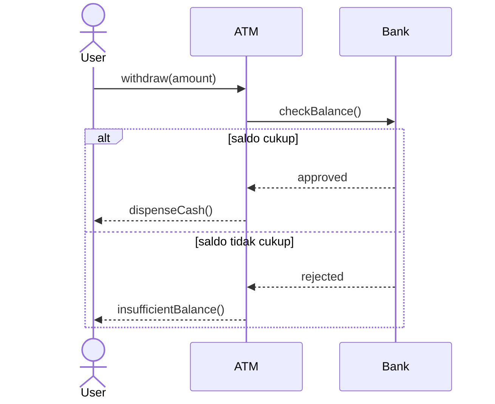
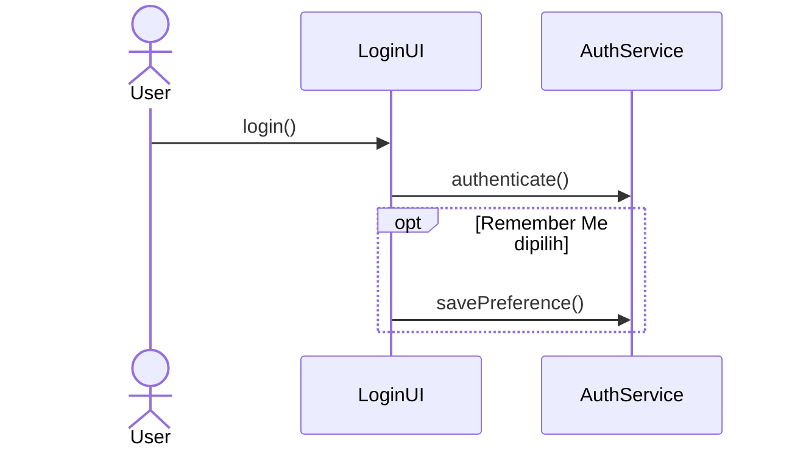
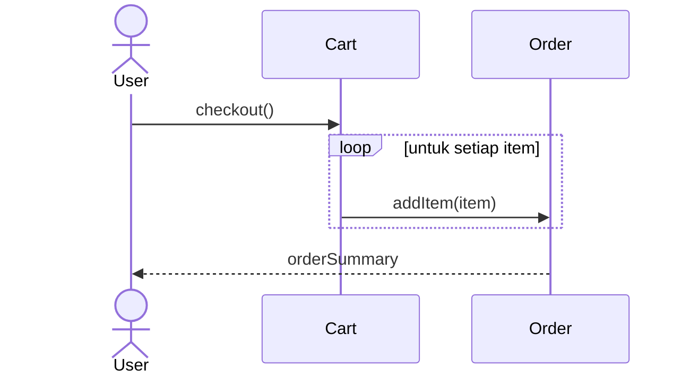
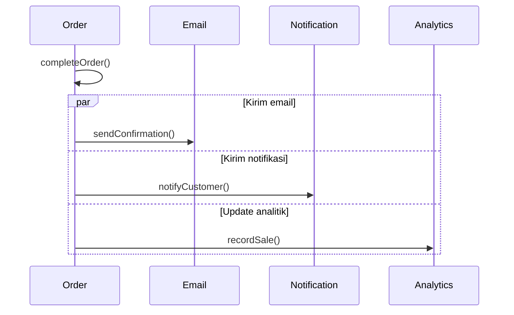
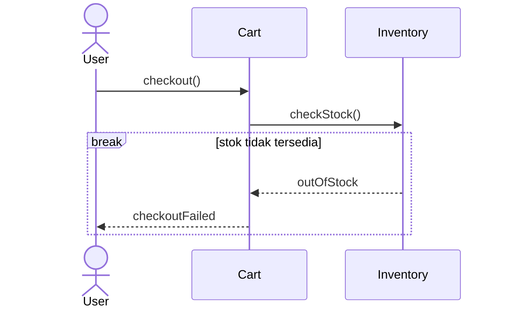
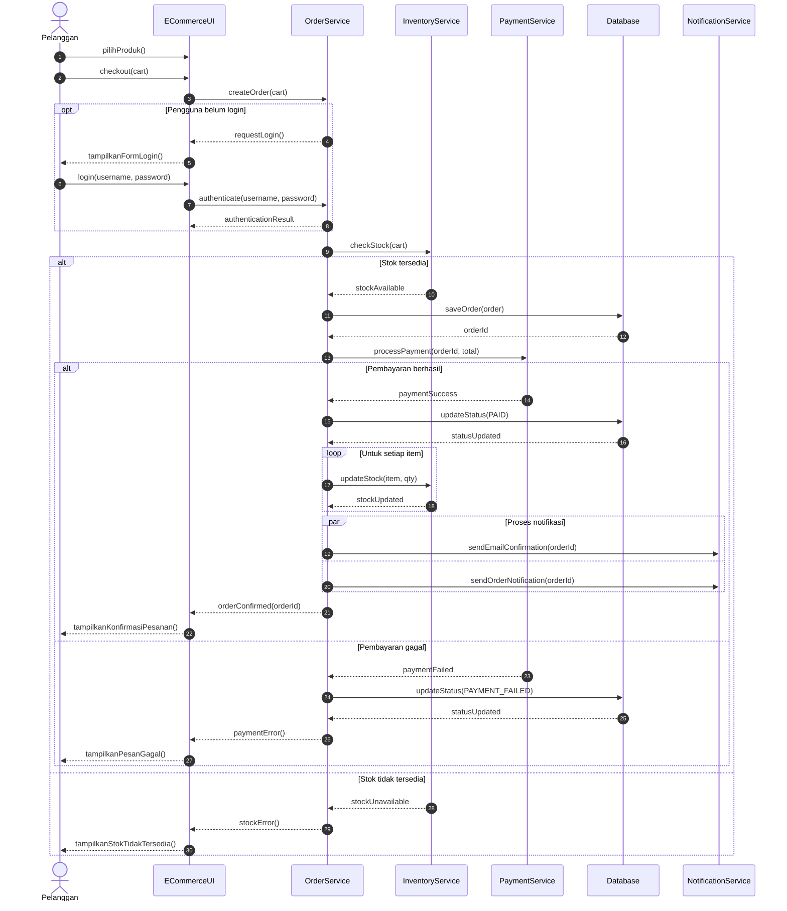
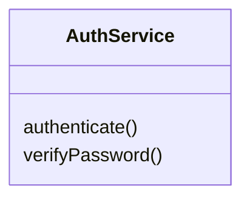

# Sequence & Communication Diagram

Sequence Diagram merupakan bagian dari UML 2.x dan termasuk kelompok Interaction Diagram.

Interaction Diagram digunakan untuk memodelkan komunikasi antarpartisipan dalam suatu sistem.

Diagram interaksi yang umum dalam UML meliputi:

| Diagram                      | Fungsi                                            |
| ---------------------------- | ------------------------------------------------- |
| Sequence Diagram             | Menggambarkan urutan pesan berdasarkan waktu      |
| Communication Diagram        | Menggambarkan hubungan komunikasi antarobjek      |
| Interaction Overview Diagram | Menggambarkan alur interaksi tingkat tinggi       |
| Timing Diagram               | Menggambarkan perubahan kondisi berdasarkan waktu |
|                              |                                                   |

## 1. Sequence Diagram

Fokus utama Sequence Diagram adalah urutan interaksi, bukan struktur kelas.

### 1.1. Elemen Sequence Diagram
#### Actor

Actor adalah pihak eksternal yang berinteraksi dengan sistem.

Actor dapat berupa:
- Manusia atau pengguna.
- Sistem eksternal.
- Perangkat atau entitas eksternal lainnya.

Contoh:
- Mahasiswa
- Admin
- Customer
- Payment Gateway
- Sistem Email

Actor biasanya digambarkan menggunakan simbol stick figure.


Actor bukan selalu manusia. Sistem eksternal yang berkomunikasi dengan sistem juga dapat menjadi actor.

#### Lifeline

Lifeline menggambarkan keberadaan suatu partisipan dalam interaksi.

Partisipan dapat berupa:
- Actor.
- Object.
- Instance dari class.
- Subsystem.
- Komponen eksternal.

Lifeline digambarkan sebagai kotak nama partisipan di bagian atas dan garis vertikal putus-putus ke bawah.


#### Message

Message adalah komunikasi yang dikirim dari satu partisipan ke partisipan lainnya.

Message dapat merepresentasikan:
- Pemanggilan operasi atau method.
- Pengiriman sinyal.
- Permintaan layanan.
- Pengembalian hasil operasi.

Message digambarkan menggunakan garis horizontal dengan panah.


#### Activation / Execution Specification

Activation atau Execution Specification menunjukkan periode ketika suatu partisipan sedang menjalankan aktivitas atau operasi.

Secara visual, activation digambarkan sebagai persegi panjang tipis pada lifeline.


Activation membantu memperlihatkan:
- Kapan operasi mulai dieksekusi.
- Berapa lama suatu operasi berlangsung secara relatif.
- Operasi yang memanggil operasi lain.
- Aktivitas bersarang (nested execution).

Activation bukan representasi waktu nyata atau durasi pasti kecuali diagram dilengkapi informasi waktu.

#### Return Message

Return Message adalah pesan yang menunjukkan hasil atau pengembalian dari suatu pemanggilan operasi.

Biasanya digambarkan dengan garis putus-putus dan panah terbuka. Dalam UML, return message bersifat opsional apabila hasil operasi sudah jelas dari interaksi.

---

### 1.2. Jenis-Jenis Message

#### Synchronous Message

Synchronous Message adalah pesan yang mengindikasikan pemanggilan operasi secara sinkron.

Pengirim biasanya menunggu operasi yang dipanggil selesai sebelum melanjutkan proses berikutnya.


Karakteristik:
- Umumnya digunakan untuk pemanggilan method.
- Pengirim menunggu penyelesaian operasi.
- Sering ditampilkan dengan panah garis penuh dan kepala panah tertutup.

Contoh penggunaan:

```
userService.getUserById(10);
```

#### Asynchronous Message

Asynchronous Message adalah pesan yang dikirim tanpa mengharuskan pengirim menunggu penyelesaian penerima.

Contoh:

```
OrderService → NotificationService : sendNotification()
```

Karakteristik:
- Pengirim dapat melanjutkan proses.
- Cocok untuk komunikasi event atau pemrosesan latar belakang.
- Umumnya menggunakan panah dengan kepala terbuka.

Contoh implementasi:

```
notificationService.sendNotification(order);
```

Pemanggilan di atas dapat berupa asynchronous jika implementasinya memang tidak memblokir pengirim.

Catatan: Jenis message dalam diagram menjelaskan semantik interaksi, bukan sekadar penggunaan thread atau teknologi tertentu.

#### Return Message

Return Message menunjukkan hasil dari operasi yang telah dipanggil.

Contoh:

```
AuthService → LoginUI : authenticationResult
```

Representasi visual biasanya berupa garis putus-putus.

Return Message tidak selalu wajib ditampilkan.

#### Self Message

Self Message adalah pesan yang dikirim oleh suatu partisipan kepada dirinya sendiri.

Contoh:

```
OrderService → OrderService : calculateTotal()
```

Digunakan ketika suatu objek memanggil operasi internal atau melakukan pemrosesan sendiri.

Contoh:

```
public void checkout() {
    calculateTotal();
}
```

#### Create Message

Create Message menunjukkan proses pembuatan objek baru.

Contoh:

```
OrderController → Order : <<create>>
```

Lifeline objek yang dibuat dimulai pada titik pembuatan tersebut.

Contoh implementasi:

```
Order order = new Order();
```

#### Delete Message

Delete Message menunjukkan penghapusan atau penghentian keberadaan objek dalam interaksi.

Dalam diagram, lifeline objek berakhir dengan tanda silang `X`.

Contoh:

```
SessionManager → Session : destroy()
```

Penghapusan lifeline tidak otomatis berarti objek dihapus dari memori oleh garbage collector. Diagram menunjukkan semantik penghentian objek dalam model.

---

### 1.3. Struktur Visual Sequence Diagram

Sequence Diagram memiliki dua dimensi utama.
* Dimensi horizontal: Menunjukkan partisipan atau objek yang terlibat dalam interaksi.
- Dimensi vertikal: Menunjukkan urutan kejadian dari atas ke bawah.

Prinsip penting:
1. Partisipan diletakkan di bagian atas diagram.
2. Lifeline ditarik secara vertikal.
3. Pesan ditampilkan secara horizontal.
4. Pesan yang lebih awal ditempatkan lebih tinggi.
5. Interaksi dibaca dari atas ke bawah.
6. Jarak vertikal tidak harus menunjukkan durasi waktu sebenarnya.

---
### 1.4. Combined Fragments

Combined Fragment digunakan untuk menggambarkan kondisi, pengulangan, dan pola interaksi khusus.

Combined Fragment ditampilkan menggunakan frame persegi panjang dengan operator di bagian kiri atas.

### 1.5. Operator `alt`

`alt` digunakan untuk memodelkan alternatif interaksi berdasarkan kondisi.

Contoh UML:


### 1.6. Operator `opt`

`opt` digunakan untuk interaksi yang hanya dijalankan jika kondisi tertentu terpenuhi.

Contoh:

```
Jika pengguna memilih "Remember Me":
    sistem menyimpan preferensi login
```

`opt` dapat dipahami sebagai alternatif dengan satu operand dan kondisi tertentu.

Contoh:



### 1.7. Operator `loop`

`loop` digunakan untuk menggambarkan pengulangan interaksi.

Contoh:

```
Selama jumlah item > 0:
    sistem memproses item
```

Contoh:



Pengulangan dapat memiliki kondisi atau batas iterasi.

Contoh kondisi:

```
loop [jumlah percobaan < 3]
```

### 1.8. Operator `par`

`par` digunakan untuk menggambarkan interaksi yang berlangsung secara paralel.

Contoh, setelah transaksi berhasil, sistem:
- Mengirim email konfirmasi.
- Memperbarui notifikasi.
- Memperbarui data analitik.



`par` menunjukkan kemungkinan eksekusi paralel, bukan jaminan bahwa seluruh proses benar-benar berjalan bersamaan pada implementasi.


### 1.9. Operator `break`

`break` digunakan untuk menunjukkan interaksi yang menghentikan bagian interaksi yang sedang berlangsung ketika kondisi tertentu terpenuhi.

Contoh:

```
Jika stok tidak tersedia:
    proses checkout dihentikan
```



### 1.10. Study Kasus

#### Contoh Sequence Diagram: Sistem Login

##### Studi Kasus

- Sebuah aplikasi memiliki fitur login.
- Pengguna memasukkan username dan password. Sistem memeriksa data pengguna melalui database.
- Jika data valid, pengguna diarahkan ke dashboard.
- Jika data tidak valid, sistem menampilkan pesan kesalahan.

##### Skenario Use Case

| No. | Aktor / Sistem | Aktivitas                        |
| --- | -------------- | -------------------------------- |
| 1   | User           | Membuka halaman login            |
| 2   | User           | Memasukkan username dan password |
| 3   | LoginUI        | Mengirim data login              |
| 4   | AuthService    | Memvalidasi kredensial           |
| 5   | UserRepository | Mengambil data pengguna          |
| 6   | AuthService    | Mengembalikan hasil autentikasi  |
| 7   | LoginUI        | Menampilkan hasil login          |

#### Sequence Diagram Login


##### Penjelasan diagram
- `User` merupakan actor.
- `LoginUI` bertanggung jawab menerima input.
- `AuthService` melakukan proses autentikasi.
- `UserRepository` bertanggung jawab mengambil data pengguna.
- `Database` menyimpan data pengguna.
- `alt` digunakan untuk menunjukkan dua kondisi hasil autentikasi.

Diagram ini menunjukkan bahwa proses login bukan hanya aktivitas pengguna, tetapi juga komunikasi antarobjek internal sistem.

#### Studi Kasus: Sistem Pemesanan Barang Online

- Sebuah aplikasi e-commerce menyediakan fitur pemesanan barang.
- Proses dimulai ketika pelanggan memilih produk dan melakukan checkout.
- Sistem memeriksa ketersediaan stok. Jika stok tersedia, sistem membuat pesanan dan memproses pembayaran.
- Jika pembayaran berhasil, sistem mengonfirmasi pesanan.
- Jika pembayaran gagal, sistem menampilkan informasi kegagalan.

| Partisipan       | Tanggung Jawab                        |
| ---------------- | ------------------------------------- |
| Customer         | Memilih produk dan melakukan checkout |
| OrderUI          | Menangani interaksi pengguna          |
| OrderService     | Memproses pesanan                     |
| InventoryService | Memeriksa ketersediaan stok           |
| PaymentService   | Memproses pembayaran                  |
| Database         | Menyimpan data pesanan                |

##### Sequence Diagram E-Commerce



##### Analisis Interaksi

Diagram tersebut memperlihatkan beberapa prinsip desain berorientasi objek.
###### Separation of Concerns
Setiap objek memiliki tanggung jawab yang berbeda.
- `OrderUI`: interaksi dengan pengguna.
- `OrderService`: logika pemrosesan pesanan.
- `InventoryService`: pemeriksaan stok.
- `PaymentService`: pembayaran.

Pemisahan ini membantu mengurangi ketergantungan antarbagian sistem.

###### Encapsulation
- Customer tidak berinteraksi langsung dengan database.
- Customer mengirimkan permintaan ke UI, kemudian UI berkomunikasi dengan service.
- Database diakses melalui objek yang bertanggung jawab terhadap proses tersebut.

###### Object Collaboration
- Proses checkout melibatkan kolaborasi beberapa objek.
- Satu objek tidak harus menangani seluruh proses.

###### Conditional Interaction
Penggunaan `alt` memperlihatkan alternatif alur berdasarkan kondisi:
- Stok tersedia atau tidak.
- Pembayaran berhasil atau gagal.

### 1.11. Hubungan Sequence Diagram dengan Class Diagram

Sequence Diagram dan Class Diagram saling melengkapi.

| Class Diagram                 | Sequence Diagram                |
| ----------------------------- | ------------------------------- |
| Menggambarkan struktur sistem | Menggambarkan interaksi sistem  |
| Menampilkan class             | Menampilkan partisipan          |
| Menampilkan atribut           | Tidak berfokus pada atribut     |
| Menampilkan operasi           | Menampilkan pemanggilan operasi |
| Menunjukkan hubungan statis   | Menunjukkan perilaku dinamis    |

#### Contoh

Class Diagram:



Sequence Diagram:

```
LoginUI → AuthService : authenticate()
AuthService → AuthService : verifyPassword()
```

Sequence Diagram dapat membantu mengidentifikasi operasi yang dibutuhkan dalam Class Diagram.

Namun, Sequence Diagram tidak menggantikan Class Diagram karena keduanya memiliki tujuan pemodelan yang berbeda.

### 1.11. Langkah-Langkah Membuat Sequence Diagram

Berikut tahapan sistematis yang dapat digunakan mahasiswa.

1. Identifikasi Use Case
    - Tentukan proses yang akan dimodelkan, misalnya login, checkout, registrasi, atau peminjaman buku.
    
2. Tentukan Skenario
    - Tuliskan alur utama dan alur alternatif berdasarkan kebutuhan sistem.
    
3. Identifikasi Actor dan Partisipan
    - Tentukan siapa yang memulai interaksi dan objek apa saja yang terlibat.
    
4. Tentukan Tanggung Jawab Objek
    - Tentukan objek yang menerima input, menjalankan logika bisnis, mengakses data, dan berkomunikasi dengan sistem eksternal.
    
5. Susun Lifeline
    - Tempatkan actor dan objek di bagian atas diagram.
    
6. Gambarkan Message
    - Susun pesan dari atas ke bawah sesuai urutan interaksi.
    
7. Tambahkan Combined Fragment
    - Gunakan `alt`, `opt`, `loop`, atau `par` jika diperlukan.
    
8. Validasi Diagram
    - Pastikan alur sesuai dengan skenario use case, tanggung jawab objek, dan kebutuhan sistem.
    

### 1.12. Kesalahan Umum dalam Membuat Sequence Diagram

| Kesalahan                                     | Penjelasan                                  |
| --------------------------------------------- | ------------------------------------------- |
| Lifeline terlalu banyak                       | Diagram menjadi sulit dibaca                |
| Pesan tidak berurutan                         | Tidak sesuai dengan skenario use case       |
| Actor langsung mengakses database             | Mengabaikan tanggung jawab objek            |
| Semua proses dilakukan satu objek             | Menunjukkan desain yang terlalu terpusat    |
| Tidak ada alur alternatif                     | Kondisi gagal tidak dimodelkan              |
| Return message berlebihan                     | Diagram menjadi penuh dan sulit dipahami    |
| Tidak menggunakan activation                  | Struktur eksekusi sulit dianalisis          |
| Pesan tidak sesuai operasi class              | Diagram tidak konsisten dengan desain objek |
| Menganggap garis vertikal sebagai waktu nyata | Salah memahami dimensi temporal diagram     |

#### Prinsip desain

> 💡Sequence Diagram harus cukup detail untuk menjelaskan interaksi, tetapi tidak terlalu detail sampai setiap instruksi program digambarkan. Fokuslah pada komunikasi antarpartisipan dan tanggung jawab objek.


## 3. 🎓Diskusi & Tugas

### Latihan 1 — Sistem Login
Buat Sequence Diagram untuk proses login dengan ketentuan:
- Pengguna memasukkan username dan password.
- Sistem memeriksa data pengguna.
- Jika valid, sistem menampilkan dashboard.
- Jika tidak valid, sistem menampilkan pesan kesalahan.
- Pengguna dapat mencoba login kembali.

Pertanyaan:
1. Siapa actor dalam sistem?
2. Objek apa saja yang terlibat?
3. Message apa yang digunakan?
4. Bagaimana menggambarkan kondisi login berhasil dan gagal?
5. Bagaimana menggambarkan pengulangan login?

### Latihan 2 — Sistem Perpustakaan

Buat Sequence Diagram untuk proses peminjaman buku.

Skenario:
1. Mahasiswa mencari buku.
2. Sistem menampilkan daftar buku.
3. Mahasiswa memilih buku.
4. Sistem memeriksa ketersediaan buku.
5. Jika tersedia, sistem mencatat peminjaman.
6. Jika tidak tersedia, sistem menampilkan pesan.
7. Sistem mengirim konfirmasi peminjaman.

Partisipan yang dapat digunakan:
- Mahasiswa
- BookUI
- BookService
- LoanService
- BookRepository
- Database

Pertanyaan analisis:
- Apakah BookService perlu berinteraksi langsung dengan database?
- Apa tanggung jawab LoanService?
- Bagaimana menggambarkan buku yang tidak tersedia?
- Apakah notifikasi dapat dilakukan secara asynchronous?

### Latihan 3 — Sistem Pembayaran

Buat Sequence Diagram untuk sistem pembayaran dengan ketentuan:
- Customer melakukan pembayaran.
- Sistem membuat transaksi.
- Payment Gateway memproses pembayaran.
- Jika pembayaran berhasil, sistem mengubah status pesanan.
- Jika gagal, sistem menampilkan informasi kegagalan.
- Sistem mengirim notifikasi setelah pembayaran berhasil.

Gunakan:
- `alt`
- `par`
- Synchronous Message
- Asynchronous Message

