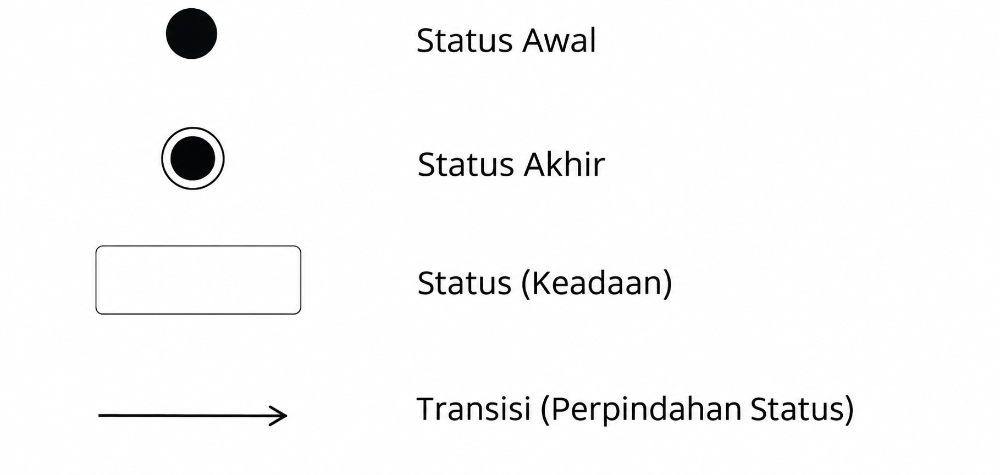
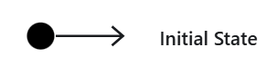
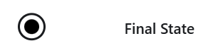
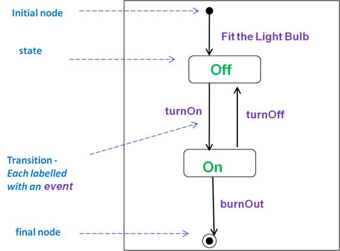
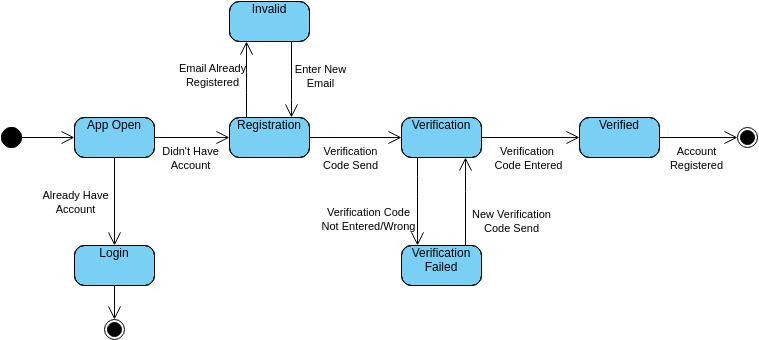
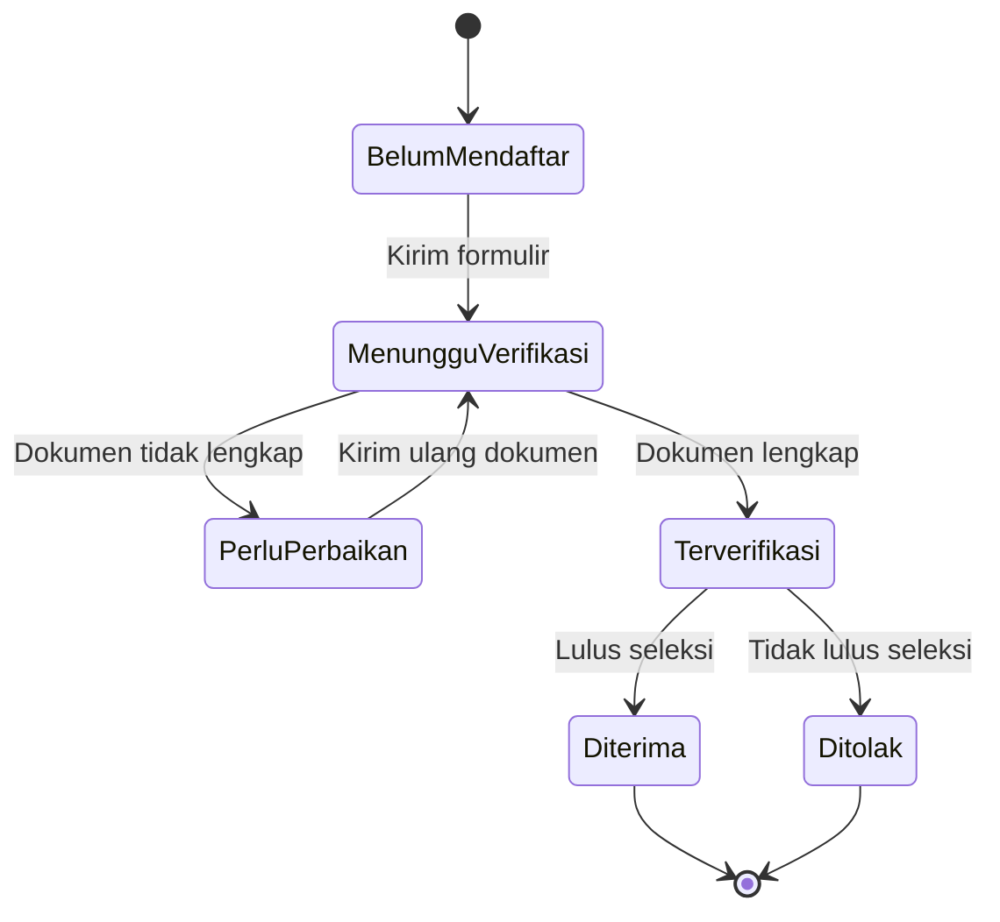
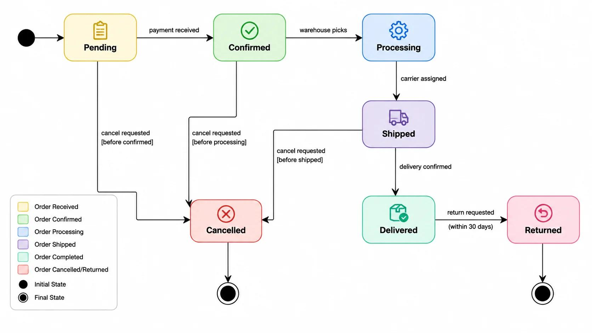
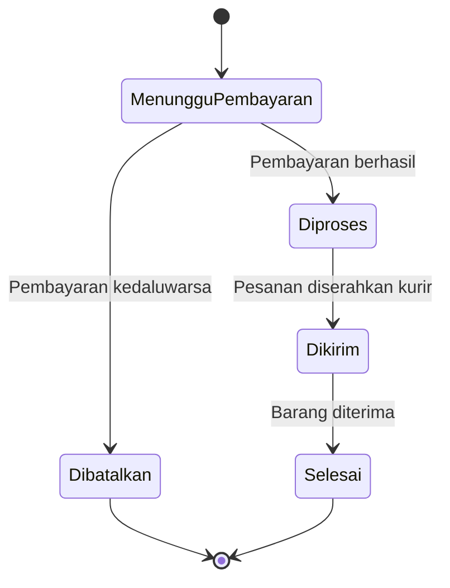
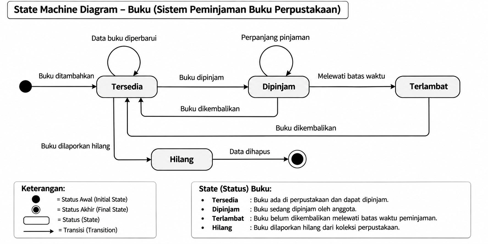
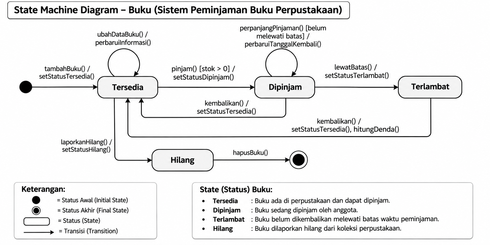

# State Machine Diagram

## 1. Pendahuluan

Dalam pengembangan sistem berorientasi objek (Object-Oriented Analysis and Design atau OOAD), setiap objek memiliki atribut, perilaku, dan kemungkinan mengalami perubahan kondisi selama sistem berjalan.

Sebagai contoh, dalam sistem penerimaan mahasiswa baru, objek Pendaftaran dapat memiliki beberapa status:
- Belum Dikirim
- Menunggu Verifikasi
- Sedang Diverifikasi
- Diterima
- Ditolak

Perubahan status tersebut terjadi karena adanya aktivitas atau kejadian tertentu, seperti mahasiswa mengirim formulir, petugas melakukan verifikasi, atau hasil seleksi diumumkan.

Untuk menggambarkan perubahan status tersebut, UML menyediakan diagram yang disebut State Machine Diagram.

---
## 2. Pengertian State Machine Diagram

State Machine Diagram adalah diagram UML yang digunakan untuk menggambarkan perubahan kondisi atau status suatu objek berdasarkan kejadian (event) yang terjadi selama objek tersebut memiliki siklus hidup.

Diagram ini menjelaskan:
1. Status apa saja yang dimiliki suatu objek.
2. Kejadian yang menyebabkan perubahan status.
3. Perpindahan dari satu status ke status lainnya.
4. Kondisi atau aturan yang menentukan perubahan status.

> 💡 Inti pemahaman, State Machine Diagram menjawab pertanyaan: "Bagaimana kondisi suatu objek berubah dari satu keadaan ke keadaan lainnya ketika suatu kejadian terjadi?"

---
## 3. Tujuan dan Manfaat State Machine Diagram

State Machine Diagram memiliki beberapa tujuan:
1. Mengidentifikasi berbagai kemungkinan status suatu objek.
2. Menggambarkan alur perubahan status objek.
3. Menjelaskan respons objek terhadap suatu kejadian.
4. Mendokumentasikan aturan bisnis dalam sistem.
5. Membantu programmer memahami perilaku objek ketika sistem dijalankan.
6. Menghindari perubahan status yang tidak sesuai dengan aturan sistem.

---
## 4. Konsep Dasar State Machine Diagram

Sebelum membuat diagram, mahasiswa perlu memahami beberapa elemen dasar berikut.

### A. State (Status)

State adalah kondisi atau keadaan yang sedang dimiliki oleh suatu objek pada waktu tertentu.

Contoh pada objek Pesanan:
- Menunggu Pembayaran
- Diproses
- Dikirim
- Selesai
- Dibatalkan



### B. Initial State (Status Awal)

Initial State merupakan kondisi awal ketika suatu objek mulai menjalankan siklus hidupnya.

Simbolnya berupa lingkaran hitam.



Contoh: Status awal pendaftaran mahasiswa adalah Belum Mendaftar.

### C. Final State (Status Akhir)

Final State merupakan kondisi akhir ketika siklus hidup suatu objek telah selesai.

Simbolnya berupa lingkaran hitam yang dikelilingi lingkaran luar.



Contoh: Proses pembatalan pesanan telah selesai.

### D. Transition (Transisi)

Transition adalah perpindahan dari satu status ke status lainnya karena adanya kejadian tertentu.

Contoh:

Menunggu Pembayaran → Diproses

Transisi terjadi ketika sistem menerima konfirmasi pembayaran.




### E. Notasi Penulisan Label

Label menjelaskan _kapan, dengan syarat apa, dan tindakan apa_ yang terjadi ketika objek berpindah dari satu status ke status lainnya.

```
Event [Guard] / Action
```

|                | Event                                                                                                                                | Guard Condition                                                                               | Action                                                                                                          |
| -------------- | ------------------------------------------------------------------------------------------------------------------------------------ | --------------------------------------------------------------------------------------------- | --------------------------------------------------------------------------------------------------------------- |
| **Keterangan** | Event adalah kejadian yang memicu perubahan status objek.<br>Event bisa ditulis berupa string bebas, tidak harus berupa nama fungsi. | kondisi atau persyaratan yang harus terpenuhi agar suatu transisi dapat dilakukan. (opsional) | aktivitas yang dijalankan ketika transisi atau perubahan status terjadi. (opsional)                             |
| **Contoh**     | - Tombol Daftar diklik.<br>- Pembayaran berhasil.<br>- Dokumen diverifikasi.<br>- Pesanan dibatalkan.                                | - belum ada pembayaran<br>- belum lunas<br>- dokumen tidak valid<br>- Pesanan sudah selesai   | - Mengirim notifikasi.<br>- Menyimpan data.<br>- Mengirim email konfirmasi.<br>- Memperbarui status pembayaran. |


> 🧑‍🏫 Jika kita mengkomunikasikan State Machine Diagram pada level konseptual, gunakan string bebas sebagai *event*, tanpa perlu menyertakan *guard* dan *action*.


### F. Self-Transition

Self-Transition adalah transisi yang menyebabkan objek tetap berada pada status yang sama, tetapi menjalankan suatu aksi.

Contoh: Ketika pesanan masih dalam status Diproses, sistem memperbarui informasi estimasi pengiriman tanpa mengubah status pesanan.

---
## 5. Contoh State Machine Diagram

Untuk mempermudah pemahaman, berikut tiga contoh penerapan State Machine Diagram.

### Contoh 1. Sistem Penerimaan Mahasiswa Baru

Studi kasus:

Sebuah perguruan tinggi memiliki sistem penerimaan mahasiswa baru. Setiap calon mahasiswa harus melakukan pendaftaran, melengkapi dokumen, dan menunggu proses verifikasi.

Ketentuan sistem:
1. Calon mahasiswa memulai proses dengan mengisi formulir.
2. Setelah formulir dikirim, status berubah menjadi Menunggu Verifikasi.
3. Petugas memeriksa kelengkapan dokumen.
4. Jika dokumen lengkap, status berubah menjadi Terverifikasi.
5. Jika dokumen tidak lengkap, status berubah menjadi Perlu Perbaikan.
6. Jika hasil seleksi memenuhi persyaratan, calon mahasiswa dinyatakan Diterima.
7. Jika tidak memenuhi persyaratan, calon mahasiswa dinyatakan Ditolak.

Diagram State Machine:




Representasi alur diagram:




Penjelasan:

| Status              | Penjelasan                                      |
| ------------------- | ----------------------------------------------- |
| Belum Mendaftar     | Calon mahasiswa belum mengirim formulir         |
| Menunggu Verifikasi | Formulir sudah dikirim dan menunggu pemeriksaan |
| Perlu Perbaikan     | Dokumen belum memenuhi persyaratan              |
| Terverifikasi       | Dokumen telah memenuhi persyaratan              |
| Diterima            | Calon mahasiswa dinyatakan lulus                |
| Ditolak             | Calon mahasiswa dinyatakan tidak lulus          |

Hal penting yang perlu diperhatikan: satu objek Pendaftaran dapat mengalami beberapa perubahan status selama proses penerimaan mahasiswa berlangsung.

### Contoh 2. Sistem Pemesanan Online

Studi kasus:

Sebuah aplikasi penjualan online memiliki objek Pesanan. Setelah pelanggan melakukan pemesanan, sistem menunggu pembayaran. Jika pembayaran berhasil, pesanan diproses hingga dikirim dan selesai.



Alur status:



Penjelasan:
- Menunggu Pembayaran: pelanggan belum menyelesaikan pembayaran.
- Diproses: pembayaran sudah berhasil dan pesanan disiapkan.
- Dikirim: barang sedang dikirim kepada pelanggan.
- Selesai: pelanggan telah menerima barang.
- Dibatalkan: pesanan dibatalkan karena pembayaran kedaluwarsa.

### Contoh 3. Sistem Peminjaman Buku Perpustakaan

Sebuah perpustakaan menggambarkan perubahan status buku pada sistem peminjaman bukunya sebagai berikut:



Ketika dikomunikasikan kepada tim developer, kita diagram bisa dibuat lebih detail menjadi seperti berikut:




---
## 6. Langkah-Langkah Membuat State Machine Diagram

Untuk membuat State Machine Diagram, mahasiswa dapat mengikuti tahapan berikut.

1. Menentukan objek yang akan dimodelkan
	- Tentukan objek yang memiliki perubahan status, misalnya Pesanan, Pendaftaran, atau Peminjaman.
2. Mengidentifikasi seluruh status objek
    - Daftarkan kondisi yang mungkin dialami objek selama siklus hidupnya.
3. Menentukan status awal dan akhir
    - Identifikasi kapan objek mulai dan kapan siklus hidupnya berakhir.
4. Mengidentifikasi event
	- Tentukan kejadian yang dapat menyebabkan perubahan status.
5. Menentukan transisi
	- Hubungkan status menggunakan panah berdasarkan urutan perubahan yang benar.
6. Menambahkan guard condition dan action
	- Tambahkan persyaratan dan aksi jika memang diperlukan.
7. Memeriksa konsistensi diagram
	- Pastikan tidak ada transisi yang bertentangan dengan aturan bisnis sistem.

---
## 7. Perbedaan State Machine Diagram dengan Activity Diagram

Keduanya merupakan diagram perilaku (Behavioral Diagram) dalam UML, tetapi memiliki fokus yang berbeda.

| Aspek            | State Machine Diagram           | Activity Diagram                  |
| ---------------- | ------------------------------- | --------------------------------- |
| Fokus            | Perubahan status objek          | Alur aktivitas atau proses        |
| Pertanyaan utama | Bagaimana status objek berubah? | Bagaimana suatu proses dilakukan? |
| Elemen utama     | State dan Transition            | Activity dan Flow                 |
| Pemicu           | Event                           | Alur aktivitas dan kondisi        |
| Contoh           | Status Pesanan                  | Proses Pemesanan                  |

Contoh sederhana:
- Activity Diagram: menggambarkan proses mahasiswa melakukan pendaftaran.
- State Machine Diagram: menggambarkan perubahan status objek Pendaftaran dari Belum Mendaftar sampai Diterima atau Ditolak.
---

## 8. Kesalahan Umum dalam Membuat State Machine Diagram

Beberapa kesalahan yang perlu dihindari:
1. Menganggap setiap aktivitas sebagai status.
2. Tidak menentukan status awal dan akhir.
3. Membuat transisi tanpa event yang jelas.
4. Tidak memperhatikan aturan bisnis.
5. Membuat perubahan status yang tidak logis.
6. Mencampurkan alur aktivitas dengan perubahan status objek.

Contoh:
- "Memeriksa dokumen" adalah aktivitas.
- "Menunggu Verifikasi" adalah status.
- "Dokumen diverifikasi" dapat menjadi event.

---

## 9. 💡 Kesimpulan

Hal-hal penting yang harus dipahami mahasiswa:
1. State Machine Diagram merupakan diagram UML untuk menggambarkan perubahan status suatu objek.
2. Setiap objek dapat memiliki beberapa status selama siklus hidupnya.
3. Perubahan status terjadi karena adanya event.
4. Transition menggambarkan perpindahan dari satu status ke status lainnya.
5. Guard Condition digunakan untuk menentukan persyaratan perubahan status.
6. State Machine Diagram membantu pengembang memahami perilaku objek dalam sebuah sistem.


---
## 🎓 Diskusi & Tugas

### Latihan 1: Sistem Pengajuan Cuti Mahasiswa

Sebuah universitas memiliki sistem pengajuan cuti mahasiswa dengan ketentuan:
1. Mahasiswa mengajukan permohonan cuti.
2. Permohonan masuk ke status Menunggu Persetujuan Dosen Wali.
3. Dosen wali dapat menyetujui atau menolak permohonan.
4. Jika disetujui dosen wali, permohonan diteruskan ke bagian akademik.
5. Bagian akademik melakukan pemeriksaan.
6. Jika disetujui, status menjadi Cuti Disetujui.
7. Jika ditolak, status menjadi Cuti Ditolak.

Tugas mahasiswa:
- Identifikasi objek yang akan dimodelkan.
- Identifikasi seluruh status objek.
- Tentukan event yang menyebabkan perubahan status.
- Buat State Machine Diagram berdasarkan kasus tersebut.

	---

### Latihan 2: Sistem Pembayaran Uang Kuliah

Sebuah sistem akademik memiliki proses pembayaran uang kuliah dengan ketentuan:
1. Mahasiswa mendapatkan tagihan pembayaran.
2. Status awal pembayaran adalah Belum Dibayar.
3. Mahasiswa melakukan pembayaran.
4. Jika pembayaran berhasil, status menjadi Lunas.
5. Jika pembayaran gagal, status menjadi Gagal.
6. Mahasiswa dapat mencoba melakukan pembayaran kembali.
7. Jika melewati batas waktu pembayaran, status menjadi Kedaluwarsa.

Tugas: Buat State Machine Diagram untuk objek Pembayaran.

---
### Latihan 3: Sistem Peminjaman Laboratorium

Mahasiswa dapat mengajukan peminjaman laboratorium dengan status:
- Pengajuan
- Menunggu Persetujuan
- Disetujui
- Ditolak
- Sedang Digunakan
- Selesai

Tugas: Buat diagram yang menggambarkan seluruh kemungkinan perubahan status peminjaman laboratorium.

---
---

