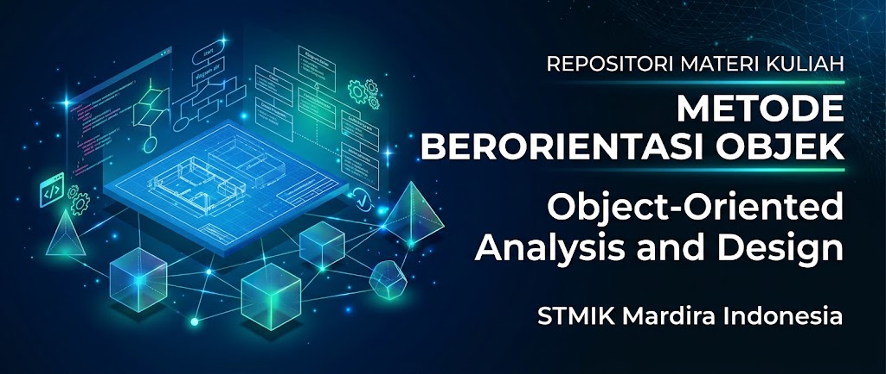

# Materi Kuliah: Object-Oriented Analysis and Design (OOAD) / Metode Berorientasi Objek (MBO)

1. [Pengantar Object-Oriented Analysis and Design (OOAD)](01-pengantar-ooad.md)
2. [Evolusi Metodologi OOAD & Standardisasi UML](02-metodologi-ooad.md)
3. [Identifikasi Kebutuhan Sistem & Pemodelan _Use Case_](03-use-case.md)
4. [Pemodelan Alur Kerja Bisnis & Activity Diagram](04-activity-diagram.md)
5. [Conceptual Modeling & Class Diagram](05-class-diagram.md)
6. [Sequence & Communication Diagram](06-sequence-communication-diagram.md)